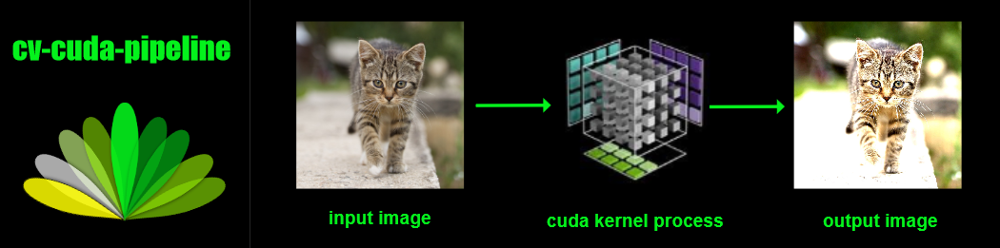

# CV-CUDA Pipeline



CV-CUDA Pipeline is a C++ computer-vision project for building and running
real-time image and video processing graphs. It uses Bazel to manage native
code, models, and third-party dependencies. The repository includes desktop
examples for tasks such as face detection, hand tracking, object detection,
and image segmentation.

## Project goals

- Compose image and video processing stages into reusable graph-based
  pipelines.
- Provide desktop examples that can process live camera input or video files.
- Use OpenCV for image and video I/O and CUDA-capable components where the
  build environment supports them.
- Keep builds and dependency configuration reproducible with Bazel.

## Requirements

- Linux (Ubuntu recommended)
- Bazelisk or a compatible Bazel installation
- OpenJDK 21 JDK, with `JAVA_HOME` set to its installation directory
- A C++20 compiler and the system development libraries required by the
  selected targets
- OpenCV development libraries for examples that use OpenCV
- Optional GPU drivers and CUDA toolkit for targets configured to use CUDA

Exact system dependencies depend on the target and platform. CPU examples
avoid requiring a CUDA-capable GPU, but still need their declared native
dependencies at build and run time.

## WSL setup, build, and run

The following commands set up a WSL Ubuntu environment. Install the JDK once:

```bash
sudo apt update
sudo apt install -y openjdk-21-jdk-headless
```

Set `JAVA_HOME` and add the JDK binaries to `PATH` in each new shell:

```bash
export JAVA_HOME=/usr/lib/jvm/java-21-openjdk-amd64
export PATH="$JAVA_HOME/bin:$PATH"
java -version
javac -version
```

Both version commands should report Java 21. To load these settings
automatically in future Bash shells, add the two `export` lines to
`~/.bashrc`, then run `source ~/.bashrc`.

Run the following commands from the repository root:

Build and run the small C++ example:

```bash
bazel build -c opt \
  //cv-cuda-pipeline/examples/desktop/hello_world:hello_world

bazel run \
  //cv-cuda-pipeline/examples/desktop/hello_world:hello_world
```

Build the CPU face-detection example:

```bash
bazel build -c opt \
  //cv-cuda-pipeline/examples/desktop/face_detection:face_detection_cpu
```

Run face detection on a video file and write an annotated output:

```bash
cd /mnt/c/Users/xincu/cv-cuda-pipeline

LD_LIBRARY_PATH=/home/cuixin/.local/opencv/usr/lib/x86_64-linux-gnu \
GLOG_logtostderr=1 \
bazel-bin/cv-cuda-pipeline/examples/desktop/face_detection/face_detection_cpu \
  --calculator_graph_config_file=cv-cuda-pipeline/graphs/face_detection/face_detection_desktop_live.pbtxt \
  --input_video_path='/mnt/c/Users/xincu/Videos/Bandicam/bandicam 2026-09-09 21-08-00-110.mp4' \
  --output_video_path=bazel-out/face_detection_output.mp4
```

The `LD_LIBRARY_PATH` above is for an OpenCV installation in the user's home
directory. If OpenCV is installed in a different non-system location, replace
it with that installation's library directory; omit it if OpenCV libraries are
available in the system library paths. The annotated video is written to
`bazel-out/face_detection_output.mp4`.

Other desktop examples and their Bazel targets are under
[`cv-cuda-pipeline/examples/desktop`](./cv-cuda-pipeline/examples/desktop).
The graph configurations used by examples are under
[`cv-cuda-pipeline/graphs`](./cv-cuda-pipeline/graphs).

## Testing

C++ unit tests are defined alongside their libraries in Bazel `BUILD` files.
For example:

```bash
bazel test -c opt \
  //cv-cuda-pipeline/examples/desktop/autoflip/quality:kinematic_path_solver_test
```

Run only targets supported by the dependencies and runtime environment
available on your machine.

## Contributing

Contributions should follow the repository's existing Bazel, C++, and
formatting conventions. Include focused tests for changes when applicable.

## References

- [MediaPipe](https://github.com/google-ai-edge/mediapipe)
- [NVIDIA CV-CUDA](https://github.com/CVCUDA/CV-CUDA.git)
- [Bazel CUDA rules](https://github.com/bazel-contrib/rules_cuda.git)
