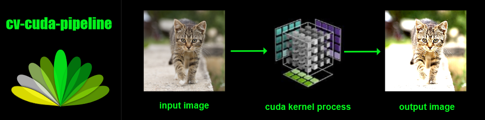

# CV-CUDA Pipeline



CV-CUDA Pipeline is a C++ computer-vision project for building and running
real-time image and video processing graphs on Linux and Windows PCs.
The product scope is desktop C++/CUDA only: Coral/Edge TPU example apps,
mobile apps, browser frontends,
TypeScript/JavaScript task APIs, and WebGPU backends are not included.
It uses Bazel to manage native
code, models, and third-party dependencies. The repository includes desktop
examples for tasks such as face detection, hand tracking, object detection,
and image segmentation.

## Project goals

- Compose image and video processing stages into reusable graph-based
  pipelines.
- Provide desktop examples that can process live camera input or video files.
- Use OpenCV for image and video I/O and CUDA-capable components where the
  build environment supports them.
- Keep builds and dependency configuration reproducible with Bazel.

## Requirements

- Linux (Ubuntu recommended)
- Bazelisk or a compatible Bazel installation
- OpenJDK 21 JDK, with `JAVA_HOME` set to its installation directory
- A C++20 compiler and the system development libraries required by the
  selected targets
- OpenCV development libraries for examples that use OpenCV
- Optional GPU drivers and CUDA toolkit for targets configured to use CUDA

Exact system dependencies depend on the target and platform. CPU examples
avoid requiring a CUDA-capable GPU, but still need their declared native
dependencies at build and run time.

## WSL setup, build, and run

### VS Code formatting

Open the repository root as the VS Code workspace. Install the
`xaver.clang-format` extension in the environment where VS Code runs (in WSL
when using Remote - WSL), and make sure `clang-format` is available on `PATH`.
On Ubuntu, install it with `sudo apt install clang-format` if needed.

The workspace [settings](./.vscode/settings.json) select clang-format for
C/C++, CUDA, Objective-C/C++, Java, JavaScript/TypeScript, and Protocol Buffers.
CUDA `.cu` and `.cuh` files use the C++ language mode; clang-format recognizes
CUDA syntax from their filenames. Use **Format Document** (`Shift+Alt+F`) to
apply the root [.clang-format](./.clang-format): Google style, two-space
indentation, no tabs, and an 80-column limit. The configuration applies to
files in subdirectories unless a closer `.clang-format` overrides it.
Other languages, such as Python, Markdown, and Bazel/Starlark, retain their
own formatters because clang-format does not support them.
This setup does not reformat existing files or enable format-on-save.

### Build and run

The following commands set up a WSL Ubuntu environment. Install the JDK once:

```bash
sudo apt update
sudo apt install -y openjdk-21-jdk-headless
```

Set `JAVA_HOME` and add the JDK binaries to `PATH` in each new shell:

```bash
export JAVA_HOME=/usr/lib/jvm/java-21-openjdk-amd64
export PATH="$JAVA_HOME/bin:$PATH"
java -version
javac -version
```

Both version commands should report Java 21. To load these settings
automatically in future Bash shells, add the two `export` lines to
`~/.bashrc`, then run `source ~/.bashrc`.

Run the following commands from the repository root:

Build and run the small C++ example:

```bash
bazel build -c opt \
  //cv-cuda-pipeline/examples/desktop/hello_world:hello_world

bazel run \
  //cv-cuda-pipeline/examples/desktop/hello_world:hello_world
```

Build the CPU face-detection example:

```bash
bazel build -c opt \
  //cv-cuda-pipeline/examples/desktop/face_detection:face_detection_cpu
```

Run face detection on a video file and write an annotated output:

```bash
cd /mnt/c/Users/xincu/cv-cuda-pipeline

LD_LIBRARY_PATH=/home/cuixin/.local/opencv/usr/lib/x86_64-linux-gnu \
GLOG_logtostderr=1 \
bazel run -c opt \
  //cv-cuda-pipeline/examples/desktop/face_detection:face_detection_cpu -- \
  --calculator_graph_config_file="$PWD/cv-cuda-pipeline/graphs/face_detection/face_detection_desktop_live.pbtxt" \
  --input_video_path='/mnt/c/Users/xincu/Videos/Bandicam/bandicam 2026-09-09 21-08-00-110.mp4' \
  --output_video_path="$PWD/bazel-out/face_detection_output.mp4"
```

The `LD_LIBRARY_PATH` above is for an OpenCV installation in the user's home
directory. If OpenCV is installed in a different non-system location, replace
it with that installation's library directory; omit it if OpenCV libraries are
available in the system library paths. The annotated video is written to
`bazel-out/face_detection_output.mp4`.

Use `bazel run` so downloaded models are available in the binary's runfiles.
Graph, input, and output paths should be absolute because the application runs
from the runfiles directory, not the repository root.

Other desktop examples and their Bazel targets are under
[`cv-cuda-pipeline/examples/desktop`](./cv-cuda-pipeline/examples/desktop).
The graph configurations used by examples are under
[`cv-cuda-pipeline/graphs`](./cv-cuda-pipeline/graphs).

Image processing CUDA kernel demos are under
[`cv-cuda-pipeline/examples/image_process`](./cv-cuda-pipeline/examples/image_process);
see the [resize demo](./cv-cuda-pipeline/examples/image_process/resize/README.md)
the [remap demo](./cv-cuda-pipeline/examples/image_process/remap/README.md), and
the [flip demo](./cv-cuda-pipeline/examples/image_process/flip/README.md), and
the [adaptive threshold demo](./cv-cuda-pipeline/examples/image_process/adaptivethreshold/README.md)
for build and usage instructions.

## Testing

C++ unit tests are defined alongside their libraries in Bazel `BUILD` files.
For example:

```bash
bazel test -c opt \
  //cv-cuda-pipeline/examples/desktop/autoflip/quality:kinematic_path_solver_test
```

### CV-CUDA native unit and system tests

The migrated CV-CUDA C++/CUDA tests and their Bazel targets are in
[`cv-cuda-pipeline/cvcuda/tests`](./cv-cuda-pipeline/cvcuda/tests/BUILD). Build
and run them from the repository root. They require a CUDA toolkit, a
compatible NVIDIA driver and GPU, and the architecture flag for that GPU.
The commands below use `/usr/local/cuda` and `sm_89` as examples; adjust them
for your environment.

Compile all currently defined CV-CUDA native test targets without running
them:

```bash
export CUDA_PATH=/usr/local/cuda
bazel build --@rules_cuda//cuda:archs=sm_89 \
  //cv-cuda-pipeline/cvcuda/tests:nvcv_types_unit_test \
  //cv-cuda-pipeline/cvcuda/tests:nvcv_types_system_test \
  //cv-cuda-pipeline/cvcuda/tests:nvcv_types_standalone_test \
  //cv-cuda-pipeline/cvcuda/tests:nvcv_cudatools_system_test \
  //cv-cuda-pipeline/cvcuda/tests:nvcv_version_api_override_test \
  //cv-cuda-pipeline/cvcuda/tests:cvcuda_unit_test \
  //cv-cuda-pipeline/cvcuda/tests:cvcuda_system_test \
  //cv-cuda-pipeline/cvcuda/tests:cvcuda_system_smoke_test
```

Run a single test target:

```bash
bazel test --@rules_cuda//cuda:archs=sm_89 --test_output=errors \
  //cv-cuda-pipeline/cvcuda/tests:cvcuda_unit_test
```

Run the complete native test matrix. The CV-CUDA system suite is large and
sharded by Bazel, so allow up to 30 minutes:

```bash
bazel test --@rules_cuda//cuda:archs=sm_89 --test_timeout=1800 \
  --test_output=errors \
  //cv-cuda-pipeline/cvcuda/tests:nvcv_types_unit_test \
  //cv-cuda-pipeline/cvcuda/tests:nvcv_types_system_test \
  //cv-cuda-pipeline/cvcuda/tests:nvcv_types_standalone_test \
  //cv-cuda-pipeline/cvcuda/tests:nvcv_cudatools_system_test \
  //cv-cuda-pipeline/cvcuda/tests:nvcv_version_api_override_test \
  //cv-cuda-pipeline/cvcuda/tests:cvcuda_unit_test \
  //cv-cuda-pipeline/cvcuda/tests:cvcuda_system_test \
  //cv-cuda-pipeline/cvcuda/tests:cvcuda_system_smoke_test
```

To run selected GoogleTest cases, pass a filter after `--`:

```bash
bazel test --@rules_cuda//cuda:archs=sm_89 \
  //cv-cuda-pipeline/cvcuda/tests:cvcuda_system_test \
  --test_arg=--gtest_filter='OpAdjustContrast.*'
```

Replace `sm_89` with the architecture supported by your GPU. `bazel test`
builds the requested target before executing it; use `bazel build` when you
only want to compile. Test logs are available with `--test_output=errors` for
failures or `--test_output=all` to show all test output.

## Contributing

Contributions should follow the repository's existing Bazel, C++, and
formatting conventions. Include focused tests for changes when applicable.

## References

- [MediaPipe](https://github.com/google-ai-edge/mediapipe)
- [NVIDIA CV-CUDA](https://github.com/CVCUDA/CV-CUDA.git)
- [Bazel CUDA rules](https://github.com/bazel-contrib/rules_cuda.git)
