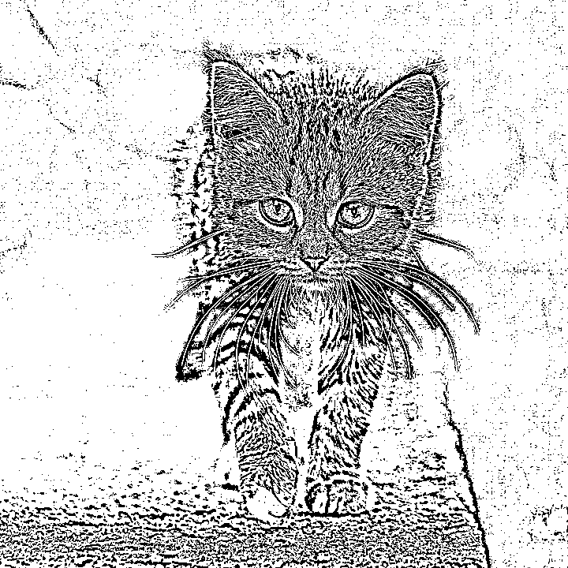
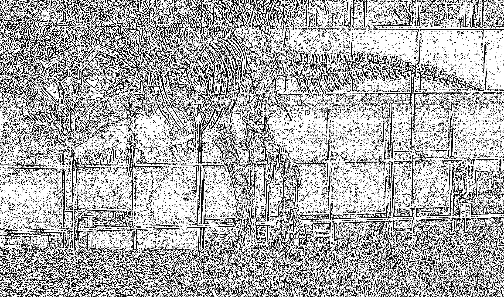

# CUDA adaptive threshold demo

This C++/CUDA example converts an RGB8 image to grayscale and applies binary
Gaussian adaptive thresholding on the GPU. It uses an 11 × 11 neighborhood,
sigma 2, replicated borders, C = 2, and a maximum value of 255. The local
Gaussian result is rounded to uint8 before comparison; each output channel
receives the same binary value. OpenCV is used only for image I/O and channel
ordering.

## Build and test

Run from the repository root with Bazel, CUDA and OpenCV development libraries:

```bash
bazel build --@rules_cuda//cuda:archs=sm_89 \
  //cv-cuda-pipeline/examples/image_process/adaptivethreshold:adaptivethreshold_demo
bazel test --@rules_cuda//cuda:archs=sm_89 --test_output=errors \
  //cv-cuda-pipeline/calculators/image_process/cuda/tests:adaptive_threshold_kernel_test
```

Replace `sm_89` with the architecture of your GPU. The kernel uses
[rules_cuda](https://github.com/bazel-contrib/rules_cuda).

## Run

```bash
mkdir -p cv-cuda-pipeline/examples/image_process/adaptivethreshold/perf_asserts
bazel-bin/cv-cuda-pipeline/examples/image_process/adaptivethreshold/adaptivethreshold_demo \
  --input cv-cuda-pipeline/pictures/tabby_tiger_cat.jpg \
  --output cv-cuda-pipeline/examples/image_process/adaptivethreshold/perf_asserts/adaptivethreshold_cat.png
bazel-bin/cv-cuda-pipeline/examples/image_process/adaptivethreshold/adaptivethreshold_demo \
  --input cv-cuda-pipeline/pictures/dino.jpg \
  --output cv-cuda-pipeline/examples/image_process/adaptivethreshold/perf_asserts/adaptivethreshold_dino.png
```

`--input` is required; `--output` defaults to `cat_adaptivethreshold.png` in
the current directory. Output format is selected by its extension.

| Input | Output |
| --- | --- |
|  |  |
|  |  |

The kernel API accepts non-overlapping RGB8 device input/output buffers and
one grayscale scratch buffer, each with a byte row stride, plus an optional
CUDA stream. The caller must keep buffers valid until stream synchronization
and check synchronization errors. Other threshold modes and block sizes are not
implemented.

## Nsight Systems performance

On an NVIDIA RTX 500 Ada Generation Laptop GPU, using CUDA 13.3, Nsight Systems
2026.1.3 and the default Bazel build, one run per image produced:

| Image | Grayscale kernel latency | Threshold kernel latency | Total kernel latency | Estimated effective bandwidth |
| --- | ---: | ---: | ---: | ---: |
| Cat, 720 × 720 | 15.659 µs | 183.334 µs | 198.993 µs | 336.06 GB/s |
| Dinosaur, 2876 × 1699 | 163.367 µs | 1657.809 µs | 1821.176 µs | 346.11 GB/s |

The estimated logical bandwidth is calculated from 129 bytes per pixel (RGB
read, grayscale write, 121 neighborhood reads, center read, and RGB write)
divided by the combined kernel time.

This is not measured DRAM bandwidth; cached and repeated reads, compiler
optimizations, and memory transactions affect actual traffic. Hardware
performance counters were unavailable (`ERR_NVGPUCTRPERM`). One run is not a
steady-state benchmark and excludes CPU setup, image I/O and transfers.

To reproduce:

```bash
mkdir -p build/adaptivethreshold cv-cuda-pipeline/examples/image_process/adaptivethreshold/perf_asserts
nsys profile --trace=cuda --sample=none --cpuctxsw=none \
  --output=build/adaptivethreshold/nsys_cat \
  bazel-bin/cv-cuda-pipeline/examples/image_process/adaptivethreshold/adaptivethreshold_demo \
  --input cv-cuda-pipeline/pictures/tabby_tiger_cat.jpg \
  --output cv-cuda-pipeline/examples/image_process/adaptivethreshold/perf_asserts/profile_cat.png
nsys stats --report cuda_gpu_kern_sum --format csv \
  build/adaptivethreshold/nsys_cat.nsys-rep
nsys profile --trace=cuda --sample=none --cpuctxsw=none \
  --output=build/adaptivethreshold/nsys_dinosaur \
  bazel-bin/cv-cuda-pipeline/examples/image_process/adaptivethreshold/adaptivethreshold_demo \
  --input cv-cuda-pipeline/pictures/dino.jpg \
  --output cv-cuda-pipeline/examples/image_process/adaptivethreshold/perf_asserts/profile_nsys_dinosaur.png
nsys stats --report cuda_gpu_kern_sum --format csv \
  build/adaptivethreshold/nsys_dinosaur.nsys-rep
```

Use a new report name if the file already exists.
