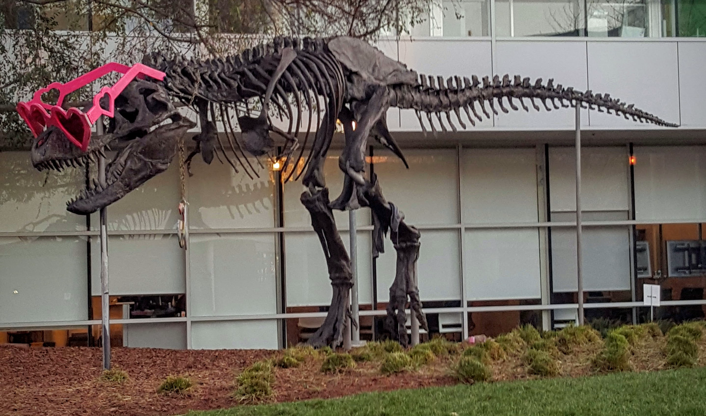

# CUDA advanced color conversion demo

This C++/CUDA example converts an RGB8 image to interleaved YUV444 and back
to RGB8 using full-range BT.709. The two GPU kernels use Q14 fixed-point
coefficients and round and clamp each stage to 8 bits, including the
intermediate YUV image. Consequently, the round trip is not lossless.
OpenCV is used for image I/O and channel ordering.

## Build and test

From the repository root, with Bazel, CUDA, and OpenCV development libraries:

```bash
bazel build --@rules_cuda//cuda:archs=sm_89 \
  //cv-cuda-pipeline/examples/image_process/advcvtcolor:advcvtcolor_demo
bazel test --@rules_cuda//cuda:archs=sm_89 --test_output=errors \
  //cv-cuda-pipeline/calculators/image_process/cuda/tests:adv_cvt_color_kernel_test
```

Replace `sm_89` with your GPU architecture. The build uses
[rules_cuda](https://github.com/bazel-contrib/rules_cuda).

## Run

```bash
mkdir -p cv-cuda-pipeline/examples/image_process/advcvtcolor/perf_asserts
bazel-bin/cv-cuda-pipeline/examples/image_process/advcvtcolor/advcvtcolor_demo \
  --input cv-cuda-pipeline/pictures/tabby_tiger_cat.jpg \
  --output cv-cuda-pipeline/examples/image_process/advcvtcolor/perf_asserts/advcvtcolor_cat.png
bazel-bin/cv-cuda-pipeline/examples/image_process/advcvtcolor/advcvtcolor_demo \
  --input cv-cuda-pipeline/pictures/dino.jpg \
  --output cv-cuda-pipeline/examples/image_process/advcvtcolor/perf_asserts/advcvtcolor_dino.png
```

`--input` is required; `--output` defaults to `cat_advcvtcolor.png` in the
current directory. OpenCV selects the output format from its extension.

| Input | Output |
| --- | --- |
|  |  |
|  |  |

The kernel API accepts non-overlapping device buffers, byte row strides,
dimensions, a direction and an optional CUDA stream. The caller must keep
the buffers valid until stream completion and check synchronization errors.
Only 8-bit RGB/YUV444 and full-range BT.709 are supported.

## Nsight Systems performance

On an NVIDIA RTX 500 Ada Generation Laptop GPU with CUDA 13.3 and Nsight
Systems 2026.1.3, the default Bazel build produced these results from one
sequential run per image:

| Image | RGB to YUV latency | YUV to RGB latency | Total kernel latency | Estimated effective bandwidth |
| --- | ---: | ---: | ---: | ---: |
| Cat, 720 × 720 | 18.693 µs | 17.020 µs | 35.713 µs | 174.19 GB/s |
| Dinosaur, 2876 × 1699 | 231.403 µs | 274.849 µs | 506.252 µs | 115.82 GB/s |

Estimated logical bandwidth is 12 bytes per pixel (three bytes read and
three written by each kernel) divided by the combined kernel time. This is
not measured DRAM bandwidth; actual memory transactions and caching differ.
Hardware counter access was unavailable (`ERR_NVGPUCTRPERM`). Single-launch
timings are not a steady-state benchmark and exclude CPU work, image I/O and
host-device transfers.

To reproduce, using new report names if they already exist:

```bash
mkdir -p build/advcvtcolor cv-cuda-pipeline/examples/image_process/advcvtcolor/perf_asserts
nsys profile --trace=cuda --sample=none --cpuctxsw=none \
  --output=build/advcvtcolor/nsys_cat \
  bazel-bin/cv-cuda-pipeline/examples/image_process/advcvtcolor/advcvtcolor_demo \
  --input cv-cuda-pipeline/pictures/tabby_tiger_cat.jpg \
  --output cv-cuda-pipeline/examples/image_process/advcvtcolor/perf_asserts/profile_cat.png
nsys stats --report cuda_gpu_kern_sum --format csv build/advcvtcolor/nsys_cat.nsys-rep
nsys profile --trace=cuda --sample=none --cpuctxsw=none \
  --output=build/advcvtcolor/nsys_dinosaur \
  bazel-bin/cv-cuda-pipeline/examples/image_process/advcvtcolor/advcvtcolor_demo \
  --input cv-cuda-pipeline/pictures/dino.jpg \
  --output cv-cuda-pipeline/examples/image_process/advcvtcolor/perf_asserts/profile_dinosaur.png
nsys stats --report cuda_gpu_kern_sum --format csv build/advcvtcolor/nsys_dinosaur.nsys-rep
```
