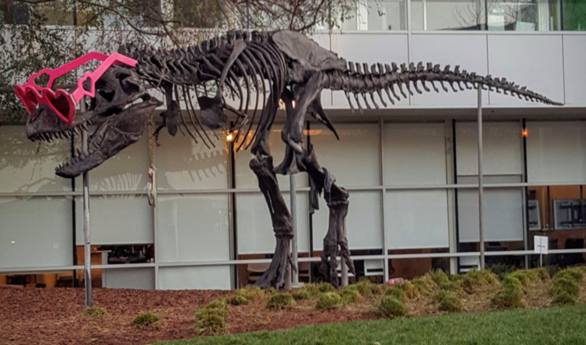

# CUDA average blur demo

This C++/CUDA example applies a centered 7 × 7 average filter independently
to each 8-bit image channel. The border uses `REFLECT101`, which mirrors
without repeating the edge pixel, including for images smaller than the
filter. Each sum is divided by 49 and rounded to the nearest integer. OpenCV
is used for image I/O; filtering runs on the GPU.

## Build and test

From the repository root, with Bazel, CUDA, and OpenCV development libraries:

```bash
bazel build --@rules_cuda//cuda:archs=sm_89 \
  //cv-cuda-pipeline/examples/image_process/averageblur:averageblur_demo
bazel test --@rules_cuda//cuda:archs=sm_89 --test_output=errors \
  //cv-cuda-pipeline/calculators/image_process/cuda/tests:average_blur_kernel_test
```

Replace `sm_89` with your GPU architecture. The build uses
[rules_cuda](https://github.com/bazel-contrib/rules_cuda).

## Run

```bash
mkdir -p cv-cuda-pipeline/examples/image_process/averageblur/perf_asserts
bazel-bin/cv-cuda-pipeline/examples/image_process/averageblur/averageblur_demo \
  --input cv-cuda-pipeline/pictures/tabby_tiger_cat.jpg \
  --output cv-cuda-pipeline/examples/image_process/averageblur/perf_asserts/averageblur_cat.png
bazel-bin/cv-cuda-pipeline/examples/image_process/averageblur/averageblur_demo \
  --input cv-cuda-pipeline/pictures/dino.jpg \
  --output cv-cuda-pipeline/examples/image_process/averageblur/perf_asserts/averageblur_dino.png
```

`--input` is required; `--output` defaults to `cat_averageblur.png` in the
current directory. OpenCV selects the output format from its extension.

| Input | Output |
| --- | --- |
|  |  |
|  |  |

The kernel API accepts non-overlapping interleaved three-channel 8-bit device
buffers, byte row strides, image dimensions and an optional CUDA stream. The
caller must keep buffers valid until stream completion and check
synchronization errors. The same operation applies to RGB and BGR data since
channels are filtered independently. Other window sizes and borders are not
implemented.

## Nsight Systems performance

On an NVIDIA RTX 500 Ada Generation Laptop GPU with CUDA 13.3 and Nsight
Systems 2026.1.3, the default Bazel build produced these results from one
sequential run per image:

| Image | Kernel latency | Estimated effective bandwidth |
| --- | ---: | ---: |
| Cat, 720 × 720 | 224.979 µs | 345.63 GB/s |
| Dinosaur, 2876 × 1699 | 1791.753 µs | 409.07 GB/s |

Estimated logical bandwidth is 150 bytes per output pixel (49 three-byte
reads and one three-byte write) divided by kernel time. This is not measured
DRAM bandwidth: caching, repeated reads and memory transactions affect actual
traffic. Single-launch timings are not a steady-state benchmark and exclude
CPU work, image I/O and host-device transfers.

To reproduce, use new report names if they already exist:

```bash
mkdir -p build/averageblur cv-cuda-pipeline/examples/image_process/averageblur/perf_asserts
nsys profile --trace=cuda --sample=none --cpuctxsw=none \
  --output=build/averageblur/nsys_cat \
  bazel-bin/cv-cuda-pipeline/examples/image_process/averageblur/averageblur_demo \
  --input cv-cuda-pipeline/pictures/tabby_tiger_cat.jpg \
  --output cv-cuda-pipeline/examples/image_process/averageblur/perf_asserts/profile_cat.png
nsys stats --report cuda_gpu_kern_sum --format csv build/averageblur/nsys_cat.nsys-rep
nsys profile --trace=cuda --sample=none --cpuctxsw=none \
  --output=build/averageblur/nsys_dinosaur \
  bazel-bin/cv-cuda-pipeline/examples/image_process/averageblur/averageblur_demo \
  --input cv-cuda-pipeline/pictures/dino.jpg \
  --output cv-cuda-pipeline/examples/image_process/averageblur/perf_asserts/profile_dinosaur.png
nsys stats --report cuda_gpu_kern_sum --format csv build/averageblur/nsys_dinosaur.nsys-rep
```
