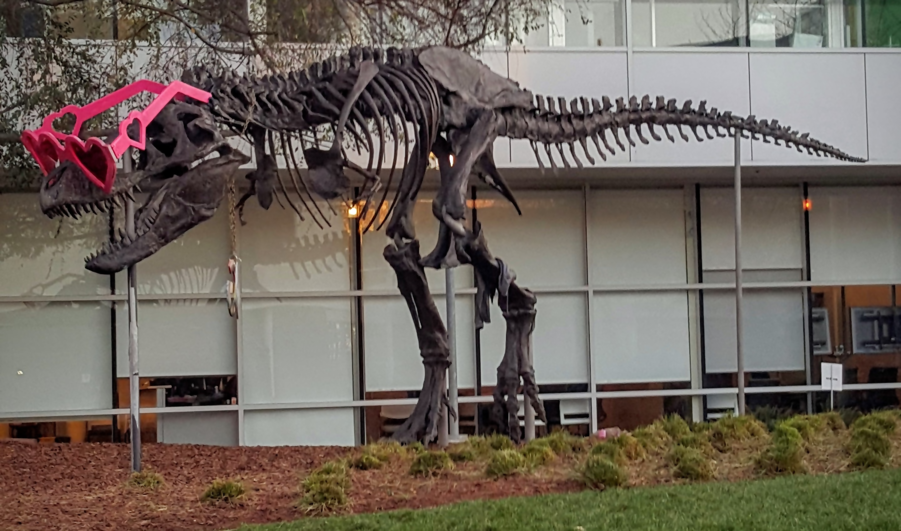

# CUDA bilateral filter demo

This C++/CUDA example applies an edge-preserving bilateral filter to an
8-bit, three-channel image. It uses diameter 9 (a circular radius-4
neighborhood), `sigma_color = 75`, `sigma_space = 75`, and a `REFLECT`
border that repeats the edge pixel. Color distance is the sum of absolute
channel differences; its square and the squared spatial distance determine
the Gaussian weight. The weighted average is rounded to the nearest 8-bit
value. OpenCV is used for image I/O; filtering runs on the GPU.

## Build and test

From the repository root, with Bazel, CUDA and OpenCV development libraries:

```bash
bazel build --@rules_cuda//cuda:archs=sm_89 \
  //cv-cuda-pipeline/examples/image_process/bilateral_filter:bilateral_filter_demo
bazel test --@rules_cuda//cuda:archs=sm_89 --test_output=errors \
  //cv-cuda-pipeline/calculators/image_process/cuda/tests:bilateral_filter_kernel_test
```

Replace `sm_89` with your GPU architecture. The build uses
[rules_cuda](https://github.com/bazel-contrib/rules_cuda).

## Run

```bash
mkdir -p cv-cuda-pipeline/examples/image_process/bilateral_filter/perf_asserts
bazel-bin/cv-cuda-pipeline/examples/image_process/bilateral_filter/bilateral_filter_demo \
  --input cv-cuda-pipeline/pictures/tabby_tiger_cat.jpg \
  --output cv-cuda-pipeline/examples/image_process/bilateral_filter/perf_asserts/bilateral_filter_cat.png
bazel-bin/cv-cuda-pipeline/examples/image_process/bilateral_filter/bilateral_filter_demo \
  --input cv-cuda-pipeline/pictures/dino.jpg \
  --output cv-cuda-pipeline/examples/image_process/bilateral_filter/perf_asserts/bilateral_filter_dino.png
```

`--input` is required; `--output` defaults to `cat_bilateral_filter.png` in
the current directory. OpenCV selects the output format from its extension.

| Input | Output |
| --- | --- |
|  |  |
|  |  |

The kernel API accepts non-overlapping interleaved three-channel 8-bit device
buffers, byte row strides, image dimensions and an optional CUDA stream. The
caller must keep buffers valid until stream completion and check
synchronization errors. RGB and BGR can both be used because the color
distance is invariant to channel ordering. Other parameters, borders and
formats are not implemented.

## Nsight Systems performance

On an NVIDIA RTX 500 Ada Generation Laptop GPU with CUDA 13.3 and Nsight
Systems 2026.1.3, the default Bazel build produced these results from one
sequential run per image:

| Image | Kernel latency | Estimated effective bandwidth |
| --- | ---: | ---: |
| Cat, 720 × 720 | 805.899 µs | 98.42 GB/s |
| Dinosaur, 2876 × 1699 | 7033.886 µs | 106.29 GB/s |

Estimated logical bandwidth is 153 bytes per output pixel (one three-byte
center read, 49 three-byte neighborhood reads, and one three-byte write)
divided by kernel time. This is not measured DRAM bandwidth: caching,
repeated reads, compiler optimizations and memory transactions affect actual
traffic. Single-launch timings are not a steady-state benchmark and exclude
CPU work, image I/O and host-device transfers.

To reproduce, use new report names if they already exist:

```bash
mkdir -p build/bilateral_filter cv-cuda-pipeline/examples/image_process/bilateral_filter/perf_asserts
nsys profile --trace=cuda --sample=none --cpuctxsw=none \
  --output=build/bilateral_filter/nsys_cat \
  bazel-bin/cv-cuda-pipeline/examples/image_process/bilateral_filter/bilateral_filter_demo \
  --input cv-cuda-pipeline/pictures/tabby_tiger_cat.jpg \
  --output cv-cuda-pipeline/examples/image_process/bilateral_filter/perf_asserts/profile_cat.png
nsys stats --report cuda_gpu_kern_sum --format csv build/bilateral_filter/nsys_cat.nsys-rep
nsys profile --trace=cuda --sample=none --cpuctxsw=none \
  --output=build/bilateral_filter/nsys_dinosaur \
  bazel-bin/cv-cuda-pipeline/examples/image_process/bilateral_filter/bilateral_filter_demo \
  --input cv-cuda-pipeline/pictures/dino.jpg \
  --output cv-cuda-pipeline/examples/image_process/bilateral_filter/perf_asserts/profile_dinosaur.png
nsys stats --report cuda_gpu_kern_sum --format csv build/bilateral_filter/nsys_dinosaur.nsys-rep
```
