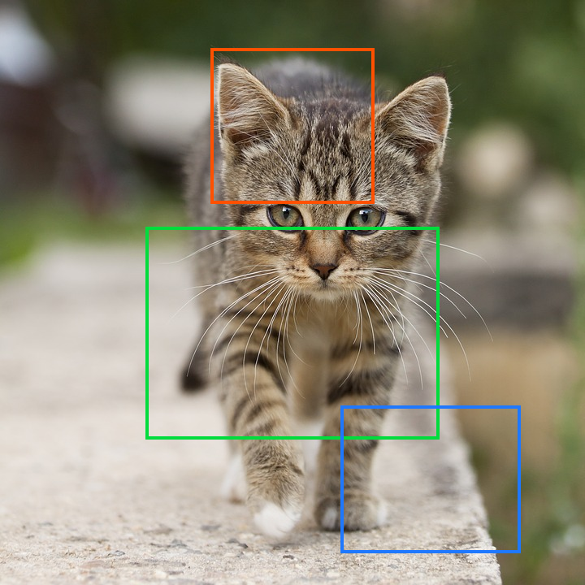
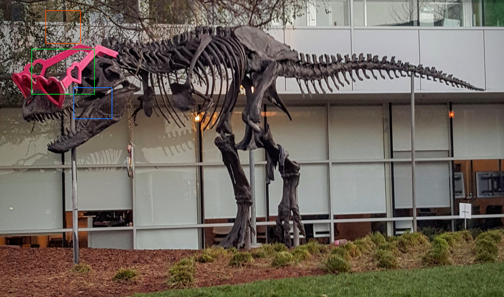

# CUDA bounding box demo

This C++/CUDA example draws three axis-aligned colored bounding boxes on an
RGB8 image. Borders are opaque, four pixels thick and centered on the box
edges; interiors remain unchanged. The boxes are drawn in order, so a later
border replaces an earlier one where they overlap. OpenCV is used for image
I/O and BGR/RGB conversion; the image copy and drawing run on the GPU.

The demo uses the following fixed pixel coordinates for both images:

| Box | `(x, y, width, height)` | Border RGB |
| --- | --- | --- |
| 1 | `(260, 60, 200, 190)` | `(255, 80, 0)` |
| 2 | `(180, 280, 360, 260)` | `(0, 220, 60)` |
| 3 | `(420, 500, 220, 180)` | `(30, 120, 255)` |

Coordinates are not scaled for the larger dinosaur image, so the boxes occupy
a smaller fraction of that image.

## Build and test

From the repository root, with Bazel, CUDA and OpenCV development libraries:

```bash
bazel build --@rules_cuda//cuda:archs=sm_89 \
  //cv-cuda-pipeline/examples/image_process/bndbox:bndbox_demo
bazel test --@rules_cuda//cuda:archs=sm_89 --test_output=errors \
  //cv-cuda-pipeline/calculators/image_process/cuda/tests:bndbox_kernel_test
```

Replace `sm_89` with your GPU architecture. The build uses
[rules_cuda](https://github.com/bazel-contrib/rules_cuda).

## Run

```bash
mkdir -p cv-cuda-pipeline/examples/image_process/bndbox/perf_asserts
bazel-bin/cv-cuda-pipeline/examples/image_process/bndbox/bndbox_demo \
  --input cv-cuda-pipeline/pictures/tabby_tiger_cat.jpg \
  --output cv-cuda-pipeline/examples/image_process/bndbox/perf_asserts/bndbox_cat.png
bazel-bin/cv-cuda-pipeline/examples/image_process/bndbox/bndbox_demo \
  --input cv-cuda-pipeline/pictures/dino.jpg \
  --output cv-cuda-pipeline/examples/image_process/bndbox/perf_asserts/bndbox_dino.png
```

`--input` is required; `--output` defaults to `cat_bndbox.png` in the
current directory. OpenCV selects the output format from its extension.

| Input | Output |
| --- | --- |
|  |  |
|  |  |

The kernel API accepts non-overlapping interleaved RGB8 device buffers, byte
row strides, image dimensions, up to three boxes passed by value, and an
optional CUDA stream. The caller must keep the buffers valid until stream
completion and check synchronization errors. Width and height must be
positive. Box origins are clamped to the image before computing and clamping
the opposite corners; degenerate clipped boxes are skipped. The API supports
only opaque borders of thickness 4 and transparent interiors.

## Nsight Systems performance

On an NVIDIA RTX 500 Ada Generation Laptop GPU with CUDA 13.3 and Nsight
Systems 2026.1.3, the default Bazel build produced these results from one
sequential run per image:

| Image | Kernel latency | Estimated effective bandwidth |
| --- | ---: | ---: |
| Cat, 720 × 720 | 80.927 µs | 38.43 GB/s |
| Dinosaur, 2876 × 1699 | 726.757 µs | 40.34 GB/s |

Estimated logical bandwidth is six bytes per pixel (one three-byte image read
and one three-byte write) divided by kernel time. This is not measured DRAM
bandwidth: caching, compiler optimizations and memory transactions affect
actual traffic. Single-launch timings are not a steady-state benchmark and
exclude CPU work, image I/O and host-device transfers.

To reproduce, use new report names if they already exist:

```bash
mkdir -p build/bndbox cv-cuda-pipeline/examples/image_process/bndbox/perf_asserts
nsys profile --trace=cuda --sample=none --cpuctxsw=none \
  --output=build/bndbox/nsys_cat \
  bazel-bin/cv-cuda-pipeline/examples/image_process/bndbox/bndbox_demo \
  --input cv-cuda-pipeline/pictures/tabby_tiger_cat.jpg \
  --output cv-cuda-pipeline/examples/image_process/bndbox/perf_asserts/profile_cat.png
nsys stats --report cuda_gpu_kern_sum --format csv build/bndbox/nsys_cat.nsys-rep
nsys profile --trace=cuda --sample=none --cpuctxsw=none \
  --output=build/bndbox/nsys_dinosaur \
  bazel-bin/cv-cuda-pipeline/examples/image_process/bndbox/bndbox_demo \
  --input cv-cuda-pipeline/pictures/dino.jpg \
  --output cv-cuda-pipeline/examples/image_process/bndbox/perf_asserts/profile_dinosaur.png
nsys stats --report cuda_gpu_kern_sum --format csv build/bndbox/nsys_dinosaur.nsys-rep
```
