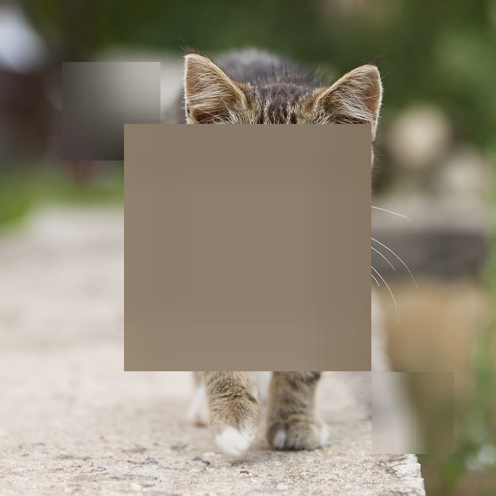
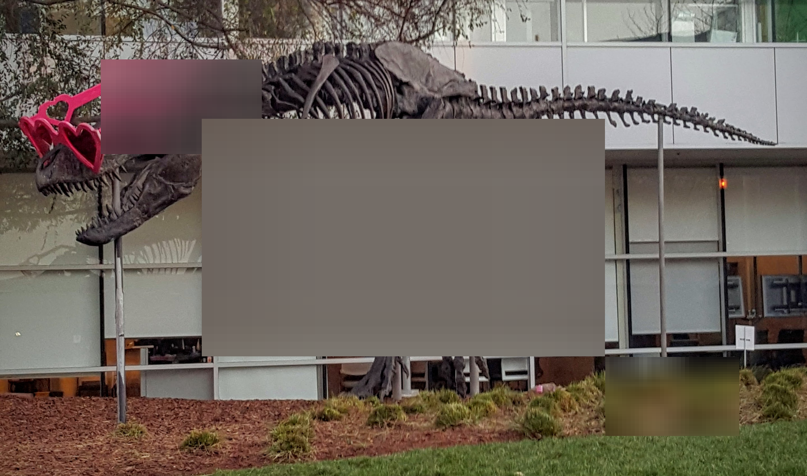

# CUDA box blur demo

This C++/CUDA example blurs three rectangular image regions while preserving
pixels outside them. Each region is sampled into a 32 × 32 crop, filtered
with a square averaging window, then mapped back to the image. Samples
outside the crop are omitted from the average; integer division truncates the
result. Consequently, the kernel size is in crop coordinates, not input-image
pixels. OpenCV is used only for image I/O.

The demo chooses the following regions from the image width `w` and height
`h`, using integer division:

| Region | `(x, y, width, height)` | Window size |
| --- | --- | ---: |
| Upper left | `(w/8, h/8, w/5, h/5)` | 21 |
| Center | `(w/4, h/4, w/2, h/2)` | 45 |
| Lower right | `(3w/4, 3h/4, w/6, h/6)` | 11 |

Overlapping regions are computed independently from the original input; the
later region takes precedence. Box origins are clamped to the image, then
their inclusive opposite corners are computed and clamped. The output covers
the half-open rectangle between those corners. Boxes smaller than 3 × 3 or
degenerate after clipping are skipped.

## Build and test

From the repository root, with Bazel, CUDA and OpenCV development libraries:

```bash
bazel build --@rules_cuda//cuda:archs=sm_89 \
  //cv-cuda-pipeline/examples/image_process/boxblur:boxblur_demo
bazel test --@rules_cuda//cuda:archs=sm_89 --test_output=errors \
  //cv-cuda-pipeline/calculators/image_process/cuda/tests:box_blur_kernel_test
```

Replace `sm_89` with your GPU architecture. The build uses
[rules_cuda](https://github.com/bazel-contrib/rules_cuda).

## Run

```bash
mkdir -p cv-cuda-pipeline/examples/image_process/boxblur/perf_asserts
bazel-bin/cv-cuda-pipeline/examples/image_process/boxblur/boxblur_demo \
  --input cv-cuda-pipeline/pictures/tabby_tiger_cat.jpg \
  --output cv-cuda-pipeline/examples/image_process/boxblur/perf_asserts/boxblur_cat.png
bazel-bin/cv-cuda-pipeline/examples/image_process/boxblur/boxblur_demo \
  --input cv-cuda-pipeline/pictures/dino.jpg \
  --output cv-cuda-pipeline/examples/image_process/boxblur/perf_asserts/boxblur_dino.png
```

`--input` is required; `--output` defaults to `cat_boxblur.png` in the
current directory. OpenCV selects the output format from its extension.

| Input | Output |
| --- | --- |
|  |  |
|  |  |

The kernel API accepts non-overlapping interleaved RGB8 or BGR8 input and
output device buffers, byte row strides, image dimensions, up to three boxes
passed by value, a device scratch buffer of `kBoxBlurScratchBytes` bytes, and
an optional CUDA stream. The caller must keep all buffers valid until stream
completion and check synchronization errors. Kernel sizes must be positive;
even sizes use a radius of `kernel_size / 2`, producing an odd window.
Negative box dimensions are invalid. Other image formats and batches are not
implemented.

## Nsight Systems performance

On an NVIDIA RTX 500 Ada Generation Laptop GPU with CUDA 13.3 and Nsight
Systems 2026.1.3, the default Bazel build produced these results from one
sequential run per image:

| Image | Crop filter latency | Compose latency | Total kernel latency | Estimated effective bandwidth |
| --- | ---: | ---: | ---: | ---: |
| Cat, 720 × 720 | 128.965 µs | 87.877 µs | 216.842 µs | 14.43 GB/s |
| Dinosaur, 2876 × 1699 | 129.353 µs | 806.167 µs | 935.520 µs | 31.36 GB/s |

The logical global-memory estimate is `6 × image pixels + 6144 × valid boxes`
bytes: one three-byte read and write per composed pixel, plus one three-byte
input read and scratch write for each of 1024 crop pixels per box. Shared
memory accesses are excluded. This is not measured DRAM bandwidth; caching,
compiler optimizations and memory transactions affect actual traffic.
Single-launch timings are not a steady-state benchmark and exclude CPU work,
image I/O and host-device transfers.

To reproduce, use new report names if they already exist:

```bash
mkdir -p build/boxblur cv-cuda-pipeline/examples/image_process/boxblur/perf_asserts
nsys profile --trace=cuda --sample=none --cpuctxsw=none \
  --output=build/boxblur/nsys_cat \
  bazel-bin/cv-cuda-pipeline/examples/image_process/boxblur/boxblur_demo \
  --input cv-cuda-pipeline/pictures/tabby_tiger_cat.jpg \
  --output cv-cuda-pipeline/examples/image_process/boxblur/perf_asserts/profile_cat.png
nsys stats --report cuda_gpu_kern_sum --format csv build/boxblur/nsys_cat.nsys-rep
nsys profile --trace=cuda --sample=none --cpuctxsw=none \
  --output=build/boxblur/nsys_dinosaur \
  bazel-bin/cv-cuda-pipeline/examples/image_process/boxblur/boxblur_demo \
  --input cv-cuda-pipeline/pictures/dino.jpg \
  --output cv-cuda-pipeline/examples/image_process/boxblur/perf_asserts/profile_dinosaur.png
nsys stats --report cuda_gpu_kern_sum --format csv build/boxblur/nsys_dinosaur.nsys-rep
```
