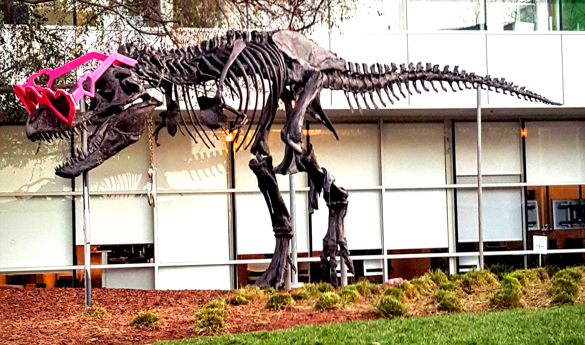

# CUDA brightness and contrast demo

This C++/CUDA example adjusts each 8-bit image channel independently using:

```text
output = brightness_shift + brightness *
         (contrast_center + contrast * (input - contrast_center))
```

The demo fixes brightness to 1.5, contrast to 1.4, brightness shift to 20
and contrast center to 127. Results are saturated to `[0, 255]` and rounded
to the nearest integer with ties to even. OpenCV is used for image I/O; the
adjustment runs on the GPU.

## Build and test

From the repository root, with Bazel, CUDA and OpenCV development libraries:

```bash
bazel build --@rules_cuda//cuda:archs=sm_89 \
  //cv-cuda-pipeline/examples/image_process/brightness_contrast:brightness_contrast_demo
bazel test --@rules_cuda//cuda:archs=sm_89 --test_output=errors \
  //cv-cuda-pipeline/calculators/image_process/cuda/tests:brightness_contrast_kernel_test
```

Replace `sm_89` with your GPU architecture. The build uses
[rules_cuda](https://github.com/bazel-contrib/rules_cuda).

## Run

```bash
mkdir -p cv-cuda-pipeline/examples/image_process/brightness_contrast/perf_asserts
bazel-bin/cv-cuda-pipeline/examples/image_process/brightness_contrast/brightness_contrast_demo \
  --input cv-cuda-pipeline/pictures/tabby_tiger_cat.jpg \
  --output cv-cuda-pipeline/examples/image_process/brightness_contrast/perf_asserts/brightness_contrast_cat.png
bazel-bin/cv-cuda-pipeline/examples/image_process/brightness_contrast/brightness_contrast_demo \
  --input cv-cuda-pipeline/pictures/dino.jpg \
  --output cv-cuda-pipeline/examples/image_process/brightness_contrast/perf_asserts/brightness_contrast_dino.png
```

`--input` is required; `--output` defaults to `cat_brightness_contrast.png` in
the current directory. OpenCV selects the output format from its extension.

| Input | Output |
| --- | --- |
|  |  |
|  |  |

The kernel API accepts non-overlapping interleaved RGB8 or BGR8 device
buffers, byte row strides, image dimensions and an optional CUDA stream. The
caller must keep buffers valid until stream completion and check
synchronization errors. The parameters above are fixed; other formats and
parameter values are not implemented.

## Nsight Systems performance

On an NVIDIA RTX 500 Ada Generation Laptop GPU with CUDA 13.3 and Nsight
Systems 2026.1.3, the default Bazel build produced these results from one
sequential run per image:

| Image | Kernel latency | Estimated effective bandwidth |
| --- | ---: | ---: |
| Cat, 720 × 720 | 18.487 µs | 168.25 GB/s |
| Dinosaur, 2876 × 1699 | 230.647 µs | 127.11 GB/s |

Estimated logical bandwidth is six bytes per pixel (one three-byte image read
and one three-byte write) divided by kernel time. This is not measured DRAM
bandwidth: caching, compiler optimizations and memory transactions affect
actual traffic. Single-launch timings are not a steady-state benchmark and
exclude CPU work, image I/O and host-device transfers.

To reproduce, use new report names if they already exist:

```bash
mkdir -p build/brightness_contrast cv-cuda-pipeline/examples/image_process/brightness_contrast/perf_asserts
nsys profile --trace=cuda --sample=none --cpuctxsw=none \
  --output=build/brightness_contrast/nsys_cat \
  bazel-bin/cv-cuda-pipeline/examples/image_process/brightness_contrast/brightness_contrast_demo \
  --input cv-cuda-pipeline/pictures/tabby_tiger_cat.jpg \
  --output cv-cuda-pipeline/examples/image_process/brightness_contrast/perf_asserts/profile_cat.png
nsys stats --report cuda_gpu_kern_sum --format csv build/brightness_contrast/nsys_cat.nsys-rep
nsys profile --trace=cuda --sample=none --cpuctxsw=none \
  --output=build/brightness_contrast/nsys_dinosaur \
  bazel-bin/cv-cuda-pipeline/examples/image_process/brightness_contrast/brightness_contrast_demo \
  --input cv-cuda-pipeline/pictures/dino.jpg \
  --output cv-cuda-pipeline/examples/image_process/brightness_contrast/perf_asserts/profile_dinosaur.png
nsys stats --report cuda_gpu_kern_sum --format csv build/brightness_contrast/nsys_dinosaur.nsys-rep
```
