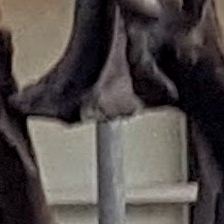

# CUDA center crop demo

This C++/CUDA example extracts a centered rectangular region from an 8-bit,
three-channel image. The default crop is 224 × 224 pixels; `--width` and
`--height` select another size. Each requested dimension is limited to the
corresponding input dimension. The top-left origin is
`((input_width - crop_width) / 2, (input_height - crop_height) / 2)`, using
integer division. No interpolation or resizing is performed. OpenCV is used
only for image I/O; cropping runs on the GPU.

## Build and test

From the repository root, with Bazel, CUDA and OpenCV development libraries:

```bash
bazel build --@rules_cuda//cuda:archs=sm_89 \
  //cv-cuda-pipeline/examples/image_process/center_crop:center_crop_demo
bazel test --@rules_cuda//cuda:archs=sm_89 --test_output=errors \
  //cv-cuda-pipeline/calculators/image_process/cuda/tests:center_crop_kernel_test
```

Replace `sm_89` with your GPU architecture. The build uses
[rules_cuda](https://github.com/bazel-contrib/rules_cuda).

## Run

```bash
mkdir -p cv-cuda-pipeline/examples/image_process/center_crop/perf_asserts
bazel-bin/cv-cuda-pipeline/examples/image_process/center_crop/center_crop_demo \
  --input cv-cuda-pipeline/pictures/tabby_tiger_cat.jpg \
  --output cv-cuda-pipeline/examples/image_process/center_crop/perf_asserts/center_crop_cat.png
bazel-bin/cv-cuda-pipeline/examples/image_process/center_crop/center_crop_demo \
  --input cv-cuda-pipeline/pictures/dino.jpg \
  --output cv-cuda-pipeline/examples/image_process/center_crop/perf_asserts/center_crop_dino.png
```

`--input` is required; `--output` defaults to `cat_center_crop.png` in the
current directory. Width and height must be positive integers. OpenCV selects
the output format from its extension.

| Input | Output (224 × 224) |
| --- | --- |
|  |  |
|  |  |

The kernel API accepts non-overlapping interleaved RGB8 or BGR8 input and
output device buffers, byte row strides, image and crop dimensions, and an
optional CUDA stream. The crop must fit the input. The caller must keep
buffers valid until stream completion and check synchronization errors.
Other formats and batches are not implemented.

## Nsight Systems performance

On an NVIDIA RTX 500 Ada Generation Laptop GPU with CUDA 13.3 and Nsight
Systems 2026.1.3, the default Bazel build produced these results from one
sequential run per image:

| Input image | Crop size | Kernel latency | Estimated effective bandwidth |
| --- | --- | ---: | ---: |
| Cat, 720 × 720 | 224 × 224 | 3.193 µs | 94.29 GB/s |
| Dinosaur, 2876 × 1699 | 224 × 224 | 3.988 µs | 75.49 GB/s |

Estimated logical bandwidth is six bytes per output pixel (one three-byte
read and one three-byte write) divided by kernel time. This is not measured
DRAM bandwidth: caching, compiler optimizations and memory transactions affect
actual traffic. Single-launch timings are not a steady-state benchmark and
exclude CPU work, image I/O and host-device transfers.

To reproduce, use new report names if they already exist:

```bash
mkdir -p build/center_crop cv-cuda-pipeline/examples/image_process/center_crop/perf_asserts
nsys profile --trace=cuda --sample=none --cpuctxsw=none \
  --output=build/center_crop/nsys_cat \
  bazel-bin/cv-cuda-pipeline/examples/image_process/center_crop/center_crop_demo \
  --input cv-cuda-pipeline/pictures/tabby_tiger_cat.jpg \
  --output cv-cuda-pipeline/examples/image_process/center_crop/perf_asserts/profile_cat.png
nsys stats --report cuda_gpu_kern_sum --format csv build/center_crop/nsys_cat.nsys-rep
nsys profile --trace=cuda --sample=none --cpuctxsw=none \
  --output=build/center_crop/nsys_dinosaur \
  bazel-bin/cv-cuda-pipeline/examples/image_process/center_crop/center_crop_demo \
  --input cv-cuda-pipeline/pictures/dino.jpg \
  --output cv-cuda-pipeline/examples/image_process/center_crop/perf_asserts/profile_dinosaur.png
nsys stats --report cuda_gpu_kern_sum --format csv build/center_crop/nsys_dinosaur.nsys-rep
```
