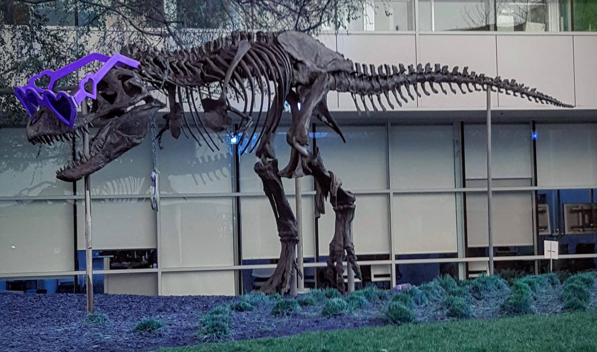

# CUDA channel reorder demo

This C++/CUDA example reorders each RGB8 pixel with output-to-input channel
indices `[2, 1, 0]`. The resulting values are interpreted as RGB when the
image is saved, so red and blue appear exchanged. OpenCV is used for image
I/O and BGR/RGB conversion; the channel reorder itself runs on the GPU.

## Build and test

From the repository root, with Bazel, CUDA and OpenCV development libraries:

```bash
bazel build --@rules_cuda//cuda:archs=sm_89 \
  //cv-cuda-pipeline/examples/image_process/channelreorder:channelreorder_demo
bazel test --@rules_cuda//cuda:archs=sm_89 --test_output=errors \
  //cv-cuda-pipeline/calculators/image_process/cuda/tests:channel_reorder_kernel_test
```

Replace `sm_89` with your GPU architecture. The build uses
[rules_cuda](https://github.com/bazel-contrib/rules_cuda).

## Run

```bash
mkdir -p cv-cuda-pipeline/examples/image_process/channelreorder/perf_asserts
bazel-bin/cv-cuda-pipeline/examples/image_process/channelreorder/channelreorder_demo \
  --input cv-cuda-pipeline/pictures/tabby_tiger_cat.jpg \
  --output cv-cuda-pipeline/examples/image_process/channelreorder/perf_asserts/channelreorder_cat.png
bazel-bin/cv-cuda-pipeline/examples/image_process/channelreorder/channelreorder_demo \
  --input cv-cuda-pipeline/pictures/dino.jpg \
  --output cv-cuda-pipeline/examples/image_process/channelreorder/perf_asserts/channelreorder_dino.png
```

`--input` is required; `--output` defaults to `cat_channelreorder.png` in the
current directory. OpenCV selects the output format from its extension.

| Input | Output |
| --- | --- |
|  |  |
|  |  |

The kernel API accepts non-overlapping interleaved three-channel 8-bit device
buffers, byte row strides, image dimensions, three output-to-input indices
passed by value, and an optional CUDA stream. Repeated indices are allowed;
negative indices produce zero, and indices greater than 2 are invalid. The
caller must keep buffers valid until stream completion and check
synchronization errors. Other formats and batches are not implemented.

## Nsight Systems performance

On an NVIDIA RTX 500 Ada Generation Laptop GPU with CUDA 13.3 and Nsight
Systems 2026.1.3, the default Bazel build produced these results from one
sequential run per image:

| Image | Kernel latency | Estimated effective bandwidth |
| --- | ---: | ---: |
| Cat, 720 × 720 | 17.319 µs | 179.59 GB/s |
| Dinosaur, 2876 × 1699 | 228.495 µs | 128.31 GB/s |

Estimated logical bandwidth is six bytes per pixel (one three-byte image read
and one three-byte write for this permutation) divided by kernel time. This
is not measured DRAM bandwidth: caching, compiler optimizations and memory
transactions affect actual traffic. Single-launch timings are not a
steady-state benchmark and exclude CPU work, image I/O and transfers.

To reproduce, use new report names if they already exist:

```bash
mkdir -p build/channelreorder cv-cuda-pipeline/examples/image_process/channelreorder/perf_asserts
nsys profile --trace=cuda --sample=none --cpuctxsw=none \
  --output=build/channelreorder/nsys_cat \
  bazel-bin/cv-cuda-pipeline/examples/image_process/channelreorder/channelreorder_demo \
  --input cv-cuda-pipeline/pictures/tabby_tiger_cat.jpg \
  --output cv-cuda-pipeline/examples/image_process/channelreorder/perf_asserts/profile_cat.png
nsys stats --report cuda_gpu_kern_sum --format csv build/channelreorder/nsys_cat.nsys-rep
nsys profile --trace=cuda --sample=none --cpuctxsw=none \
  --output=build/channelreorder/nsys_dinosaur \
  bazel-bin/cv-cuda-pipeline/examples/image_process/channelreorder/channelreorder_demo \
  --input cv-cuda-pipeline/pictures/dino.jpg \
  --output cv-cuda-pipeline/examples/image_process/channelreorder/perf_asserts/profile_dinosaur.png
nsys stats --report cuda_gpu_kern_sum --format csv build/channelreorder/nsys_dinosaur.nsys-rep
```
