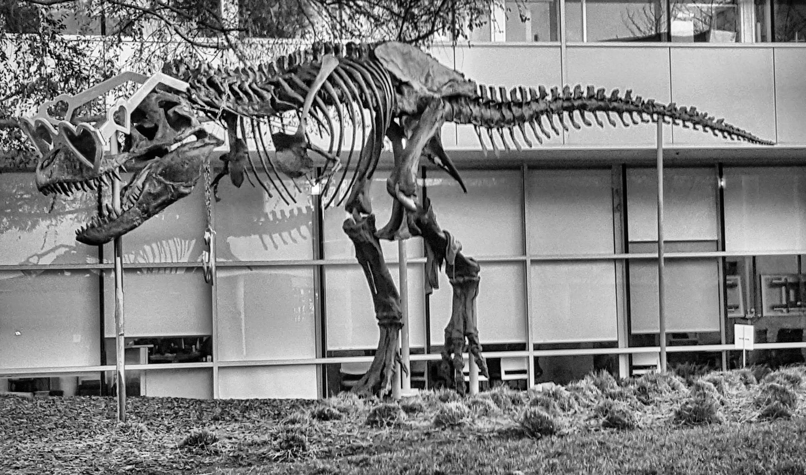

# CUDA CLAHE demo

This C++/CUDA example converts an RGB8 image to grayscale, then applies
contrast limited adaptive histogram equalization (CLAHE) with an 8 × 8 tile
grid and clip limit 2.0. The output grayscale channel is replicated to RGB for
image encoding. The RGB-to-grayscale conversion and CLAHE run on the GPU;
OpenCV handles image I/O and channel layout conversion.

Each tile is extended to a uniform size by reflecting pixels at the right and
bottom edges (REFLECT101). The 256-bin histogram is clipped at
`max(tile_area / 128, 1)` and its excess is redistributed before constructing
the cumulative lookup table. Neighboring tile tables are bilinearly
interpolated for each output pixel.

## Build and test

From the repository root, with Bazel, CUDA and OpenCV development libraries:

```bash
bazel build --@rules_cuda//cuda:archs=sm_89 \
  //cv-cuda-pipeline/examples/image_process/clahe:clahe_demo
bazel test --@rules_cuda//cuda:archs=sm_89 --test_output=errors \
  //cv-cuda-pipeline/calculators/image_process/cuda/tests:clahe_kernel_test
```

Replace `sm_89` with your GPU architecture. The build uses
[rules_cuda](https://github.com/bazel-contrib/rules_cuda).

## Run

```bash
mkdir -p cv-cuda-pipeline/examples/image_process/clahe/perf_asserts
bazel-bin/cv-cuda-pipeline/examples/image_process/clahe/clahe_demo \
  --input cv-cuda-pipeline/pictures/tabby_tiger_cat.jpg \
  --output cv-cuda-pipeline/examples/image_process/clahe/perf_asserts/clahe_cat.png
bazel-bin/cv-cuda-pipeline/examples/image_process/clahe/clahe_demo \
  --input cv-cuda-pipeline/pictures/dino.jpg \
  --output cv-cuda-pipeline/examples/image_process/clahe/perf_asserts/clahe_dino.png
```

`--input` is required; `--output` defaults to `cat_clahe.png` in the current
directory. OpenCV selects the output format from its extension.

| Input | Output |
| --- | --- |
|  |  |
|  |  |

The kernel API operates on one image at a time with byte row strides and an
optional CUDA stream. `ClaheRgbToGray` takes interleaved RGB8 input and
single-channel U8 output; `Clahe` takes single-channel U8 input and output and
requires 16,384 bytes of device LUT scratch. All buffers must be distinct and
non-overlapping, and must remain valid until stream completion. Synchronize
the stream to detect asynchronous errors. Grid size and clip limit are fixed;
other formats and batches are not implemented.

## Nsight Systems performance

On an NVIDIA RTX 500 Ada Generation Laptop GPU with CUDA 13.3 and Nsight
Systems 2026.1.3, the default Bazel build produced these results from one
sequential run per image:

| Image | RGB to gray | LUT construction | LUT interpolation | Total GPU kernel latency | Estimated effective bandwidth |
| --- | ---: | ---: | ---: | ---: | ---: |
| Cat, 720 × 720 | 15.662 µs | 26.794 µs | 23.668 µs | 66.124 µs | 86.49 GB/s |
| Dinosaur, 2876 × 1699 | 163.028 µs | 222.534 µs | 203.977 µs | 589.539 µs | 91.24 GB/s |

Total GPU kernel latency is the sum of the three kernel durations, not
end-to-end time; CLAHE itself comprises LUT construction and interpolation.
The estimated logical bandwidth divides `10 × pixels + padded_pixels +
16,384` bytes by that sum: four bytes per pixel for grayscale conversion,
one grayscale read per padded histogram sample and one LUT write per bin,
then one grayscale read, four LUT reads and one output write per pixel. This
is not measured DRAM bandwidth; compiler optimizations, caching, shared-memory
operations and transaction sizes affect actual traffic. Single-launch timings
are not a steady-state benchmark and exclude CPU work, image I/O and transfers.

To reproduce, use new report names if they already exist:

```bash
mkdir -p build/clahe cv-cuda-pipeline/examples/image_process/clahe/perf_asserts
nsys profile --trace=cuda --sample=none --cpuctxsw=none \
  --output=build/clahe/nsys_cat \
  bazel-bin/cv-cuda-pipeline/examples/image_process/clahe/clahe_demo \
  --input cv-cuda-pipeline/pictures/tabby_tiger_cat.jpg \
  --output cv-cuda-pipeline/examples/image_process/clahe/perf_asserts/profile_cat.png
nsys stats --report cuda_gpu_kern_sum --format csv build/clahe/nsys_cat.nsys-rep
nsys profile --trace=cuda --sample=none --cpuctxsw=none \
  --output=build/clahe/nsys_dinosaur \
  bazel-bin/cv-cuda-pipeline/examples/image_process/clahe/clahe_demo \
  --input cv-cuda-pipeline/pictures/dino.jpg \
  --output cv-cuda-pipeline/examples/image_process/clahe/perf_asserts/profile_dinosaur.png
nsys stats --report cuda_gpu_kern_sum --format csv build/clahe/nsys_dinosaur.nsys-rep
```
