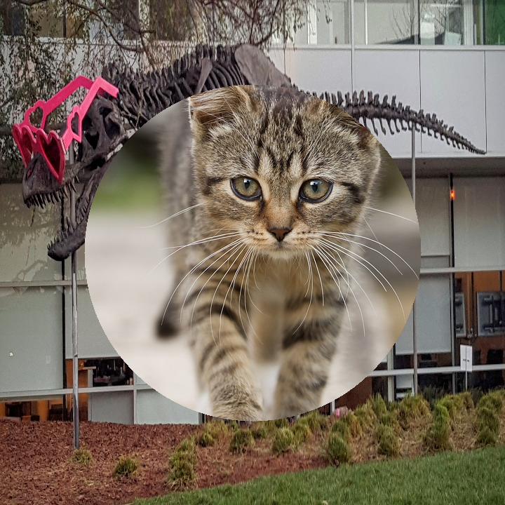
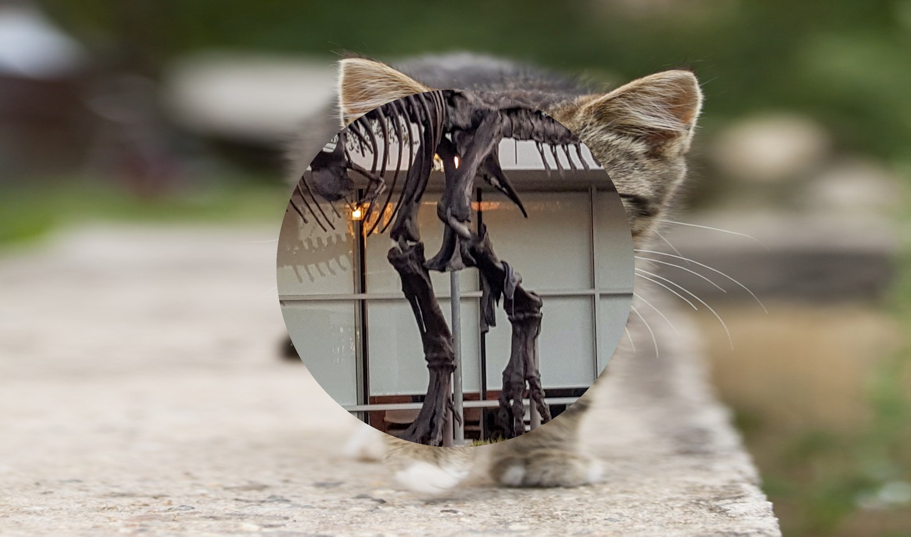

# CUDA composite demo

This C++/CUDA example composites two color images using an 8-bit foreground
mask. The background is resized to the foreground dimensions on the GPU with
bilinear interpolation. A circular mask is built on the CPU: pixels inside
the circle use the foreground, and pixels outside use the background. The
circle is centered at `(width / 2, height / 2)` using integer division, with
radius `min(width, height) / 3`; its boundary is included.

The reference demonstration uses a dog as the background. This version uses
images already present in this repository and accepts either input from the
command line. OpenCV handles image I/O; resize and compositing run on the GPU.
Both inputs use the same BGR channel order, so no color conversion is needed.

## Build and test

From the repository root, with Bazel, CUDA and OpenCV development libraries:

```bash
bazel build --@rules_cuda//cuda:archs=sm_89 \
  //cv-cuda-pipeline/examples/image_process/composite:composite_demo
bazel test --@rules_cuda//cuda:archs=sm_89 --test_output=errors \
  //cv-cuda-pipeline/calculators/image_process/cuda/tests:composite_kernel_test \
  //cv-cuda-pipeline/calculators/image_process/cuda/tests:resize_kernel_test
```

Replace `sm_89` with your GPU architecture. The build uses
[rules_cuda](https://github.com/bazel-contrib/rules_cuda).

## Run

```bash
mkdir -p cv-cuda-pipeline/examples/image_process/composite/perf_asserts
bazel-bin/cv-cuda-pipeline/examples/image_process/composite/composite_demo \
  --input cv-cuda-pipeline/pictures/tabby_tiger_cat.jpg \
  --background cv-cuda-pipeline/pictures/dino.jpg \
  --output cv-cuda-pipeline/examples/image_process/composite/perf_asserts/composite_cat.png
bazel-bin/cv-cuda-pipeline/examples/image_process/composite/composite_demo \
  --input cv-cuda-pipeline/pictures/dino.jpg \
  --background cv-cuda-pipeline/pictures/tabby_tiger_cat.jpg \
  --output cv-cuda-pipeline/examples/image_process/composite/perf_asserts/composite_dino.png
```

`--input` and `--background` are required; `--output` defaults to
`cat_composite.png` in the current directory. OpenCV selects the output format
from its extension.

| Foreground | Background | Output |
| --- | --- | --- |
|  |  |  |
|  |  |  |

The kernel API accepts two interleaved three-channel U8 device images, a
single-channel U8 mask, and a three- or four-channel U8 output, with byte row
strides, matching dimensions and an optional CUDA stream. For each channel it
calculates `round((foreground * mask + background * (255 - mask)) / 255)`.
Thus intermediate mask values blend the images; an optional fourth output
channel is always 255. Output must not overlap any input. The caller must keep
buffers valid until stream completion and check synchronization errors. Other
formats and batches are not implemented.

## Nsight Systems performance

On an NVIDIA RTX 500 Ada Generation Laptop GPU with CUDA 13.3 and Nsight
Systems 2026.1.3, the default Bazel build produced these results from one
sequential run per image:

| Foreground | Background resize latency | Composite latency | Estimated composite bandwidth |
| --- | ---: | ---: | ---: |
| Cat, 720 × 720 | 109.353 µs | 24.621 µs | 210.55 GB/s |
| Dinosaur, 2876 × 1699 | 320.892 µs | 472.727 µs | 103.36 GB/s |

Estimated composite bandwidth is 10 bytes per output pixel (three-byte
foreground and background reads, one-byte mask read, and three-byte output
write) divided by composite kernel time. It excludes background resizing and
is not measured DRAM bandwidth; caching, compiler optimizations and memory
transactions affect actual traffic. Single-launch timings are not a
steady-state benchmark and exclude CPU work, image I/O and transfers.

To reproduce, use new report names if they already exist:

```bash
mkdir -p build/composite cv-cuda-pipeline/examples/image_process/composite/perf_asserts
nsys profile --trace=cuda --sample=none --cpuctxsw=none \
  --output=build/composite/nsys_cat \
  bazel-bin/cv-cuda-pipeline/examples/image_process/composite/composite_demo \
  --input cv-cuda-pipeline/pictures/tabby_tiger_cat.jpg \
  --background cv-cuda-pipeline/pictures/dino.jpg \
  --output cv-cuda-pipeline/examples/image_process/composite/perf_asserts/profile_cat.png
nsys stats --report cuda_gpu_kern_sum --format csv build/composite/nsys_cat.nsys-rep
nsys profile --trace=cuda --sample=none --cpuctxsw=none \
  --output=build/composite/nsys_dinosaur \
  bazel-bin/cv-cuda-pipeline/examples/image_process/composite/composite_demo \
  --input cv-cuda-pipeline/pictures/dino.jpg \
  --background cv-cuda-pipeline/pictures/tabby_tiger_cat.jpg \
  --output cv-cuda-pipeline/examples/image_process/composite/perf_asserts/profile_dinosaur.png
nsys stats --report cuda_gpu_kern_sum --format csv build/composite/nsys_dinosaur.nsys-rep
```
