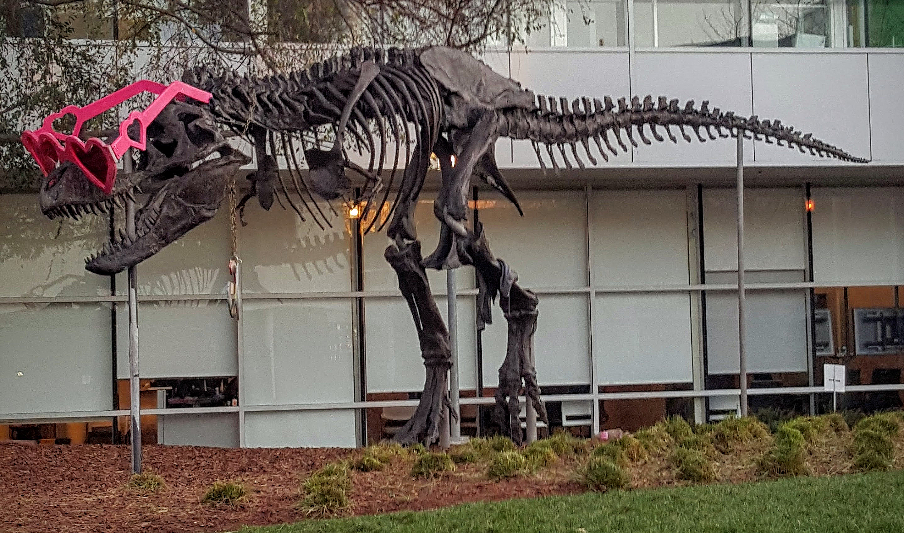

# CUDA 2D convolution demo

This C++/CUDA example applies the centered sharpening kernel
`[[0,-1,0],[-1,5,-1],[0,-1,0]]` independently to each RGB8 channel, with
REFLECT101 borders and output clamped to `[0,255]`. Integer arithmetic is
exactly equivalent to using float for this kernel on U8 data. OpenCV provides
image I/O; filtering runs on the GPU.

## Build and test

From the repository root, with Bazel, CUDA and OpenCV development libraries:

```bash
bazel build --@rules_cuda//cuda:archs=sm_89 \
  //cv-cuda-pipeline/examples/image_process/conv2d:conv2d_demo
bazel test --@rules_cuda//cuda:archs=sm_89 --test_output=errors \
  //cv-cuda-pipeline/calculators/image_process/cuda/tests:conv2d_kernel_test
```

Replace `sm_89` with your GPU architecture. The build uses
[rules_cuda](https://github.com/bazel-contrib/rules_cuda).

## Run

```bash
mkdir -p cv-cuda-pipeline/examples/image_process/conv2d/perf_asserts
bazel-bin/cv-cuda-pipeline/examples/image_process/conv2d/conv2d_demo \
  --input cv-cuda-pipeline/pictures/tabby_tiger_cat.jpg \
  --output cv-cuda-pipeline/examples/image_process/conv2d/perf_asserts/conv2d_cat.png
bazel-bin/cv-cuda-pipeline/examples/image_process/conv2d/conv2d_demo \
  --input cv-cuda-pipeline/pictures/dino.jpg \
  --output cv-cuda-pipeline/examples/image_process/conv2d/perf_asserts/conv2d_dino.png
```

`--input` is required; `--output` defaults to `cat_conv2d.png`. OpenCV selects
the output format from its extension.

| Input | Output |
| --- | --- |
|  |  |
|  |  |

The API handles one interleaved U8 three-channel image with byte row strides and
an optional CUDA stream. The buffers must not overlap and must remain valid
until stream completion; synchronize to detect asynchronous errors. The
sharpening kernel is fixed; arbitrary convolution kernels are not supported.

## Nsight Systems performance

On an NVIDIA RTX 500 Ada Generation Laptop GPU, CUDA 13.3 and Nsight Systems
2026.1.3, the default Bazel build produced these single-launch results:

| Image | Kernel latency | Estimated logical bandwidth |
| --- | ---: | ---: |
| Cat, 720 × 720 | 25.649 µs | 363.80 GB/s |
| Dinosaur, 2876 × 1699 | 265.371 µs | 331.44 GB/s |

The estimate counts five three-byte reads and one three-byte write per output
pixel, divided by kernel time. It is not measured DRAM bandwidth; cached and
overlapping reads, compiler optimizations and memory transactions affect actual
traffic. Single-launch timings are not a steady-state benchmark and exclude
image I/O, CPU work and transfers.

To reproduce, use new report names if they already exist:

```bash
mkdir -p build/conv2d cv-cuda-pipeline/examples/image_process/conv2d/perf_asserts
nsys profile --trace=cuda --sample=none --cpuctxsw=none \
  --output=build/conv2d/nsys_cat \
  bazel-bin/cv-cuda-pipeline/examples/image_process/conv2d/conv2d_demo \
  --input cv-cuda-pipeline/pictures/tabby_tiger_cat.jpg \
  --output cv-cuda-pipeline/examples/image_process/conv2d/perf_asserts/profile_cat.png
nsys stats --report cuda_gpu_kern_sum --format csv build/conv2d/nsys_cat.nsys-rep
nsys profile --trace=cuda --sample=none --cpuctxsw=none \
  --output=build/conv2d/nsys_dinosaur \
  bazel-bin/cv-cuda-pipeline/examples/image_process/conv2d/conv2d_demo \
  --input cv-cuda-pipeline/pictures/dino.jpg \
  --output cv-cuda-pipeline/examples/image_process/conv2d/perf_asserts/profile_dinosaur.png
nsys stats --report cuda_gpu_kern_sum --format csv build/conv2d/nsys_dinosaur.nsys-rep
```
