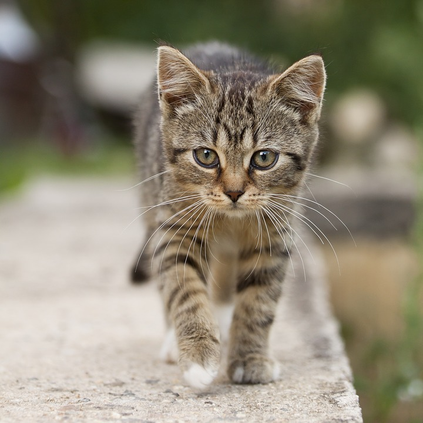
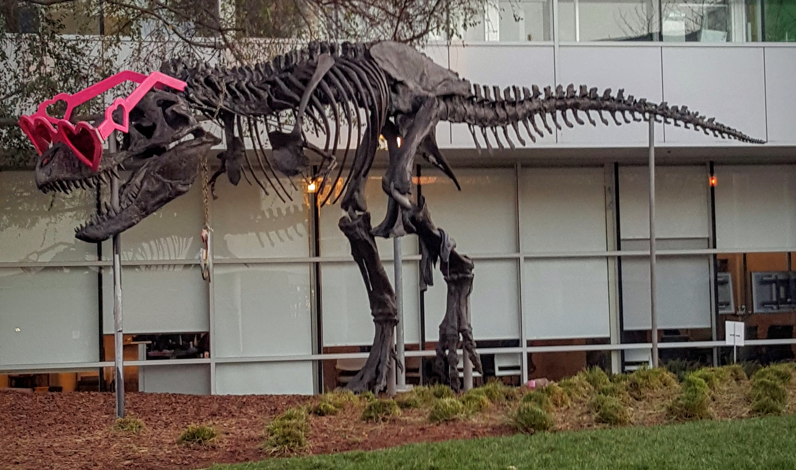

# CUDA convert-to demo

This C++/CUDA example converts an interleaved U8 image to F32 with scale
`1/255`, then converts it back to U8 with scale `255` and nearest-even rounding.
All 256 input values round-trip exactly. OpenCV is used for image I/O; both
conversion stages run on the GPU.

## Build and test

From the repository root, with Bazel, CUDA and OpenCV development libraries:

```bash
bazel build --@rules_cuda//cuda:archs=sm_89 \
  //cv-cuda-pipeline/examples/image_process/convertto:convertto_demo
bazel test --@rules_cuda//cuda:archs=sm_89 --test_output=errors \
  //cv-cuda-pipeline/calculators/image_process/cuda/tests:convertto_kernel_test
```

Replace `sm_89` with your GPU architecture. The build uses
[rules_cuda](https://github.com/bazel-contrib/rules_cuda).

## Run

```bash
mkdir -p cv-cuda-pipeline/examples/image_process/convertto/perf_asserts
bazel-bin/cv-cuda-pipeline/examples/image_process/convertto/convertto_demo \
  --input cv-cuda-pipeline/pictures/tabby_tiger_cat.jpg \
  --output cv-cuda-pipeline/examples/image_process/convertto/perf_asserts/convertto_cat.png
bazel-bin/cv-cuda-pipeline/examples/image_process/convertto/convertto_demo \
  --input cv-cuda-pipeline/pictures/dino.jpg \
  --output cv-cuda-pipeline/examples/image_process/convertto/perf_asserts/convertto_dino.png
```

`--input` is required; `--output` defaults to `cat_convertto.png`. OpenCV
selects the output format from its extension.

| Input | Output |
| --- | --- |
|  |  |
|  |  |

The API handles a single interleaved three-channel image with byte row strides,
a float-aligned F32 device scratch buffer and an optional CUDA stream. The
three buffers must not overlap and must remain valid until stream completion;
synchronize to detect asynchronous errors. The two types and scales are fixed.

## Nsight Systems performance

On an NVIDIA RTX 500 Ada Generation Laptop GPU, CUDA 13.3 and Nsight Systems
2026.1.3, the default Bazel build produced these single-launch results:

| Image | U8 to F32 | F32 to U8 | Total GPU kernel latency | Estimated logical bandwidth |
| --- | ---: | ---: | ---: | ---: |
| Cat, 720 × 720 | 43.004 µs | 40.495 µs | 83.499 µs | 186.25 GB/s |
| Dinosaur, 2876 × 1699 | 662.472 µs | 725.526 µs | 1387.998 µs | 105.61 GB/s |

Total GPU kernel latency is the sum of the two kernel durations. The bandwidth
estimate counts 30 bytes per pixel: one three-byte input read, a 12-byte float
write and read, and one three-byte output write. It is not measured DRAM
bandwidth; caching and transaction sizes affect actual traffic. Single-launch
timings are not a steady-state benchmark and exclude CPU work, image I/O and
transfers.

To reproduce, use new report names if they already exist:

```bash
mkdir -p build/convertto cv-cuda-pipeline/examples/image_process/convertto/perf_asserts
nsys profile --trace=cuda --sample=none --cpuctxsw=none \
  --output=build/convertto/nsys_cat \
  bazel-bin/cv-cuda-pipeline/examples/image_process/convertto/convertto_demo \
  --input cv-cuda-pipeline/pictures/tabby_tiger_cat.jpg \
  --output cv-cuda-pipeline/examples/image_process/convertto/perf_asserts/profile_cat.png
nsys stats --report cuda_gpu_kern_sum --format csv build/convertto/nsys_cat.nsys-rep
nsys profile --trace=cuda --sample=none --cpuctxsw=none \
  --output=build/convertto/nsys_dinosaur \
  bazel-bin/cv-cuda-pipeline/examples/image_process/convertto/convertto_demo \
  --input cv-cuda-pipeline/pictures/dino.jpg \
  --output cv-cuda-pipeline/examples/image_process/convertto/perf_asserts/profile_dinosaur.png
nsys stats --report cuda_gpu_kern_sum --format csv build/convertto/nsys_dinosaur.nsys-rep
```
