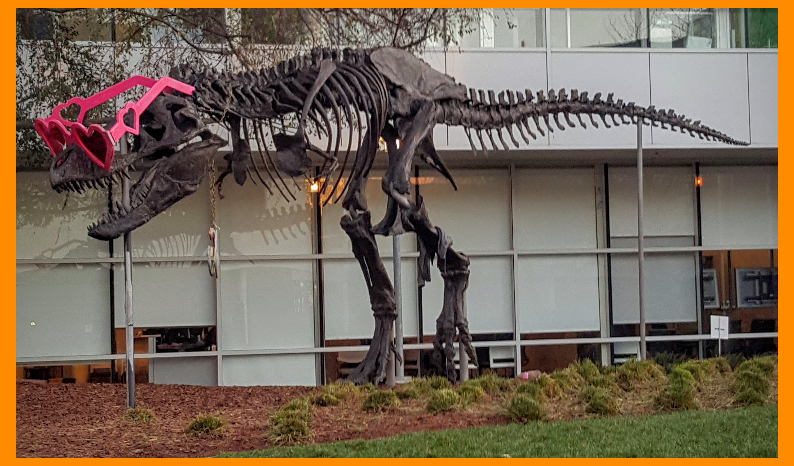

# CUDA copy-make-border demo

This C++/CUDA example adds a constant orange border to an 8-bit three-channel
image: 30 pixels at the top and bottom, 60 at the left and right, and RGB
color `(255, 140, 0)`. OpenCV handles image I/O; copying and padding run on
the GPU.

## Build and test

From the repository root, with Bazel, CUDA and OpenCV development libraries:

```bash
bazel build --@rules_cuda//cuda:archs=sm_89 \
  //cv-cuda-pipeline/examples/image_process/copymakeborder:copymakeborder_demo
bazel test --@rules_cuda//cuda:archs=sm_89 --test_output=errors \
  //cv-cuda-pipeline/calculators/image_process/cuda/tests:copymakeborder_kernel_test
```

Replace `sm_89` with your GPU architecture. The build uses
[rules_cuda](https://github.com/bazel-contrib/rules_cuda).

## Run

```bash
mkdir -p cv-cuda-pipeline/examples/image_process/copymakeborder/perf_asserts
bazel-bin/cv-cuda-pipeline/examples/image_process/copymakeborder/copymakeborder_demo \
  --input cv-cuda-pipeline/pictures/tabby_tiger_cat.jpg \
  --output cv-cuda-pipeline/examples/image_process/copymakeborder/perf_asserts/copymakeborder_cat.png
bazel-bin/cv-cuda-pipeline/examples/image_process/copymakeborder/copymakeborder_demo \
  --input cv-cuda-pipeline/pictures/dino.jpg \
  --output cv-cuda-pipeline/examples/image_process/copymakeborder/perf_asserts/copymakeborder_dino.png
```

`--input` is required; `--output` defaults to `cat_copymakeborder.png`. OpenCV
selects the output format from its extension.

| Input | Output |
| --- | --- |
|  |  |
|  |  |

The API handles a single interleaved U8 three-channel image with byte row
strides, nonnegative border widths, a color in buffer channel order and an
optional CUDA stream. The buffers must not overlap and must remain valid until
stream completion; synchronize to detect asynchronous errors. Only constant
borders are supported.

## Nsight Systems performance

On an NVIDIA RTX 500 Ada Generation Laptop GPU, CUDA 13.3 and Nsight Systems
2026.1.3, the default Bazel build produced these single-launch results:

| Input image | Output dimensions | Kernel latency | Estimated logical bandwidth |
| --- | --- | ---: | ---: |
| Cat, 720 × 720 | 840 × 780 | 22.428 µs | 156.98 GB/s |
| Dinosaur, 2876 × 1699 | 2996 × 1759 | 242.403 µs | 125.70 GB/s |

The estimate counts one three-byte read per input pixel and one three-byte
write per output pixel, divided by kernel time. It is not measured DRAM
bandwidth; caching and transaction sizes affect actual traffic. Single-launch
timings are not a steady-state benchmark and exclude CPU work, image I/O and
transfers.

To reproduce, use new report names if they already exist:

```bash
mkdir -p build/copymakeborder cv-cuda-pipeline/examples/image_process/copymakeborder/perf_asserts
nsys profile --trace=cuda --sample=none --cpuctxsw=none \
  --output=build/copymakeborder/nsys_cat \
  bazel-bin/cv-cuda-pipeline/examples/image_process/copymakeborder/copymakeborder_demo \
  --input cv-cuda-pipeline/pictures/tabby_tiger_cat.jpg \
  --output cv-cuda-pipeline/examples/image_process/copymakeborder/perf_asserts/profile_cat.png
nsys stats --report cuda_gpu_kern_sum --format csv build/copymakeborder/nsys_cat.nsys-rep
nsys profile --trace=cuda --sample=none --cpuctxsw=none \
  --output=build/copymakeborder/nsys_dinosaur \
  bazel-bin/cv-cuda-pipeline/examples/image_process/copymakeborder/copymakeborder_demo \
  --input cv-cuda-pipeline/pictures/dino.jpg \
  --output cv-cuda-pipeline/examples/image_process/copymakeborder/perf_asserts/profile_dinosaur.png
nsys stats --report cuda_gpu_kern_sum --format csv build/copymakeborder/nsys_dinosaur.nsys-rep
```
