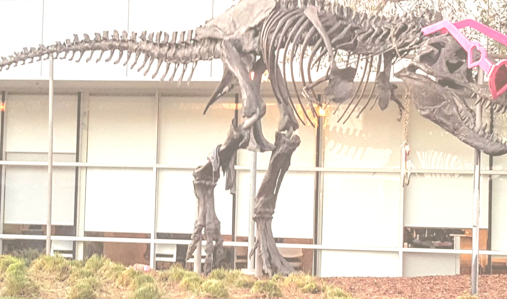

# CUDA crop, flip, normalize and reformat demo

This C++/CUDA example crops the central 80% of an RGB8 image, flips the crop
horizontally, normalizes each channel and writes a planar F32 result on the
GPU. The host then converts the planar output to a viewable RGB image using
`clamp((value * stddev + base) * 255, 0, 255)` and truncates to U8. OpenCV
handles image I/O and channel layout conversion.

The kernel follows the reference operator's actual calculation:
`(pixel - base) / sqrt(stddev * stddev + 1e-8) / 255`, not the sample comment's
`(pixel / 255 - base) / stddev`. Consequently the example's host visualization
is not an exact inverse and appears brighter than a simple crop and flip.
The RGB `base` values are `(0.485, 0.456, 0.406)` and `stddev` values are
`(0.229, 0.224, 0.225)`.

## Build and test

From the repository root, with Bazel, CUDA and OpenCV development libraries:

```bash
bazel build --@rules_cuda//cuda:archs=sm_89 \
  //cv-cuda-pipeline/examples/image_process/crop_flip_normalize_reformat:crop_flip_normalize_reformat_demo
bazel test --@rules_cuda//cuda:archs=sm_89 --test_output=errors \
  //cv-cuda-pipeline/calculators/image_process/cuda/tests:crop_flip_normalize_reformat_kernel_test
```

Replace `sm_89` with your GPU architecture. The build uses
[rules_cuda](https://github.com/bazel-contrib/rules_cuda).

## Run

```bash
mkdir -p cv-cuda-pipeline/examples/image_process/crop_flip_normalize_reformat/perf_asserts
bazel-bin/cv-cuda-pipeline/examples/image_process/crop_flip_normalize_reformat/crop_flip_normalize_reformat_demo \
  --input cv-cuda-pipeline/pictures/tabby_tiger_cat.jpg \
  --output cv-cuda-pipeline/examples/image_process/crop_flip_normalize_reformat/perf_asserts/crop_flip_normalize_reformat_cat.png
bazel-bin/cv-cuda-pipeline/examples/image_process/crop_flip_normalize_reformat/crop_flip_normalize_reformat_demo \
  --input cv-cuda-pipeline/pictures/dino.jpg \
  --output cv-cuda-pipeline/examples/image_process/crop_flip_normalize_reformat/perf_asserts/crop_flip_normalize_reformat_dino.png
```

`--input` is required; `--output` defaults to
`cat_crop_flip_normalize_reformat.png`. The sample's 80% crop must have
positive dimensions. OpenCV selects the output format from its extension.

| Input | Output |
| --- | --- |
|  |  |
|  |  |

The kernel API accepts non-overlapping interleaved RGB8 input and planar F32
output device buffers, byte row and plane strides, an in-bounds crop, and an
optional CUDA stream. The float pointer and output strides must be aligned.
The caller must keep buffers valid until stream completion and check
synchronization errors. The flip direction and normalization parameters are
fixed; other formats and batches are not implemented.

## Nsight Systems performance

On an NVIDIA RTX 500 Ada Generation Laptop GPU, CUDA 13.3 and Nsight Systems
2026.1.3, the default Bazel build produced these single-launch results:

| Input image | Output size | Kernel latency | Estimated logical bandwidth |
| --- | --- | ---: | ---: |
| Cat, 720 × 720 | 576 × 576 | 12.097 µs | 411.39 GB/s |
| Dinosaur, 2876 × 1699 | 2300 × 1359 | 340.769 µs | 137.59 GB/s |

The estimate counts one three-byte input read and one three-float output write
per output pixel, divided by kernel time. It is not measured DRAM bandwidth;
caching and transaction sizes affect actual traffic. Single-launch timings are
not a steady-state benchmark and exclude CPU work, image I/O and transfers.

To reproduce, use new report names if they already exist:

```bash
mkdir -p build/crop_flip_normalize_reformat cv-cuda-pipeline/examples/image_process/crop_flip_normalize_reformat/perf_asserts
nsys profile --trace=cuda --sample=none --cpuctxsw=none \
  --output=build/crop_flip_normalize_reformat/nsys_cat \
  bazel-bin/cv-cuda-pipeline/examples/image_process/crop_flip_normalize_reformat/crop_flip_normalize_reformat_demo \
  --input cv-cuda-pipeline/pictures/tabby_tiger_cat.jpg \
  --output cv-cuda-pipeline/examples/image_process/crop_flip_normalize_reformat/perf_asserts/profile_cat.png
nsys stats --report cuda_gpu_kern_sum --format csv build/crop_flip_normalize_reformat/nsys_cat.nsys-rep
nsys profile --trace=cuda --sample=none --cpuctxsw=none \
  --output=build/crop_flip_normalize_reformat/nsys_dinosaur \
  bazel-bin/cv-cuda-pipeline/examples/image_process/crop_flip_normalize_reformat/crop_flip_normalize_reformat_demo \
  --input cv-cuda-pipeline/pictures/dino.jpg \
  --output cv-cuda-pipeline/examples/image_process/crop_flip_normalize_reformat/perf_asserts/profile_dinosaur.png
nsys stats --report cuda_gpu_kern_sum --format csv build/crop_flip_normalize_reformat/nsys_dinosaur.nsys-rep
```
