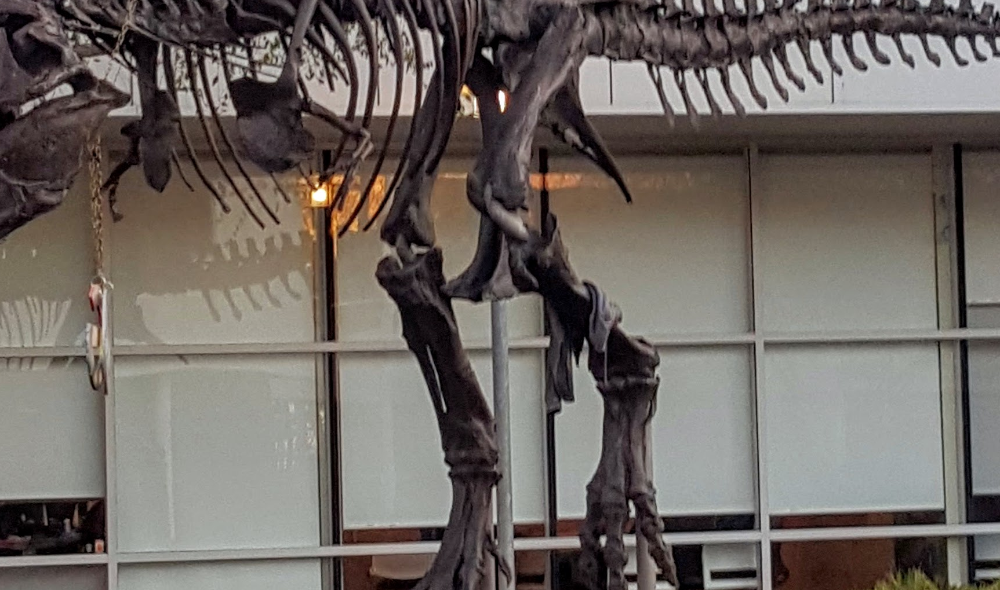

# CUDA custom crop demo

This C++/CUDA example extracts an in-bounds rectangular region from a
three-channel U8 image. It selects the origin `(width / 5, height / 5)` and the
size `(max(1, width * 3 / 5), max(1, height * 3 / 5))`, using integer division.
No interpolation or resizing is performed. OpenCV provides image I/O; cropping
runs on the GPU.

## Build and test

From the repository root, with Bazel, CUDA and OpenCV development libraries:

```bash
bazel build --@rules_cuda//cuda:archs=sm_89 \
  //cv-cuda-pipeline/examples/image_process/customcrop:customcrop_demo
bazel test --@rules_cuda//cuda:archs=sm_89 --test_output=errors \
  //cv-cuda-pipeline/calculators/image_process/cuda/tests:customcrop_kernel_test
```

Replace `sm_89` with your GPU architecture. The build uses
[rules_cuda](https://github.com/bazel-contrib/rules_cuda).

## Run

```bash
mkdir -p cv-cuda-pipeline/examples/image_process/customcrop/perf_asserts
bazel-bin/cv-cuda-pipeline/examples/image_process/customcrop/customcrop_demo \
  --input cv-cuda-pipeline/pictures/tabby_tiger_cat.jpg \
  --output cv-cuda-pipeline/examples/image_process/customcrop/perf_asserts/customcrop_cat.png
bazel-bin/cv-cuda-pipeline/examples/image_process/customcrop/customcrop_demo \
  --input cv-cuda-pipeline/pictures/dino.jpg \
  --output cv-cuda-pipeline/examples/image_process/customcrop/perf_asserts/customcrop_dino.png
```

`--input` is required; `--output` defaults to `cat_customcrop.png`. OpenCV
selects the output format from its extension.

| Input | Output |
| --- | --- |
|  |  |
|  |  |

The kernel API accepts non-overlapping interleaved RGB8 or BGR8 input and
output device buffers, byte row strides, image dimensions, an in-bounds crop
rectangle, and an optional CUDA stream. The caller must keep buffers valid
until stream completion and check synchronization errors. Other formats and
batches are not implemented.

## Nsight Systems performance

On an NVIDIA RTX 500 Ada Generation Laptop GPU, CUDA 13.3 and Nsight Systems
2026.1.3, the default Bazel build produced these single-launch results:

| Input image | Crop size | Kernel latency | Estimated logical bandwidth |
| --- | --- | ---: | ---: |
| Cat, 720 × 720 | 432 × 432 | 7.012 µs | 159.69 GB/s |
| Dinosaur, 2876 × 1699 | 1725 × 1019 | 62.352 µs | 169.15 GB/s |

The estimate counts one three-byte read and one three-byte write per output
pixel, divided by kernel time. It is not measured DRAM bandwidth; caching and
transaction sizes affect actual traffic. Single-launch timings are not a
steady-state benchmark and exclude CPU work, image I/O and transfers.

To reproduce, use new report names if they already exist:

```bash
mkdir -p build/customcrop cv-cuda-pipeline/examples/image_process/customcrop/perf_asserts
nsys profile --trace=cuda --sample=none --cpuctxsw=none \
  --output=build/customcrop/nsys_cat \
  bazel-bin/cv-cuda-pipeline/examples/image_process/customcrop/customcrop_demo \
  --input cv-cuda-pipeline/pictures/tabby_tiger_cat.jpg \
  --output cv-cuda-pipeline/examples/image_process/customcrop/perf_asserts/profile_cat.png
nsys stats --report cuda_gpu_kern_sum --format csv build/customcrop/nsys_cat.nsys-rep
nsys profile --trace=cuda --sample=none --cpuctxsw=none \
  --output=build/customcrop/nsys_dinosaur \
  bazel-bin/cv-cuda-pipeline/examples/image_process/customcrop/customcrop_demo \
  --input cv-cuda-pipeline/pictures/dino.jpg \
  --output cv-cuda-pipeline/examples/image_process/customcrop/perf_asserts/profile_dinosaur.png
nsys stats --report cuda_gpu_kern_sum --format csv build/customcrop/nsys_dinosaur.nsys-rep
```
