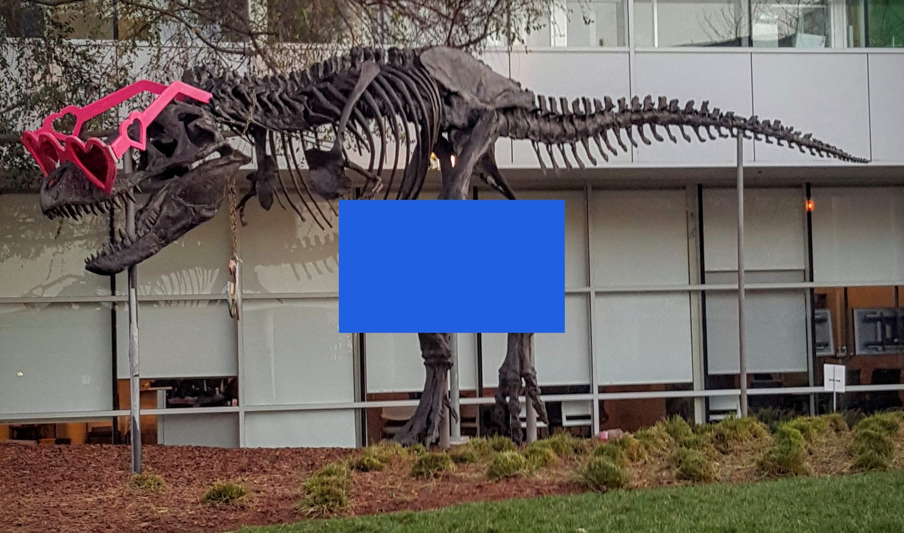

# CUDA CV-CUDA TV augmentation demo

This C++/CUDA example follows the CV-CUDA [TV augmentation
sample](https://github.com/CVCUDA/CV-CUDA/blob/main/samples/operators/cvcuda_tv_augment.py):
it fills the centered quarter-size rectangle with RGB `(32, 96, 224)` and
then creates JPEG-quality-65 artifacts. The rectangular erase is performed by
a CUDA kernel. OpenCV encodes and decodes the JPEG preview on the CPU because
this repository does not include the CV-CUDA TV JPEG codec; this changes the
codec implementation but preserves the sample's quality setting and output
effect.

## Build and test

From the repository root, with Bazel, CUDA and OpenCV development libraries:

```bash
bazel build --@rules_cuda//cuda:archs=sm_89 \
  //cv-cuda-pipeline/examples/image_process/cvcuda_tv_augment:tv_augment_demo
bazel test --@rules_cuda//cuda:archs=sm_89 --test_output=errors \
  //cv-cuda-pipeline/calculators/image_process/cuda/tests:erase_kernel_test
```

Replace `sm_89` with your GPU architecture. The build uses
[rules_cuda](https://github.com/bazel-contrib/rules_cuda).

## Run

```bash
mkdir -p cv-cuda-pipeline/examples/image_process/cvcuda_tv_augment/perf_asserts
bazel-bin/cv-cuda-pipeline/examples/image_process/cvcuda_tv_augment/tv_augment_demo \
  --input cv-cuda-pipeline/pictures/tabby_tiger_cat.jpg \
  --output cv-cuda-pipeline/examples/image_process/cvcuda_tv_augment/perf_asserts/cvcuda_tv_augment_cat.jpg
bazel-bin/cv-cuda-pipeline/examples/image_process/cvcuda_tv_augment/tv_augment_demo \
  --input cv-cuda-pipeline/pictures/dino.jpg \
  --output cv-cuda-pipeline/examples/image_process/cvcuda_tv_augment/perf_asserts/cvcuda_tv_augment_dino.jpg
```

`--input` is required; `--output` defaults to `cvcuda_tv_augment.jpg`.

| Input | Erase and JPEG-quality-65 preview |
| --- | --- |
|  |  |
|  |  |

## Nsight Systems performance

On an NVIDIA RTX 500 Ada Generation Laptop GPU, CUDA 13.3 and Nsight Systems
2026.1.3, the erase kernel measured:

| Image | Kernel time | Estimated logical bandwidth |
| --- | ---: | ---: |
| Cat, 720 × 720 | 18.383 µs | 169.20 GB/s |
| Dinosaur, 2876 × 1699 | 212.655 µs | 137.87 GB/s |

The estimate counts one three-byte input and output per pixel; it is logical
traffic, not measured DRAM bandwidth. The kernel copies every image pixel and
replaces pixels inside the rectangle. Timings exclude CPU JPEG encode/decode,
image I/O and transfers.

To reproduce, use new report names if they already exist:

```bash
mkdir -p build/cvcuda_tv_augment
nsys profile --trace=cuda --sample=none --cpuctxsw=none \
  --output=build/cvcuda_tv_augment/nsys_cat \
  bazel-bin/cv-cuda-pipeline/examples/image_process/cvcuda_tv_augment/tv_augment_demo \
  --input cv-cuda-pipeline/pictures/tabby_tiger_cat.jpg \
  --output build/cvcuda_tv_augment/cat.jpg
nsys stats --report cuda_gpu_kern_sum --format csv \
  build/cvcuda_tv_augment/nsys_cat.nsys-rep
```
