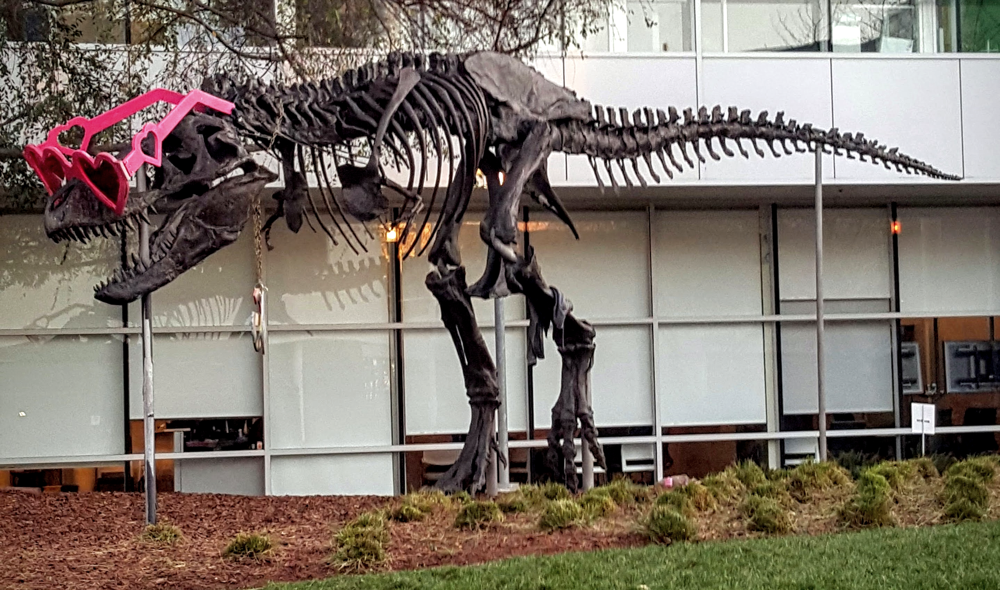

# CUDA CV-CUDA TV color demo

This C++/CUDA example follows the CV-CUDA [TV color
sample](https://github.com/CVCUDA/CV-CUDA/blob/main/samples/operators/cvcuda_tv_color.py):
brightness 1.15, contrast 1.2 and saturation 0.8, in that order. Each
adjustment reuses the repository's tested `ColorTwist` CUDA kernel. The input
is BGR U8; the global grayscale mean required by contrast is computed on the
host from the brightness-adjusted image, and the per-pixel color transforms
run on the GPU. OpenCV is used only for image I/O.

## Build and test

From the repository root, with Bazel, CUDA and OpenCV development libraries:

```bash
bazel build --@rules_cuda//cuda:archs=sm_89 \
  //cv-cuda-pipeline/examples/image_process/cvcuda_tv_color:tv_color_demo
bazel test --@rules_cuda//cuda:archs=sm_89 --test_output=errors \
  //cv-cuda-pipeline/calculators/image_process/cuda/tests:color_twist_kernel_test
```

Replace `sm_89` with your GPU architecture. The build uses
[rules_cuda](https://github.com/bazel-contrib/rules_cuda).

## Run

```bash
mkdir -p cv-cuda-pipeline/examples/image_process/cvcuda_tv_color/perf_asserts
bazel-bin/cv-cuda-pipeline/examples/image_process/cvcuda_tv_color/tv_color_demo \
  --input cv-cuda-pipeline/pictures/tabby_tiger_cat.jpg \
  --output cv-cuda-pipeline/examples/image_process/cvcuda_tv_color/perf_asserts/cvcuda_tv_color_cat.png
bazel-bin/cv-cuda-pipeline/examples/image_process/cvcuda_tv_color/tv_color_demo \
  --input cv-cuda-pipeline/pictures/dino.jpg \
  --output cv-cuda-pipeline/examples/image_process/cvcuda_tv_color/perf_asserts/cvcuda_tv_color_dino.png
```

`--input` is required; `--output` defaults to `cvcuda_tv_color.png`. OpenCV
selects the output format from its extension.

| Input | Brightness, contrast and saturation |
| --- | --- |
|  |  |
|  |  |

## Nsight Systems performance

On an NVIDIA RTX 500 Ada Generation Laptop GPU, CUDA 13.3 and Nsight Systems
2026.1.3, the three `ColorTwist` launches measured:

| Image | Three-kernel time | Estimated logical bandwidth |
| --- | ---: | ---: |
| Cat, 720 × 720 | 51.809 µs | 180.11 GB/s |
| Dinosaur, 2876 × 1699 | 771.158 µs | 114.05 GB/s |

The estimate counts one three-byte input and output per pixel for each of the
three transforms. It is logical traffic, not measured DRAM bandwidth. Timings
exclude the CPU grayscale-mean calculation, image I/O and transfers.

To reproduce, use new report names if they already exist:

```bash
mkdir -p build/cvcuda_tv_color
nsys profile --trace=cuda --sample=none --cpuctxsw=none \
  --output=build/cvcuda_tv_color/nsys_cat \
  bazel-bin/cv-cuda-pipeline/examples/image_process/cvcuda_tv_color/tv_color_demo \
  --input cv-cuda-pipeline/pictures/tabby_tiger_cat.jpg \
  --output build/cvcuda_tv_color/cat.png
nsys stats --report cuda_gpu_kern_sum --format csv \
  build/cvcuda_tv_color/nsys_cat.nsys-rep
```
