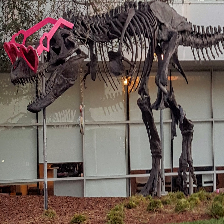

# CV-CUDA TV compose demo

This C++/CUDA example follows the operation sequence in the CV-CUDA
[TV compose sample](https://github.com/CVCUDA/CV-CUDA/blob/main/samples/operators/cvcuda_tv_compose.py):
seeded random resized crop, optional horizontal flip, brightness/contrast/
saturation jitter, and ImageNet normalization. The random crop selection and
jitter parameters are generated on the CPU; crop resize, flip, color transforms,
and normalization use the repository's CUDA kernels. The normalized result is
interleaved HWC `float32`, rather than the sample's PyTorch NCHW tensor.

The demo runs the same seeded pipeline twice and verifies that the normalized
outputs are identical. It writes a crop/flip preview, matching the sample's
visualization focus; the normalized tensor is checked in memory.
OpenCV computes the global grayscale mean used by contrast jitter and handles
image I/O on the CPU. The seed and standard-library random sequence are
deterministic for this implementation, but do not reproduce PyTorch's random
sequence or CV-CUDA's exact augmentation choices.

## Build and test

From the repository root, with Bazel, CUDA and OpenCV development libraries:

```bash
bazel build --@rules_cuda//cuda:archs=sm_89 \
  //cv-cuda-pipeline/examples/image_process/cvcuda_tv_compose:tv_compose_demo
bazel test --@rules_cuda//cuda:archs=sm_89 --test_output=errors \
  //cv-cuda-pipeline/calculators/image_process/cuda/tests:random_resized_crop_test \
  //cv-cuda-pipeline/calculators/image_process/cuda/tests:resize_kernel_test \
  //cv-cuda-pipeline/calculators/image_process/cuda/tests:flip_kernel_test \
  //cv-cuda-pipeline/calculators/image_process/cuda/tests:color_twist_kernel_test \
  //cv-cuda-pipeline/calculators/image_process/cuda/tests:normalize_kernel_test
```

Replace `sm_89` with your GPU architecture. The build uses
[rules_cuda](https://github.com/bazel-contrib/rules_cuda).

## Run

```bash
mkdir -p cv-cuda-pipeline/examples/image_process/cvcuda_tv_compose/perf_asserts
bazel-bin/cv-cuda-pipeline/examples/image_process/cvcuda_tv_compose/tv_compose_demo \
  --input cv-cuda-pipeline/pictures/tabby_tiger_cat.jpg \
  --output cv-cuda-pipeline/examples/image_process/cvcuda_tv_compose/perf_asserts/cvcuda_tv_compose_cat.png
bazel-bin/cv-cuda-pipeline/examples/image_process/cvcuda_tv_compose/tv_compose_demo \
  --input cv-cuda-pipeline/pictures/dino.jpg \
  --output cv-cuda-pipeline/examples/image_process/cvcuda_tv_compose/perf_asserts/cvcuda_tv_compose_dino.png
```

`--input` is required. `--output` defaults to `cvcuda_tv_compose.png`;
`--width` and `--height` default to 224.

| Input | Seeded crop/flip preview |
| --- | --- |
|  |  |
|  |  |

## Nsight Systems performance

On an NVIDIA RTX 500 Ada Generation Laptop GPU, CUDA 13.3 and Nsight Systems
2026.1.3, the GPU work in two repeated full pipelines measured:

| Image | Two-run kernel total | Average per pipeline |
| --- | ---: | ---: |
| Cat, 720 × 720 | 37.588 µs | 18.794 µs |
| Dinosaur, 2876 × 1699 | 55.865 µs | 27.933 µs |

The totals include two resize kernels, six color-twist kernels, and two
normalization kernels. Flip is a device-to-device copy for these seeded runs.
These are summed kernel durations from Nsight Systems, divided by two; they
exclude CPU work, image I/O, host-device transfers, and launch overhead.
The larger input has a much slower resize outlier in this short run, so these
measurements should not be treated as a stable benchmark.

To reproduce, use new report names if they already exist:

```bash
mkdir -p build/cvcuda_tv_compose
nsys profile --trace=cuda --sample=none --cpuctxsw=none \
  --output=build/cvcuda_tv_compose/nsys_cat \
  bazel-bin/cv-cuda-pipeline/examples/image_process/cvcuda_tv_compose/tv_compose_demo \
  --input cv-cuda-pipeline/pictures/tabby_tiger_cat.jpg \
  --output build/cvcuda_tv_compose/cat.png
nsys stats --report cuda_gpu_kern_sum --format csv \
  build/cvcuda_tv_compose/nsys_cat.nsys-rep
```
