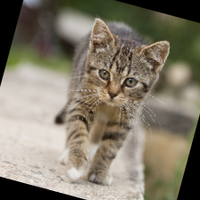
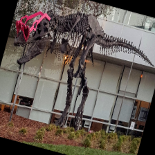

# CUDA CV-CUDA TV geometry demo

This C++/CUDA example ports the geometry flow from the CV-CUDA
[TV geometry sample](https://github.com/CVCUDA/CV-CUDA/blob/main/samples/operators/cvcuda_tv_geometry.py):
resize an image to the selected output dimensions, then rotate it by 15 degrees
with bilinear interpolation and a black border. It reuses the repository's
tested resize and warp kernels. OpenCV is used only for image I/O.

## Build and test

From the repository root, with Bazel, CUDA and OpenCV development libraries:

```bash
bazel build --@rules_cuda//cuda:archs=sm_89 \
  //cv-cuda-pipeline/examples/image_process/cvcuda_tv_geometry:tv_geometry_demo
bazel test --@rules_cuda//cuda:archs=sm_89 --test_output=errors \
  //cv-cuda-pipeline/calculators/image_process/cuda/tests:resize_kernel_test \
  //cv-cuda-pipeline/calculators/image_process/cuda/tests:warp_kernel_test
```

Replace `sm_89` with your GPU architecture. The build uses
[rules_cuda](https://github.com/bazel-contrib/rules_cuda).

## Run

```bash
mkdir -p cv-cuda-pipeline/examples/image_process/cvcuda_tv_geometry/perf_asserts
bazel-bin/cv-cuda-pipeline/examples/image_process/cvcuda_tv_geometry/tv_geometry_demo \
  --input cv-cuda-pipeline/pictures/tabby_tiger_cat.jpg \
  --output cv-cuda-pipeline/examples/image_process/cvcuda_tv_geometry/perf_asserts/cvcuda_tv_geometry_cat.png
bazel-bin/cv-cuda-pipeline/examples/image_process/cvcuda_tv_geometry/tv_geometry_demo \
  --input cv-cuda-pipeline/pictures/dino.jpg \
  --output cv-cuda-pipeline/examples/image_process/cvcuda_tv_geometry/perf_asserts/cvcuda_tv_geometry_dino.png
```

`--input` is required; `--output` defaults to `cvcuda_tv_geometry.png`.
Output dimensions default to 224×224; pass `--width N` and `--height N` to
change them.

| Input | Resize and 15° rotation |
| --- | --- |
|  |  |
|  |  |

## Nsight Systems performance

On an NVIDIA RTX 500 Ada Generation Laptop GPU, CUDA 13.3 and Nsight Systems
2026.1.3, the two kernel launches measured:

| Image | Two-kernel time | Estimated logical bandwidth |
| --- | ---: | ---: |
| Cat, 720 × 720 input | 10.157 µs | 148.20 GB/s |
| Dinosaur, 2876 × 1699 input | 35.902 µs | 41.93 GB/s |

The estimate counts, for each resize and warp output pixel, up to four
three-byte source samples plus a three-byte destination. It is logical memory
traffic, not measured DRAM bandwidth; cached taps affect physical traffic.
Timings exclude CPU work, image I/O and transfers.

To reproduce, use new report names if they already exist:

```bash
mkdir -p build/cvcuda_tv_geometry
nsys profile --trace=cuda --sample=none --cpuctxsw=none \
  --output=build/cvcuda_tv_geometry/nsys_cat \
  bazel-bin/cv-cuda-pipeline/examples/image_process/cvcuda_tv_geometry/tv_geometry_demo \
  --input cv-cuda-pipeline/pictures/tabby_tiger_cat.jpg \
  --output build/cvcuda_tv_geometry/cat.png
nsys stats --report cuda_gpu_kern_sum --format csv \
  build/cvcuda_tv_geometry/nsys_cat.nsys-rep
```
