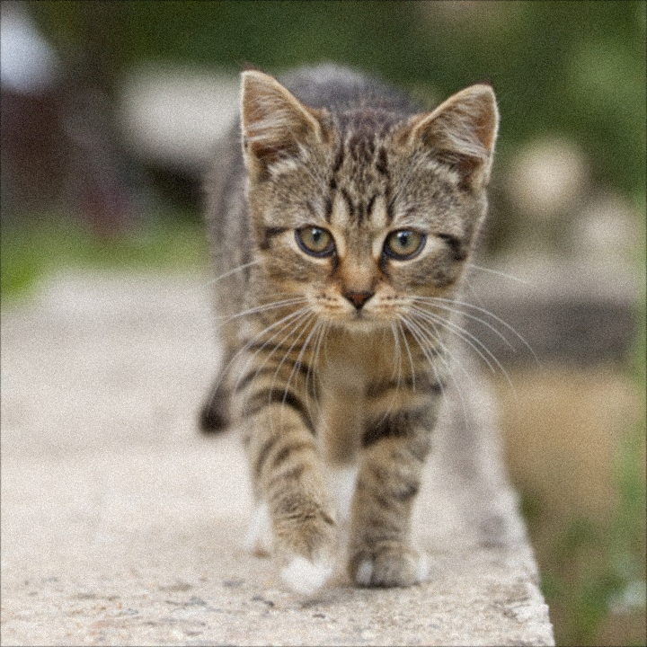
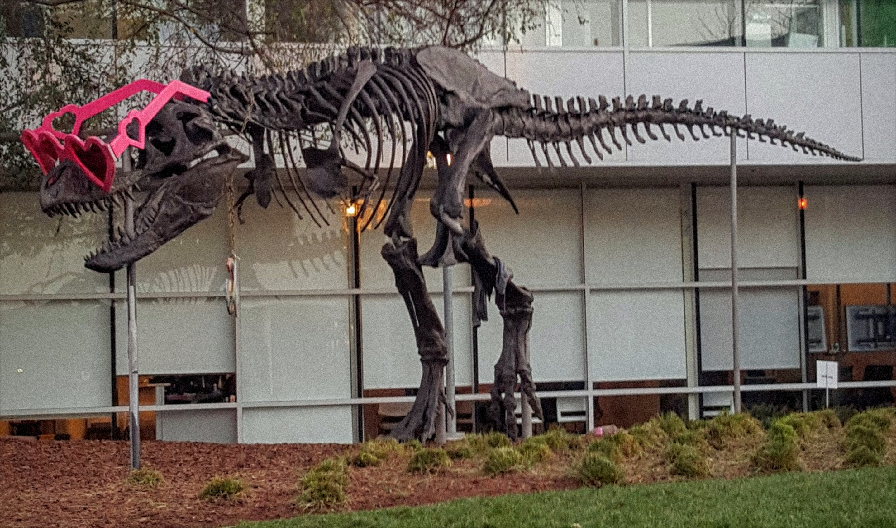

# CUDA CV-CUDA TV miscellaneous demo

This C++/CUDA example follows the CV-CUDA [TV miscellaneous
sample](https://github.com/CVCUDA/CV-CUDA/blob/main/samples/operators/cvcuda_tv_misc.py).
It runs ImageNet normalization into a separate F32 buffer, then applies a 5×5
Gaussian blur and seeded Gaussian noise to the original U8 image. The blur,
normalization and noise operations use CUDA kernels. OpenCV is used only for
image I/O.

The noise standard deviation is `0.03 × 255` in U8 units, corresponding to
the sample's normalized sigma 0.03. The normalization result is generated for
the preprocessing path but, like the source sample, the saved preview is the
blurred and noisy U8 image.

## Build and test

From the repository root, with Bazel, CUDA and OpenCV development libraries:

```bash
bazel build --@rules_cuda//cuda:archs=sm_89 \
  //cv-cuda-pipeline/examples/image_process/cvcuda_tv_misc:tv_misc_demo
bazel test --@rules_cuda//cuda:archs=sm_89 --test_output=errors \
  //cv-cuda-pipeline/calculators/image_process/cuda/tests:gaussian_kernel_test \
  //cv-cuda-pipeline/calculators/image_process/cuda/tests:gaussiannoise_kernel_test \
  //cv-cuda-pipeline/calculators/image_process/cuda/tests:normalize_kernel_test
```

Replace `sm_89` with your GPU architecture. The build uses
[rules_cuda](https://github.com/bazel-contrib/rules_cuda).

## Run

```bash
mkdir -p cv-cuda-pipeline/examples/image_process/cvcuda_tv_misc/perf_asserts
bazel-bin/cv-cuda-pipeline/examples/image_process/cvcuda_tv_misc/tv_misc_demo \
  --input cv-cuda-pipeline/pictures/tabby_tiger_cat.jpg \
  --output cv-cuda-pipeline/examples/image_process/cvcuda_tv_misc/perf_asserts/cvcuda_tv_misc_cat.png
bazel-bin/cv-cuda-pipeline/examples/image_process/cvcuda_tv_misc/tv_misc_demo \
  --input cv-cuda-pipeline/pictures/dino.jpg \
  --output cv-cuda-pipeline/examples/image_process/cvcuda_tv_misc/perf_asserts/cvcuda_tv_misc_dino.png
```

`--input` is required; `--output` defaults to `cvcuda_tv_misc.png`. OpenCV
selects the output format from its extension.

| Input | 5×5 blur and seeded noise |
| --- | --- |
|  |  |
|  |  |

## Nsight Systems performance

On an NVIDIA RTX 500 Ada Generation Laptop GPU, CUDA 13.3 and Nsight Systems
2026.1.3, the summed three-kernel times were:

| Image | Kernel time | Estimated logical bandwidth |
| --- | ---: | ---: |
| Cat, 720 × 720 | 168.600 µs | 304.40 GB/s |
| Dinosaur, 2876 × 1699 | 1.802 ms | 268.39 GB/s |

The estimate counts, per pixel, one three-byte read and one 12-byte F32 write
for normalization, 25 three-byte reads and one three-byte write for blur, and
one three-byte read and write for noise (99 logical bytes total). Border
pixels use fewer blur samples. This is not measured DRAM bandwidth; cached
samples affect actual traffic. Timings exclude CPU work, image I/O and transfers.

To reproduce, use new report names if they already exist:

```bash
mkdir -p build/cvcuda_tv_misc
nsys profile --trace=cuda --sample=none --cpuctxsw=none \
  --output=build/cvcuda_tv_misc/nsys_cat \
  bazel-bin/cv-cuda-pipeline/examples/image_process/cvcuda_tv_misc/tv_misc_demo \
  --input cv-cuda-pipeline/pictures/tabby_tiger_cat.jpg \
  --output build/cvcuda_tv_misc/cat.png
nsys stats --report cuda_gpu_kern_sum --format csv \
  build/cvcuda_tv_misc/nsys_cat.nsys-rep
```
