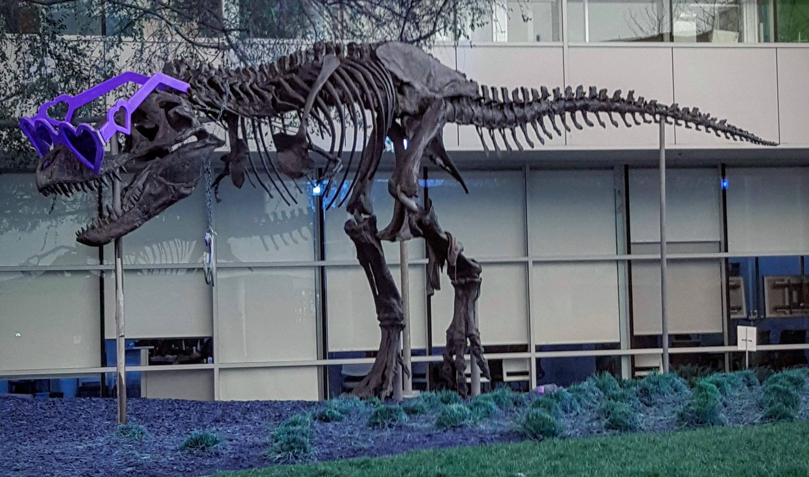

# CUDA RGB/BGR color conversion demo

This C++/CUDA example implements the RGB2BGR channel swap shown in the
[CV-CUDA color conversion sample](https://github.com/CVCUDA/CV-CUDA/blob/main/samples/operators/cvtcolor.py).
The operation preserves the middle channel and exchanges the first and third
channels. OpenCV reads and writes BGR images, so the resulting saved image
appears with red and blue exchanged. Image I/O is handled by OpenCV; channel
conversion runs on the GPU.

The kernel handles interleaved three-channel U8 images only. Other color
conversion codes, formats and batches are not implemented.

## Build and test

From the repository root, with Bazel, CUDA and OpenCV development libraries:

```bash
bazel build --@rules_cuda//cuda:archs=sm_89 \
  //cv-cuda-pipeline/examples/image_process/cvtcolor:cvtcolor_demo
bazel test --@rules_cuda//cuda:archs=sm_89 --test_output=errors \
  //cv-cuda-pipeline/calculators/image_process/cuda/tests:cvtcolor_kernel_test
```

Replace `sm_89` with your GPU architecture. The build uses
[rules_cuda](https://github.com/bazel-contrib/rules_cuda). Tests check exact
channel values, padded row strides, image boundaries and invalid arguments.

## Run

```bash
mkdir -p cv-cuda-pipeline/examples/image_process/cvtcolor/perf_asserts
bazel-bin/cv-cuda-pipeline/examples/image_process/cvtcolor/cvtcolor_demo \
  --input cv-cuda-pipeline/pictures/tabby_tiger_cat.jpg \
  --output cv-cuda-pipeline/examples/image_process/cvtcolor/perf_asserts/cvtcolor_cat.png
bazel-bin/cv-cuda-pipeline/examples/image_process/cvtcolor/cvtcolor_demo \
  --input cv-cuda-pipeline/pictures/dino.jpg \
  --output cv-cuda-pipeline/examples/image_process/cvtcolor/perf_asserts/cvtcolor_dino.png
```

`--input` is required; `--output` defaults to `cat_cvtcolor.png`. OpenCV
selects the output format from its extension.

| Input | Output |
| --- | --- |
|  |  |
|  |  |

The kernel API accepts non-overlapping interleaved three-channel U8 device
buffers, byte row strides, image dimensions and an optional CUDA stream. Keep
the buffers valid until stream completion and check synchronization errors.

## Nsight Systems performance

On an NVIDIA RTX 500 Ada Generation Laptop GPU, CUDA 13.3 and Nsight Systems
2026.1.3, the default Bazel build produced these single-launch results:

| Image | Kernel latency | Estimated logical bandwidth |
| --- | ---: | ---: |
| Cat, 720 × 720 | 16.945 µs | 183.56 GB/s |
| Dinosaur, 2876 × 1699 | 232.018 µs | 126.36 GB/s |

Bandwidth counts one three-byte read and one three-byte write per pixel,
divided by kernel time. This is a logical estimate, not measured DRAM
bandwidth; caching and transaction sizes affect physical traffic. Single
launch timings are not a steady-state benchmark and exclude CPU work, image
I/O and transfers.

To reproduce, use new report names if they already exist:

```bash
mkdir -p build/cvtcolor
nsys profile --trace=cuda --sample=none --cpuctxsw=none \
  --output=build/cvtcolor/nsys_cat \
  bazel-bin/cv-cuda-pipeline/examples/image_process/cvtcolor/cvtcolor_demo \
  --input cv-cuda-pipeline/pictures/tabby_tiger_cat.jpg \
  --output build/cvtcolor/cat.png
nsys stats --report cuda_gpu_kern_sum --format csv build/cvtcolor/nsys_cat.nsys-rep
nsys profile --trace=cuda --sample=none --cpuctxsw=none \
  --output=build/cvtcolor/nsys_dinosaur \
  bazel-bin/cv-cuda-pipeline/examples/image_process/cvtcolor/cvtcolor_demo \
  --input cv-cuda-pipeline/pictures/dino.jpg \
  --output build/cvtcolor/dinosaur.png
nsys stats --report cuda_gpu_kern_sum --format csv build/cvtcolor/nsys_dinosaur.nsys-rep
```
