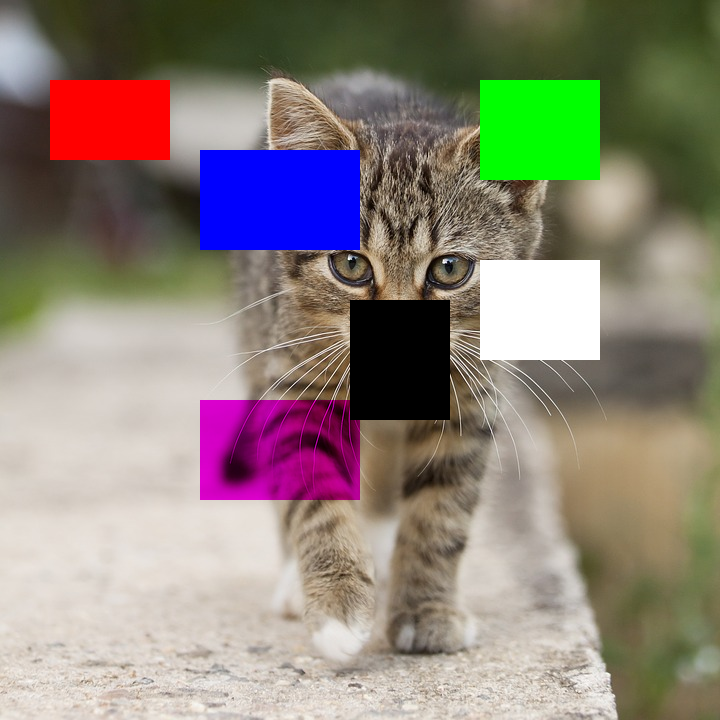
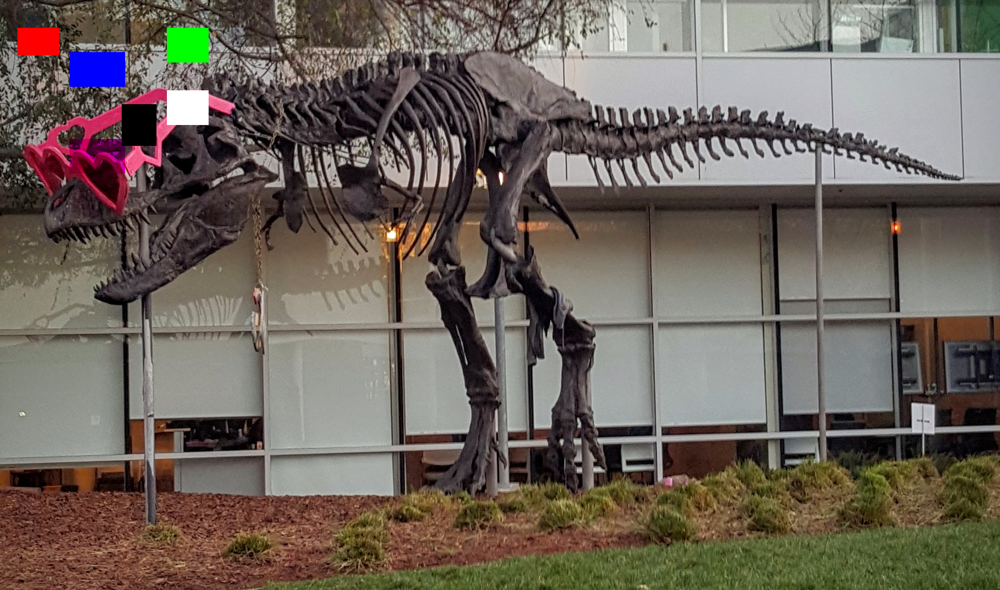

# CUDA erase demo

This C++/CUDA example reproduces the six fixed rectangles in the
[CV-CUDA erase sample](https://github.com/CVCUDA/CV-CUDA/blob/main/samples/operators/erase.py)
for one RGB8 image. OpenCV reads and writes BGR8 images, so the kernel maps
the sample's RGB channels to BGR buffer order. Rectangles are clipped to the
image; the last rectangle modifies only the green channel.

The upstream sample provides four values per rectangle, but its CUDA tensor
kernel indexes those values with a stride of **three** for a three-channel
image. Consequently, its actual fill colors differ from the sample comments.
This example follows the kernel's indexing: the five solid areas are red,
blue, black, green and white; the green-only area sets green to zero.
This fixed example does not implement arbitrary areas, random fills or batches.

## Build and test

From the repository root, with Bazel, CUDA and OpenCV development libraries:

```bash
bazel build --@rules_cuda//cuda:archs=sm_89 \
  //cv-cuda-pipeline/examples/image_process/erase:erase_demo
bazel test --@rules_cuda//cuda:archs=sm_89 --test_output=errors \
  //cv-cuda-pipeline/calculators/image_process/cuda/tests:erase_kernel_test
```

Replace `sm_89` with your GPU architecture. The build uses
[rules_cuda](https://github.com/bazel-contrib/rules_cuda).

## Run

```bash
mkdir -p cv-cuda-pipeline/examples/image_process/erase/perf_asserts
bazel-bin/cv-cuda-pipeline/examples/image_process/erase/erase_demo \
  --input cv-cuda-pipeline/pictures/tabby_tiger_cat.jpg \
  --output cv-cuda-pipeline/examples/image_process/erase/perf_asserts/erase_cat.png
bazel-bin/cv-cuda-pipeline/examples/image_process/erase/erase_demo \
  --input cv-cuda-pipeline/pictures/dino.jpg \
  --output cv-cuda-pipeline/examples/image_process/erase/perf_asserts/erase_dino.png
```

`--input` is required; `--output` defaults to `cat_erase.png`. OpenCV selects
the output format from its extension.

| Input | Output |
| --- | --- |
|  |  |
|  |  |

The kernel API accepts non-overlapping interleaved BGR8 device buffers, byte
row strides, image dimensions, and an optional CUDA stream. Keep the buffers
valid until stream completion and check synchronization errors.

## Nsight Systems performance

On an NVIDIA RTX 500 Ada Generation Laptop GPU, CUDA 13.3 and Nsight Systems
2026.1.3, the default Bazel build produced these single-launch results:

| Image | Kernel latency | Nominal logical bandwidth |
| --- | ---: | ---: |
| Cat, 720 × 720 | 23.753 µs | 130.95 GB/s |
| Dinosaur, 2876 × 1699 | 242.454 µs | 120.92 GB/s |

The nominal estimate counts one three-byte read and one three-byte write per
pixel, divided by kernel time. Actual reads can be reduced for overwritten
channels; caching and transaction sizes also affect traffic. This is not
measured DRAM bandwidth. Single-launch timings are not a steady-state
benchmark and exclude CPU work, image I/O and transfers.

To reproduce, use new report names if they already exist:

```bash
mkdir -p build/erase
nsys profile --trace=cuda --sample=none --cpuctxsw=none \
  --output=build/erase/nsys_cat \
  bazel-bin/cv-cuda-pipeline/examples/image_process/erase/erase_demo \
  --input cv-cuda-pipeline/pictures/tabby_tiger_cat.jpg \
  --output build/erase/cat.png
nsys stats --report cuda_gpu_kern_sum --format csv build/erase/nsys_cat.nsys-rep
nsys profile --trace=cuda --sample=none --cpuctxsw=none \
  --output=build/erase/nsys_dinosaur \
  bazel-bin/cv-cuda-pipeline/examples/image_process/erase/erase_demo \
  --input cv-cuda-pipeline/pictures/dino.jpg \
  --output build/erase/dinosaur.png
nsys stats --report cuda_gpu_kern_sum --format csv build/erase/nsys_dinosaur.nsys-rep
```
