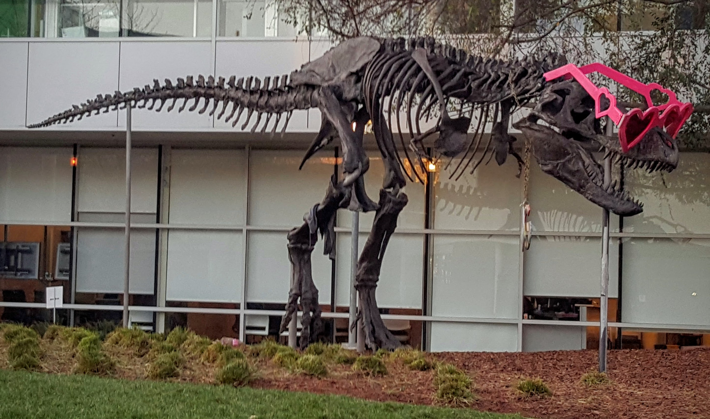

# CUDA flip demo

This C++/CUDA example flips a three-channel image on the GPU. OpenCV reads and
writes the image; no Python runtime is required. The default is horizontal
flipping, matching the sample.

From the repository root, build and test with Bazel and a compatible GPU:

```bash
bazel build --@rules_cuda//cuda:archs=sm_89 \
  //cv-cuda-pipeline/examples/image_process/flip:flip_demo
bazel test --@rules_cuda//cuda:archs=sm_89 --test_output=errors \
  //cv-cuda-pipeline/calculators/image_process/cuda/tests:flip_kernel_test
mkdir -p cv-cuda-pipeline/examples/image_process/flip/perf_asserts
bazel-bin/cv-cuda-pipeline/examples/image_process/flip/flip_demo \
  --input cv-cuda-pipeline/pictures/tabby_tiger_cat.jpg \
  --output cv-cuda-pipeline/examples/image_process/flip/perf_asserts/flip_cat.png
bazel-bin/cv-cuda-pipeline/examples/image_process/flip/flip_demo \
  --input cv-cuda-pipeline/pictures/dino.jpg \
  --output cv-cuda-pipeline/examples/image_process/flip/perf_asserts/flip_dino.png
```

Replace `sm_89` with the architecture of your GPU. `--input` is required;
`--output` defaults to `cat_flip.png`. `--code 1`, `0`, and `-1` select
horizontal, vertical, and both axes, respectively.

| Input | Output |
| --- | --- |
|  |  |
|  |  |

The kernel accepts non-overlapping RGB8 device buffers with byte row strides and
an optional CUDA stream. The caller must keep both buffers alive and synchronize
the stream to detect asynchronous errors.

## Nsight Systems performance

On an NVIDIA RTX 500 Ada Generation Laptop GPU, using CUDA 13.3 and Nsight
Systems 2026.1.3 and the default Bazel build, one horizontal flip kernel launch
per image produced:

| Image | Kernel latency | Estimated effective bandwidth |
| --- | ---: | ---: |
| Cat, 720 × 720 | 17.297 µs | 179.82 GB/s |
| Dinosaur, 2876 × 1699 | 229.414 µs | 127.79 GB/s |

The estimated logical bandwidth is calculated as `width × height × 6 bytes`
divided by kernel time for one three-byte read and one three-byte write per
pixel. This is not a hardware DRAM bandwidth
measurement; GPU performance counters were unavailable due to
`ERR_NVGPUCTRPERM`. A single launch is not a steady-state benchmark and
excludes transfers and image I/O.

To collect a trace after building:

```bash
mkdir -p build/flip cv-cuda-pipeline/examples/image_process/flip/perf_asserts
nsys profile --trace=cuda --sample=none --cpuctxsw=none \
  --output=build/flip/nsys_cat \
  bazel-bin/cv-cuda-pipeline/examples/image_process/flip/flip_demo \
  --input cv-cuda-pipeline/pictures/tabby_tiger_cat.jpg \
  --output cv-cuda-pipeline/examples/image_process/flip/perf_asserts/profile_flip_cat.png
nsys stats --report cuda_gpu_kern_sum --format csv build/flip/nsys_cat.nsys-rep
nsys profile --trace=cuda --sample=none --cpuctxsw=none \
  --output=build/flip/nsys_dinosaur \
  bazel-bin/cv-cuda-pipeline/examples/image_process/flip/flip_demo \
  --input cv-cuda-pipeline/pictures/dino.jpg \
  --output cv-cuda-pipeline/examples/image_process/flip/perf_asserts/profile_nsys_dinosaur.png
nsys stats --report cuda_gpu_kern_sum --format csv build/flip/nsys_dinosaur.nsys-rep
```

Use new report names if the files already exist.
