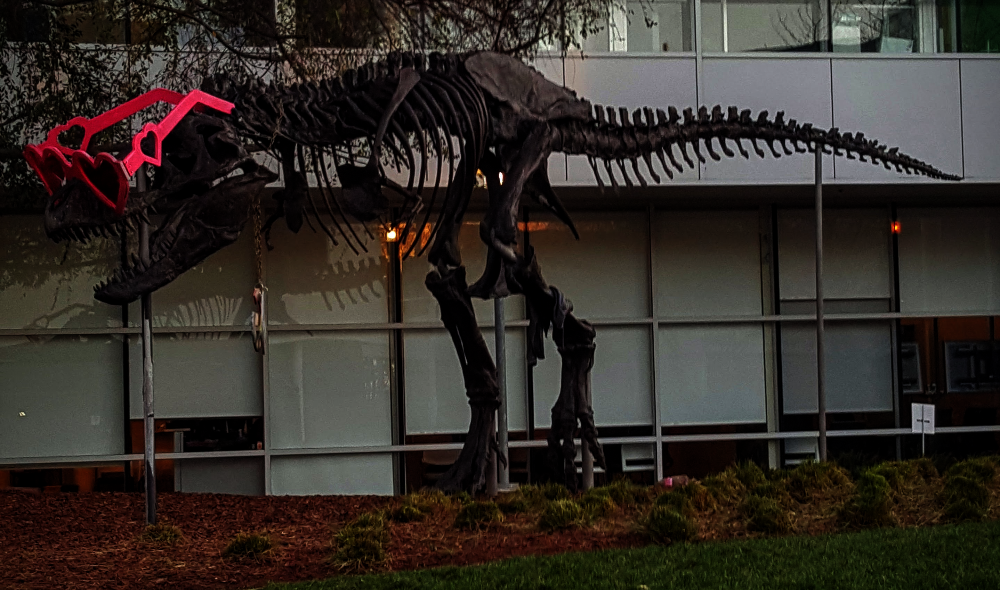

# CUDA gamma contrast demo

This C++/CUDA example reproduces the single-image U8 case of the
[CV-CUDA gamma contrast sample](https://github.com/CVCUDA/CV-CUDA/blob/main/samples/operators/gamma_contrast.py).
Each channel is independently mapped to `round(255 * (pixel / 255)^2.2)`
with saturation and nearest-even rounding. OpenCV is used only for image I/O.
This example does not implement the upstream operator's other image types,
variable gamma values, or batch interface.

## Build and test

From the repository root, with Bazel, CUDA and OpenCV development libraries:

```bash
bazel build --@rules_cuda//cuda:archs=sm_89 \
  //cv-cuda-pipeline/examples/image_process/gamma_contrast:gamma_contrast_demo
bazel test --@rules_cuda//cuda:archs=sm_89 --test_output=errors \
  //cv-cuda-pipeline/calculators/image_process/cuda/tests:gamma_contrast_kernel_test
```

Replace `sm_89` with your GPU architecture. The build uses
[rules_cuda](https://github.com/bazel-contrib/rules_cuda).

## Run

```bash
mkdir -p cv-cuda-pipeline/examples/image_process/gamma_contrast/perf_asserts
bazel-bin/cv-cuda-pipeline/examples/image_process/gamma_contrast/gamma_contrast_demo \
  --input cv-cuda-pipeline/pictures/tabby_tiger_cat.jpg \
  --output cv-cuda-pipeline/examples/image_process/gamma_contrast/perf_asserts/gamma_cat.png
bazel-bin/cv-cuda-pipeline/examples/image_process/gamma_contrast/gamma_contrast_demo \
  --input cv-cuda-pipeline/pictures/dino.jpg \
  --output cv-cuda-pipeline/examples/image_process/gamma_contrast/perf_asserts/gamma_dino.png
```

`--input` is required; `--output` defaults to `cat_gamma_contrast.png`.
OpenCV selects the output format from its extension.

| Input | Output |
| --- | --- |
|  |  |
|  |  |

The kernel API accepts non-overlapping interleaved RGB8 or BGR8 input and
output device buffers, byte row strides, image dimensions, and an optional
CUDA stream. Keep the buffers valid until stream completion and check
synchronization errors.

## Nsight Systems performance

On an NVIDIA RTX 500 Ada Generation Laptop GPU, CUDA 13.3 and Nsight Systems
2026.1.3, the default Bazel build produced these single-launch results:

| Image | Kernel latency | Estimated logical bandwidth |
| --- | ---: | ---: |
| Cat, 720 × 720 | 45.996 µs | 67.62 GB/s |
| Dinosaur, 2876 × 1699 | 440.755 µs | 66.52 GB/s |

The estimate counts one three-byte read and one three-byte write per pixel,
divided by kernel time. It is not measured DRAM bandwidth; caching and
transaction sizes affect actual traffic. Single-launch timings are not a
steady-state benchmark and exclude CPU work, image I/O and transfers.

To reproduce, use new report names if they already exist:

```bash
mkdir -p build/gamma_contrast
nsys profile --trace=cuda --sample=none --cpuctxsw=none \
  --output=build/gamma_contrast/nsys_cat \
  bazel-bin/cv-cuda-pipeline/examples/image_process/gamma_contrast/gamma_contrast_demo \
  --input cv-cuda-pipeline/pictures/tabby_tiger_cat.jpg \
  --output build/gamma_contrast/cat.png
nsys stats --report cuda_gpu_kern_sum --format csv build/gamma_contrast/nsys_cat.nsys-rep
nsys profile --trace=cuda --sample=none --cpuctxsw=none \
  --output=build/gamma_contrast/nsys_dinosaur \
  bazel-bin/cv-cuda-pipeline/examples/image_process/gamma_contrast/gamma_contrast_demo \
  --input cv-cuda-pipeline/pictures/dino.jpg \
  --output build/gamma_contrast/dinosaur.png
nsys stats --report cuda_gpu_kern_sum --format csv build/gamma_contrast/nsys_dinosaur.nsys-rep
```
