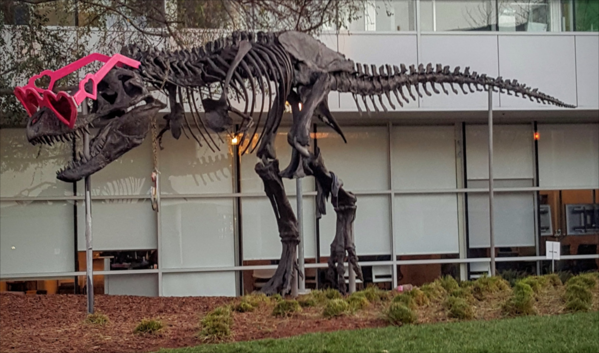

# CUDA Gaussian blur demo

This C++/CUDA example implements the single-image U8 case of the
[CV-CUDA Gaussian sample](https://github.com/CVCUDA/CV-CUDA/blob/main/samples/operators/gaussian.py):
a 9 × 9 Gaussian window with sigma 1.5 in both directions. The sample's
default border is constant zero, not OpenCV's default reflected border.
OpenCV is used for image I/O; filtering runs on the GPU.

The kernel uses normalized separable weights in a direct 2D convolution and
rounds to the nearest U8 value. Its floating-point operation order differs
from CV-CUDA's implementation, so bit-exact equality is not guaranteed.
The tests compare against a floating-point OpenCV reference with absolute
error at most 0.501 intensity units, including small images and borders.
Other kernel sizes, types and batches are not implemented.

## Build and test

From the repository root, with Bazel, CUDA and OpenCV development libraries:

```bash
bazel build --@rules_cuda//cuda:archs=sm_89 \
  //cv-cuda-pipeline/examples/image_process/gaussian:gaussian_demo
bazel test --@rules_cuda//cuda:archs=sm_89 --test_output=errors \
  //cv-cuda-pipeline/calculators/image_process/cuda/tests:gaussian_kernel_test
```

Replace `sm_89` with your GPU architecture. The build uses
[rules_cuda](https://github.com/bazel-contrib/rules_cuda).

## Run

```bash
mkdir -p cv-cuda-pipeline/examples/image_process/gaussian/perf_asserts
bazel-bin/cv-cuda-pipeline/examples/image_process/gaussian/gaussian_demo \
  --input cv-cuda-pipeline/pictures/tabby_tiger_cat.jpg \
  --output cv-cuda-pipeline/examples/image_process/gaussian/perf_asserts/gaussian_cat.png
bazel-bin/cv-cuda-pipeline/examples/image_process/gaussian/gaussian_demo \
  --input cv-cuda-pipeline/pictures/dino.jpg \
  --output cv-cuda-pipeline/examples/image_process/gaussian/perf_asserts/gaussian_dino.png
```

`--input` is required; `--output` defaults to `cat_blurred.png`. OpenCV
selects the output format from its extension.

| Input | Output |
| --- | --- |
|  |  |
|  |  |

The kernel accepts non-overlapping interleaved RGB8 or BGR8 device buffers,
byte row strides, image dimensions, and an optional CUDA stream. Keep the
buffers valid until stream completion and check synchronization errors.

## Nsight Systems performance

On an NVIDIA RTX 500 Ada Generation Laptop GPU, CUDA 13.3 and Nsight Systems
2026.1.3, the default Bazel build produced these single-launch results:

| Image | Kernel latency | Effective image bandwidth |
| --- | ---: | ---: |
| Cat, 720 × 720 | 235.648 µs | 13.20 GB/s |
| Dinosaur, 2876 × 1699 | 2200.712 µs | 13.32 GB/s |

The bandwidth is calculated as one three-byte input image plus one three-byte
output image divided by kernel time. The direct convolution performs multiple
logical input reads per pixel; caching and transactions affect physical traffic.
This is not measured DRAM bandwidth. Single-launch timings are not a
steady-state benchmark and exclude CPU work, image I/O and transfers.

To reproduce, use new report names if they already exist:

```bash
mkdir -p build/gaussian
nsys profile --trace=cuda --sample=none --cpuctxsw=none \
  --output=build/gaussian/nsys_cat \
  bazel-bin/cv-cuda-pipeline/examples/image_process/gaussian/gaussian_demo \
  --input cv-cuda-pipeline/pictures/tabby_tiger_cat.jpg \
  --output build/gaussian/cat.png
nsys stats --report cuda_gpu_kern_sum --format csv build/gaussian/nsys_cat.nsys-rep
nsys profile --trace=cuda --sample=none --cpuctxsw=none \
  --output=build/gaussian/nsys_dinosaur \
  bazel-bin/cv-cuda-pipeline/examples/image_process/gaussian/gaussian_demo \
  --input cv-cuda-pipeline/pictures/dino.jpg \
  --output build/gaussian/dinosaur.png
nsys stats --report cuda_gpu_kern_sum --format csv build/gaussian/nsys_dinosaur.nsys-rep
```
