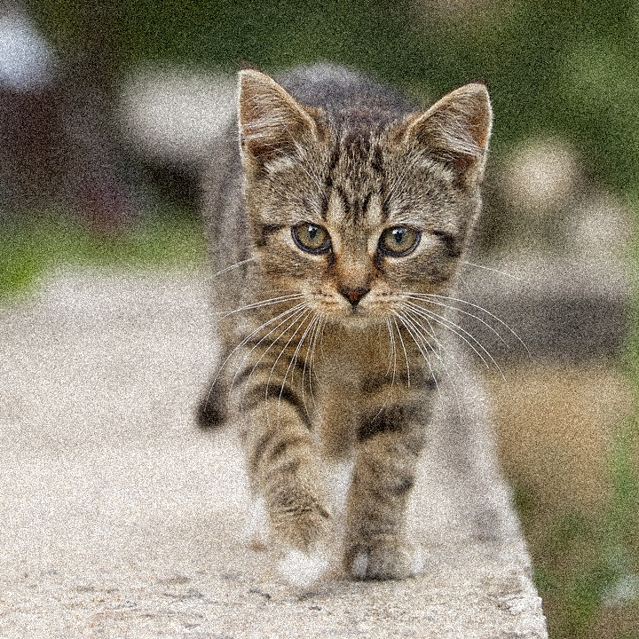
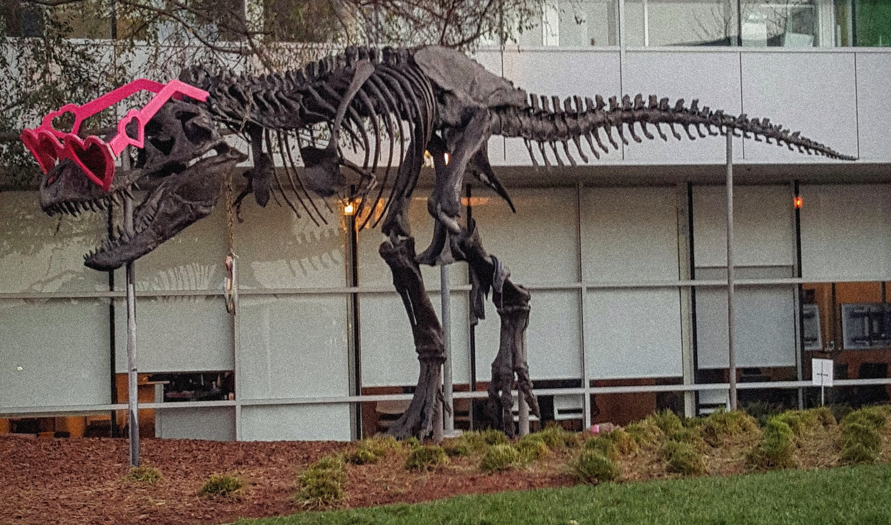

# CUDA Gaussian noise demo

This C++/CUDA example follows the CV-CUDA [Gaussian noise
sample](https://github.com/CVCUDA/CV-CUDA/blob/main/samples/operators/gaussiannoise.py):
it adds zero-mean Gaussian noise with standard deviation 25 to an interleaved
BGR U8 image. One random sample is shared by all three color channels of each
pixel, and the result is clamped to the U8 range. The fixed seed makes each
run reproducible. OpenCV is used only for image I/O.

The kernel also accepts one- and four-channel interleaved U8 images. Its
deterministic counter-based random sequence is local to this implementation;
it reproduces the operator's noise parameters and per-channel behavior, but
is not bit-for-bit equivalent to CV-CUDA's random-number stream.

## Build and test

From the repository root, with Bazel, CUDA and OpenCV development libraries:

```bash
bazel build --@rules_cuda//cuda:archs=sm_89 \
  //cv-cuda-pipeline/examples/image_process/gaussiannoise:gaussiannoise_demo
bazel test --@rules_cuda//cuda:archs=sm_89 --test_output=errors \
  //cv-cuda-pipeline/calculators/image_process/cuda/tests:gaussiannoise_kernel_test
```

Replace `sm_89` with your GPU architecture. The build uses
[rules_cuda](https://github.com/bazel-contrib/rules_cuda).

## Run

```bash
mkdir -p cv-cuda-pipeline/examples/image_process/gaussiannoise/perf_asserts
bazel-bin/cv-cuda-pipeline/examples/image_process/gaussiannoise/gaussiannoise_demo \
  --input cv-cuda-pipeline/pictures/tabby_tiger_cat.jpg \
  --output cv-cuda-pipeline/examples/image_process/gaussiannoise/perf_asserts/gaussiannoise_cat.png
bazel-bin/cv-cuda-pipeline/examples/image_process/gaussiannoise/gaussiannoise_demo \
  --input cv-cuda-pipeline/pictures/dino.jpg \
  --output cv-cuda-pipeline/examples/image_process/gaussiannoise/perf_asserts/gaussiannoise_dino.png
```

`--input` is required; `--output` defaults to `gaussiannoise.png`. OpenCV
selects the output format from its extension.

| Input | Gaussian noise output |
| --- | --- |
|  |  |
|  |  |

## Nsight Systems performance

On an NVIDIA RTX 500 Ada Generation Laptop GPU, CUDA 13.3 and Nsight Systems
2026.1.3, the measured kernel times were:

| Image | Kernel time | Estimated logical bandwidth |
| --- | ---: | ---: |
| Cat, 720 × 720 | 37.004 µs | 84.06 GB/s |
| Dinosaur, 2876 × 1699 | 332.105 µs | 88.28 GB/s |

The bandwidth estimate counts three input bytes and three output bytes per
pixel, divided by kernel duration. It excludes random-number math and is not
measured DRAM bandwidth; caching affects actual traffic. Kernel timing excludes
CPU work, image I/O and transfers and represents a single profiled launch.

To reproduce, use new report names if they already exist:

```bash
mkdir -p build/gaussiannoise
nsys profile --trace=cuda --sample=none --cpuctxsw=none \
  --output=build/gaussiannoise/nsys_cat \
  bazel-bin/cv-cuda-pipeline/examples/image_process/gaussiannoise/gaussiannoise_demo \
  --input cv-cuda-pipeline/pictures/tabby_tiger_cat.jpg \
  --output build/gaussiannoise/cat.png
nsys stats --report cuda_gpu_kern_sum --format csv build/gaussiannoise/nsys_cat.nsys-rep
nsys profile --trace=cuda --sample=none --cpuctxsw=none \
  --output=build/gaussiannoise/nsys_dinosaur \
  bazel-bin/cv-cuda-pipeline/examples/image_process/gaussiannoise/gaussiannoise_demo \
  --input cv-cuda-pipeline/pictures/dino.jpg \
  --output build/gaussiannoise/dinosaur.png
nsys stats --report cuda_gpu_kern_sum --format csv build/gaussiannoise/nsys_dinosaur.nsys-rep
```
