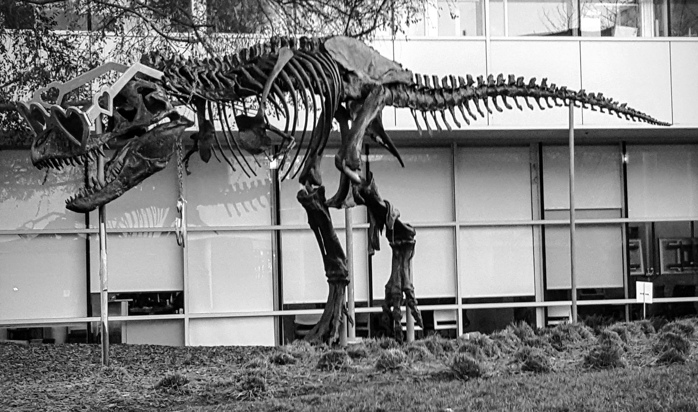

# CUDA histogram equalization demo

This C++/CUDA example follows the CV-CUDA [histogram equalization
sample](https://github.com/CVCUDA/CV-CUDA/blob/main/samples/operators/histogrameq.py).
It converts the input BGR image to grayscale, equalizes the U8 intensity
histogram on the GPU, then replicates the equalized channel to BGR for viewing.
OpenCV performs image I/O and the grayscale/color conversions; histogram
construction, lookup-table generation and application are CUDA kernels.

The kernel uses 256 histogram counters and a 256-entry lookup table supplied
by the caller as device scratch buffers. Both buffers must remain valid until
the CUDA stream has completed.

## Build and test

From the repository root, with Bazel, CUDA and OpenCV development libraries:

```bash
bazel build --@rules_cuda//cuda:archs=sm_89 \
  //cv-cuda-pipeline/examples/image_process/histogrameq:histogrameq_demo
bazel test --@rules_cuda//cuda:archs=sm_89 --test_output=errors \
  //cv-cuda-pipeline/calculators/image_process/cuda/tests:histogrameq_kernel_test
```

Replace `sm_89` with your GPU architecture. The build uses
[rules_cuda](https://github.com/bazel-contrib/rules_cuda).

## Run

```bash
mkdir -p cv-cuda-pipeline/examples/image_process/histogrameq/perf_asserts
bazel-bin/cv-cuda-pipeline/examples/image_process/histogrameq/histogrameq_demo \
  --input cv-cuda-pipeline/pictures/tabby_tiger_cat.jpg \
  --output cv-cuda-pipeline/examples/image_process/histogrameq/perf_asserts/histogrameq_cat.png
bazel-bin/cv-cuda-pipeline/examples/image_process/histogrameq/histogrameq_demo \
  --input cv-cuda-pipeline/pictures/dino.jpg \
  --output cv-cuda-pipeline/examples/image_process/histogrameq/perf_asserts/histogrameq_dino.png
```

`--input` is required; `--output` defaults to `histogrameq.png`. OpenCV
selects the output format from its extension.

| Input | Equalized grayscale replicated to BGR |
| --- | --- |
|  |  |
|  |  |

## Nsight Systems performance

On an NVIDIA RTX 500 Ada Generation Laptop GPU, CUDA 13.3 and Nsight Systems
2026.1.3, the summed histogram, lookup-table and apply kernel times were:

| Image | Three-kernel time | Estimated logical bandwidth |
| --- | ---: | ---: |
| Cat, 720 × 720 | 149.913 µs | 6.92 GB/s |
| Dinosaur, 2876 × 1699 | 1.252 ms | 7.81 GB/s |

The bandwidth estimate counts one grayscale byte read and one byte written
per pixel, divided by the summed kernel durations. It excludes histogram
atomic operations and lookup-table scratch traffic; it is logical traffic,
not measured DRAM bandwidth. The timings exclude CPU color conversion, image
I/O and transfers.

To reproduce, use new report names if they already exist:

```bash
mkdir -p build/histogrameq
nsys profile --trace=cuda --sample=none --cpuctxsw=none \
  --output=build/histogrameq/nsys_cat \
  bazel-bin/cv-cuda-pipeline/examples/image_process/histogrameq/histogrameq_demo \
  --input cv-cuda-pipeline/pictures/tabby_tiger_cat.jpg \
  --output build/histogrameq/cat.png
nsys stats --report cuda_gpu_kern_sum --format csv build/histogrameq/nsys_cat.nsys-rep
```
