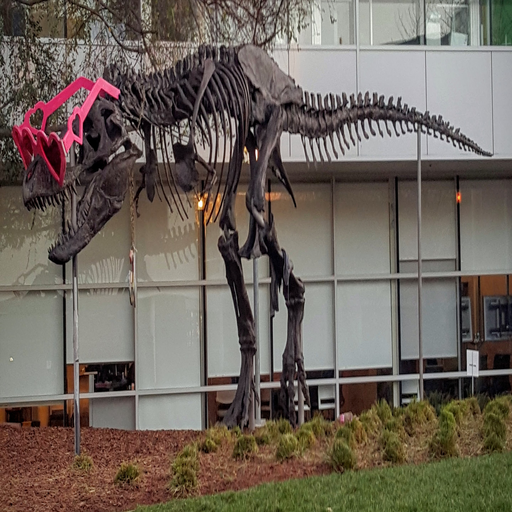

# HQ resize demo

This C++/CUDA example follows the CV-CUDA
[HQ resize sample](https://github.com/CVCUDA/CV-CUDA/blob/main/samples/operators/hq_resize.py).
It uses separable, antialiased Lanczos-3 filtering when an axis is downscaled
and linear filtering when that axis is upscaled. The sample's interpolation
choices and image output are reproduced with a project CUDA kernel; border and
rounding details may differ from CV-CUDA.

## Build and run

From the repository root:

```bash
bazel build --@rules_cuda//cuda:archs=sm_89 \
  //cv-cuda-pipeline/examples/image_process/hq_resize:hq_resize_demo
bazel test --@rules_cuda//cuda:archs=sm_89 --test_output=errors \
  //cv-cuda-pipeline/calculators/image_process/cuda/tests:quality_resize_kernel_test
mkdir -p cv-cuda-pipeline/examples/image_process/hq_resize/perf_asserts
bazel-bin/cv-cuda-pipeline/examples/image_process/hq_resize/hq_resize_demo \
  --input cv-cuda-pipeline/pictures/tabby_tiger_cat.jpg \
  --output cv-cuda-pipeline/examples/image_process/hq_resize/perf_asserts/hq_resize_cat.png
bazel-bin/cv-cuda-pipeline/examples/image_process/hq_resize/hq_resize_demo \
  --input cv-cuda-pipeline/pictures/dino.jpg \
  --output cv-cuda-pipeline/examples/image_process/hq_resize/perf_asserts/hq_resize_dino.png
```

`--input` is required; `--output` defaults to `cat_hq_resize.jpg`. The output
dimensions default to 512 × 512 and can be set with `--width` and `--height`.
Replace `sm_89` with your GPU architecture.

| Input | HQ resize output |
| --- | --- |
|  |  |
|  |  |

## Nsight Systems performance

Measured on an NVIDIA RTX 500 Ada Generation Laptop GPU with CUDA 13.3 and
Nsight Systems 2026.1.3. Each measurement is one invocation at 512 × 512:

| Image | Horizontal kernel | Vertical kernel | Total |
| --- | ---: | ---: | ---: |
| Cat, 720 × 720 | 123.669 µs | 83.854 µs | 207.523 µs |
| Dinosaur, 2876 × 1699 | 985.942 µs | 189.354 µs | 1.175 ms |

The totals sum GPU kernel durations reported by Nsight Systems; they exclude
image I/O, host-device transfers, and launch overhead. Reproduce with:

```bash
mkdir -p build/hq_resize
nsys profile --trace=cuda --sample=none --cpuctxsw=none \
  --output=build/hq_resize/nsys_cat \
  bazel-bin/cv-cuda-pipeline/examples/image_process/hq_resize/hq_resize_demo \
  --input cv-cuda-pipeline/pictures/tabby_tiger_cat.jpg \
  --output build/hq_resize/cat.png
nsys stats --report cuda_gpu_kern_sum --format csv \
  build/hq_resize/nsys_cat.nsys-rep
```
