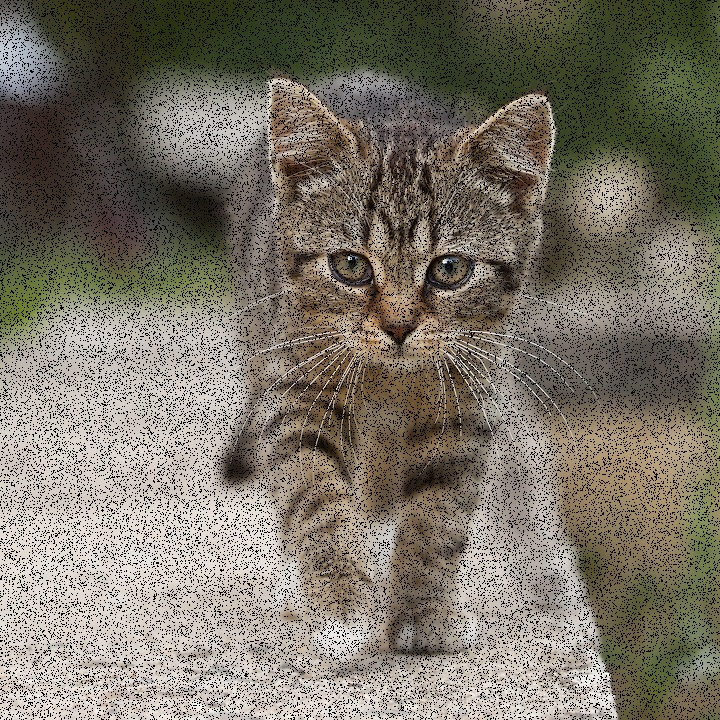
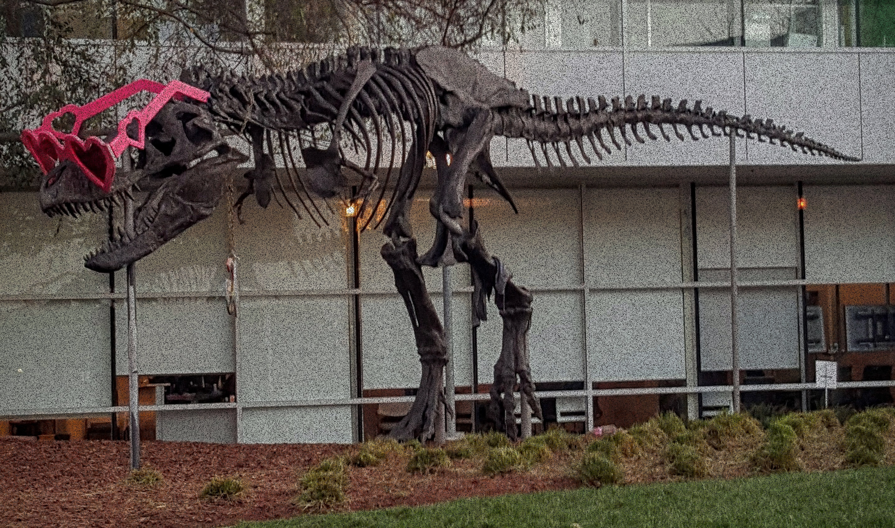
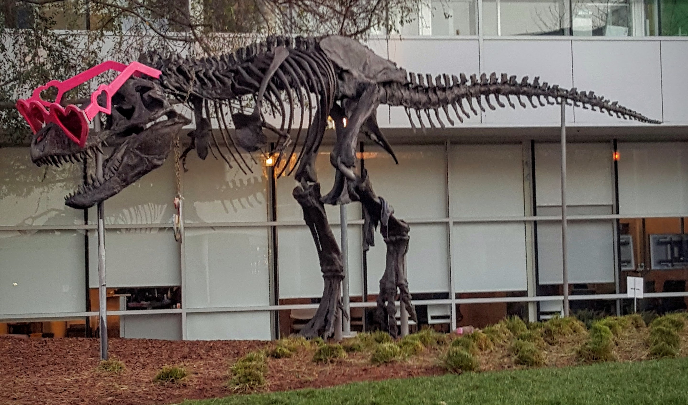

# Inpaint demo

This C++ example follows the CV-CUDA
[inpaint sample](https://github.com/CVCUDA/CV-CUDA/blob/main/samples/operators/inpaint.py):
it generates a deterministic 15% salt-and-pepper mask and writes a damaged
preview. The CUDA kernel copies unmasked pixels exactly and reconstructs each
masked pixel with inverse-distance-weighted averaging over unmasked pixels in
a 9 × 9 neighborhood. This is a lightweight GPU implementation rather than an
exact reproduction of CV-CUDA's `inpaintRadius=15` algorithm. The random-number
sequence and reconstructed values may differ from CV-CUDA.

## Build and run

From the repository root:

```bash
bazel build --@rules_cuda//cuda:archs=sm_89 \
  //cv-cuda-pipeline/examples/image_process/inpaint:inpaint_demo
bazel test --@rules_cuda//cuda:archs=sm_89 --test_output=errors \
  //cv-cuda-pipeline/calculators/image_process/cuda/tests:inpaint_kernel_test
mkdir -p cv-cuda-pipeline/examples/image_process/inpaint/perf_asserts
bazel-bin/cv-cuda-pipeline/examples/image_process/inpaint/inpaint_demo \
  --input cv-cuda-pipeline/pictures/tabby_tiger_cat.jpg \
  --output cv-cuda-pipeline/examples/image_process/inpaint/perf_asserts/inpaint_cat.jpg
bazel-bin/cv-cuda-pipeline/examples/image_process/inpaint/inpaint_demo \
  --input cv-cuda-pipeline/pictures/dino.jpg \
  --output cv-cuda-pipeline/examples/image_process/inpaint/perf_asserts/inpaint_dino.jpg
```

`--input` is required; `--output` defaults to `cat_inpaint.jpg`. A second
`*_damaged.jpg` image is written beside each requested output. Replace `sm_89`
with your GPU architecture.

| Input | Damaged preview | CUDA local reconstruction |
| --- | --- | --- |
|  |  |  |
|  |  |  |

The program reports the CUDA kernel time separately from image I/O, mask
generation, and host-device transfers.

## Nsight Systems performance

Measured on an NVIDIA RTX 500 Ada Generation Laptop GPU with CUDA 13.3 and
Nsight Systems 2026.1.3:

| Image | Kernel time |
| --- | ---: |
| Cat, 720 × 720 | 387.257 µs |
| Dinosaur, 2876 × 1699 | 3.619 ms |

These are GPU kernel durations; they exclude mask generation, transfers and
image I/O. Reproduce with:

```bash
mkdir -p build/inpaint
nsys profile --trace=cuda --sample=none --cpuctxsw=none \
  --output=build/inpaint/nsys_cat \
  bazel-bin/cv-cuda-pipeline/examples/image_process/inpaint/inpaint_demo \
  --input cv-cuda-pipeline/pictures/tabby_tiger_cat.jpg \
  --output build/inpaint/cat.jpg
nsys stats --report cuda_gpu_kern_sum --format csv \
  build/inpaint/nsys_cat.nsys-rep
```
