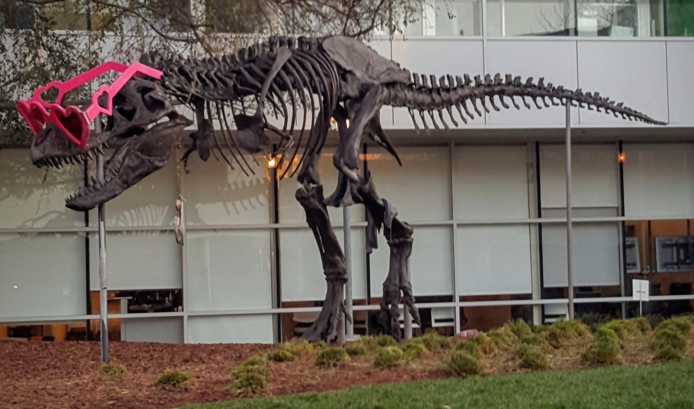

# Joint bilateral filter demo

This C++/CUDA example follows the CV-CUDA
[joint bilateral filter sample](https://github.com/CVCUDA/CV-CUDA/blob/main/samples/operators/joint_bilateral_filter.py).
It builds a three-channel grayscale guidance image on the CPU, then filters the
original image with a 9 × 9 CUDA joint bilateral filter using
`sigma_color=75`, `sigma_space=75`, and reflect borders. The implementation
uses squared Euclidean distance across the guide's channels and normalizes
weighted source pixels. It is an independent CUDA implementation and is not
guaranteed to match CV-CUDA's precise border or weight arithmetic.

## Build and test

From the repository root:

```bash
bazel build --@rules_cuda//cuda:archs=sm_89 \
  //cv-cuda-pipeline/examples/image_process/joint_bilateral_filter:joint_bilateral_filter_demo
bazel test --@rules_cuda//cuda:archs=sm_89 --test_output=errors \
  //cv-cuda-pipeline/calculators/image_process/cuda/tests:joint_bilateral_filter_kernel_test
```

Replace `sm_89` with your GPU architecture.

## Run

```bash
mkdir -p cv-cuda-pipeline/examples/image_process/joint_bilateral_filter/perf_asserts
bazel-bin/cv-cuda-pipeline/examples/image_process/joint_bilateral_filter/joint_bilateral_filter_demo \
  --input cv-cuda-pipeline/pictures/tabby_tiger_cat.jpg \
  --output cv-cuda-pipeline/examples/image_process/joint_bilateral_filter/perf_asserts/joint_bilateral_filter_cat.png
bazel-bin/cv-cuda-pipeline/examples/image_process/joint_bilateral_filter/joint_bilateral_filter_demo \
  --input cv-cuda-pipeline/pictures/dino.jpg \
  --output cv-cuda-pipeline/examples/image_process/joint_bilateral_filter/perf_asserts/joint_bilateral_filter_dino.png
```

`--input` is required; `--output` defaults to `joint_bilateral_filter.png`.

| Input | Joint bilateral output |
| --- | --- |
|  |  |
|  |  |

## Nsight Systems performance

Measured on an NVIDIA RTX 500 Ada Generation Laptop GPU with CUDA 13.3 and
Nsight Systems 2026.1.3:

| Image | Kernel time |
| --- | ---: |
| Cat, 720 × 720 | 912.880 µs |
| Dinosaur, 2876 × 1699 | 9.310 ms |

Times are GPU kernel durations. They exclude grayscale guidance conversion,
image I/O, host-device transfers, and launch overhead. Reproduce with:

```bash
mkdir -p build/joint_bilateral_filter
nsys profile --trace=cuda --sample=none --cpuctxsw=none \
  --output=build/joint_bilateral_filter/nsys_cat \
  bazel-bin/cv-cuda-pipeline/examples/image_process/joint_bilateral_filter/joint_bilateral_filter_demo \
  --input cv-cuda-pipeline/pictures/tabby_tiger_cat.jpg \
  --output build/joint_bilateral_filter/cat.png
nsys stats --report cuda_gpu_kern_sum --format csv \
  build/joint_bilateral_filter/nsys_cat.nsys-rep
```
