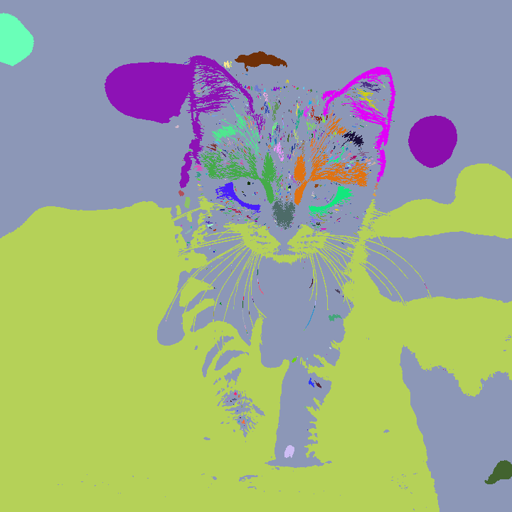
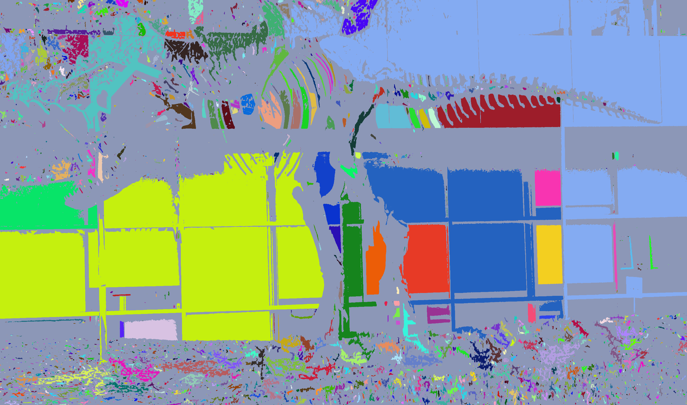

# Connected components label demo

This C++/CUDA example follows the CV-CUDA
[label sample](https://github.com/CVCUDA/CV-CUDA/blob/main/samples/operators/label.py):
convert to grayscale, equalize the histogram, threshold at 128, label 8-way
connected components, and colorize each component. Histogram equalization and
thresholding run with the repository's CUDA kernels. OpenCV performs the
grayscale conversion, connected-components labeling, and visualization on the
CPU; the CPU labeling fallback is an implementation difference from
`cvcuda.label`. Component colors are deterministic within this C++ program but
do not match NumPy's random color sequence.

## Build and test

From the repository root:

```bash
bazel build --@rules_cuda//cuda:archs=sm_89 \
  //cv-cuda-pipeline/examples/image_process/label:label_demo
bazel test --@rules_cuda//cuda:archs=sm_89 --test_output=errors \
  //cv-cuda-pipeline/calculators/image_process/cuda/tests:histogrameq_kernel_test \
  //cv-cuda-pipeline/calculators/image_process/cuda/tests:threshold_kernel_test
```

Replace `sm_89` with your GPU architecture.

## Run

```bash
mkdir -p cv-cuda-pipeline/examples/image_process/label/perf_asserts
bazel-bin/cv-cuda-pipeline/examples/image_process/label/label_demo \
  --input cv-cuda-pipeline/pictures/tabby_tiger_cat.jpg \
  --output cv-cuda-pipeline/examples/image_process/label/perf_asserts/label_cat.png
bazel-bin/cv-cuda-pipeline/examples/image_process/label/label_demo \
  --input cv-cuda-pipeline/pictures/dino.jpg \
  --output cv-cuda-pipeline/examples/image_process/label/perf_asserts/label_dino.png
```

`--input` is required; `--output` defaults to `cat_labeled.jpg`.

| Input | Component visualization |
| --- | --- |
|  |  |
|  |  |

## Performance

On an NVIDIA RTX 500 Ada Generation Laptop GPU with CUDA 13.3 and Nsight
Systems 2026.1.3, the GPU preprocessing kernels summed to 160.206 µs for the
720 × 720 cat and 1.482 ms for the 2876 × 1699 dinosaur. These sums include
histogram equalization and binary thresholding, but not transfers or CPU work.

OpenCV's CPU connected-components stage took 5.842 ms for the cat and
6.209 ms for the dinosaur in the output-generating run. CPU timing may vary
with system load and warm-up. These operator timings exclude grayscale
conversion and image I/O.

To reproduce the GPU measurements:

```bash
mkdir -p build/label
nsys profile --trace=cuda --sample=none --cpuctxsw=none \
  --output=build/label/nsys_cat \
  bazel-bin/cv-cuda-pipeline/examples/image_process/label/label_demo \
  --input cv-cuda-pipeline/pictures/tabby_tiger_cat.jpg \
  --output build/label/cat.png
nsys stats --report cuda_gpu_kern_sum --format csv \
  build/label/nsys_cat.nsys-rep
```
