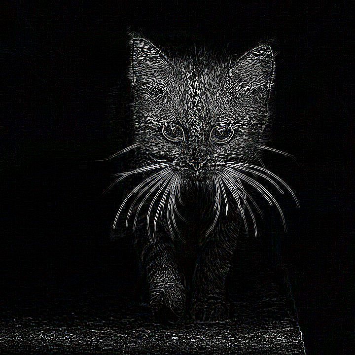
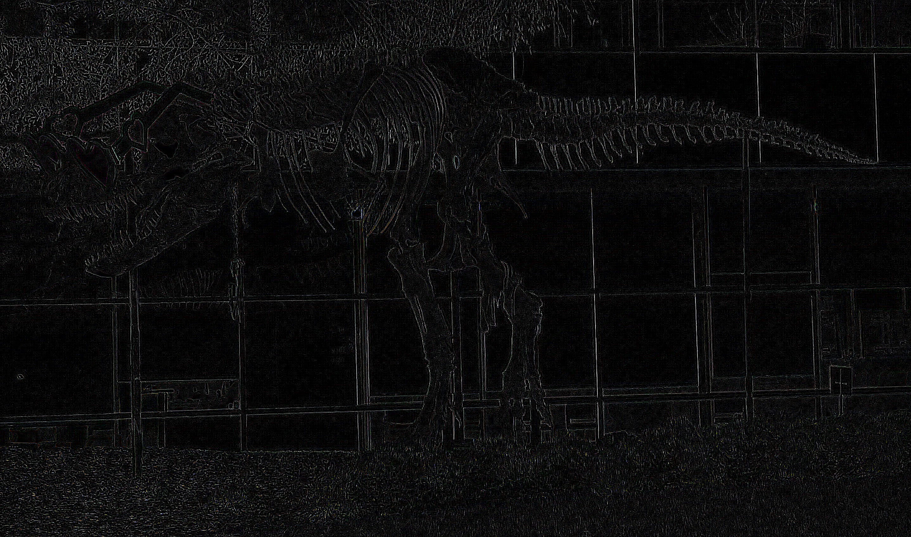

# CUDA Laplacian edge demo

This C++/CUDA example implements the U8 single-image case of the
[CV-CUDA Laplacian sample](https://github.com/CVCUDA/CV-CUDA/blob/main/samples/operators/laplacian.py):
the 3 × 3 corner-weighted stencil `[2 0 2; 0 -8 0; 2 0 2]`, scale 1, and
replicated borders. The U8 response is saturated to `[0, 255]`, then the
sample's host-side min/max stretch maps the response to the full display range.
OpenCV is used for image I/O; the Laplacian filter runs on the GPU.

The test compares every U8 filter output exactly with OpenCV, including border
pixels, tiny images and padded row strides. The visualization stretch is a
separate host-side postprocess, as in the Python example.

## Build and test

From the repository root, with Bazel, CUDA and OpenCV development libraries:

```bash
bazel build --@rules_cuda//cuda:archs=sm_89 \
  //cv-cuda-pipeline/examples/image_process/laplacian:laplacian_demo
bazel test --@rules_cuda//cuda:archs=sm_89 --test_output=errors \
  //cv-cuda-pipeline/calculators/image_process/cuda/tests:laplacian_kernel_test
```

Replace `sm_89` with your GPU architecture. The build uses
[rules_cuda](https://github.com/bazel-contrib/rules_cuda).

## Run

```bash
mkdir -p cv-cuda-pipeline/examples/image_process/laplacian/perf_asserts
bazel-bin/cv-cuda-pipeline/examples/image_process/laplacian/laplacian_demo \
  --input cv-cuda-pipeline/pictures/tabby_tiger_cat.jpg \
  --output cv-cuda-pipeline/examples/image_process/laplacian/perf_asserts/laplacian_cat.png
bazel-bin/cv-cuda-pipeline/examples/image_process/laplacian/laplacian_demo \
  --input cv-cuda-pipeline/pictures/dino.jpg \
  --output cv-cuda-pipeline/examples/image_process/laplacian/perf_asserts/laplacian_dino.png
```

`--input` is required; `--output` defaults to `cat_laplacian.png`. OpenCV
selects the output format from its extension.

| Input | Output |
| --- | --- |
|  |  |
|  |  |

The kernel API accepts non-overlapping interleaved three-channel U8 device
buffers, byte row strides, image dimensions and an optional CUDA stream. The
caller must keep buffers valid until stream completion and synchronize to
detect asynchronous errors.

## Nsight Systems performance

On an NVIDIA RTX 500 Ada Generation Laptop GPU, CUDA 13.3 and Nsight Systems
2026.1.3, the default Bazel build produced these single-launch results:

| Image | Kernel latency | Estimated logical bandwidth |
| --- | ---: | ---: |
| Cat, 720 × 720 | 27.805 µs | 111.86 GB/s |
| Dinosaur, 2876 × 1699 | 277.808 µs | 105.53 GB/s |

Bandwidth counts one three-byte input and one three-byte output per pixel,
divided by kernel time. Each pixel also gathers its four diagonal neighbors;
cache reuse and memory transactions affect actual traffic, so this is not
measured DRAM bandwidth. The reported time is for the GPU filter only and
excludes host-side range normalization, image I/O and transfers. A single
launch is not a steady-state benchmark.

To reproduce, use new report names if they already exist:

```bash
mkdir -p build/laplacian
nsys profile --trace=cuda --sample=none --cpuctxsw=none \
  --output=build/laplacian/nsys_cat \
  bazel-bin/cv-cuda-pipeline/examples/image_process/laplacian/laplacian_demo \
  --input cv-cuda-pipeline/pictures/tabby_tiger_cat.jpg \
  --output build/laplacian/cat.png
nsys stats --report cuda_gpu_kern_sum --format csv build/laplacian/nsys_cat.nsys-rep
nsys profile --trace=cuda --sample=none --cpuctxsw=none \
  --output=build/laplacian/nsys_dinosaur \
  bazel-bin/cv-cuda-pipeline/examples/image_process/laplacian/laplacian_demo \
  --input cv-cuda-pipeline/pictures/dino.jpg \
  --output build/laplacian/dinosaur.png
nsys stats --report cuda_gpu_kern_sum --format csv build/laplacian/nsys_dinosaur.nsys-rep
```
