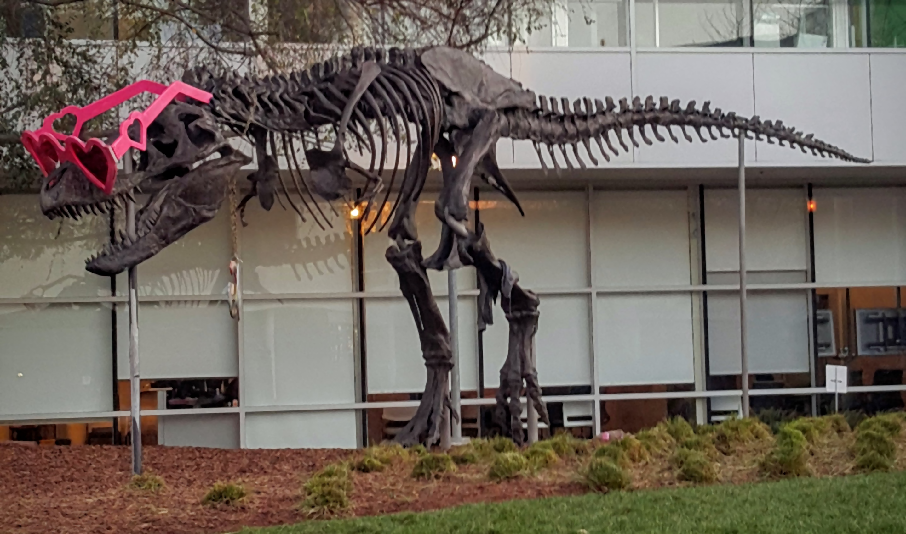

# CUDA median blur demo

This C++/CUDA example follows the CV-CUDA [median blur
sample](https://github.com/CVCUDA/CV-CUDA/blob/main/samples/operators/median_blur.py).
It applies a per-channel 7×7 median filter to an interleaved BGR U8 image.
Neighborhood coordinates outside the image are clamped to the nearest edge.
OpenCV is used only for image I/O.

The implementation accepts a separate source and destination buffer and byte
row strides. The kernel selects the 25th value of the 49 samples independently
for each color channel. Tests compare against a scalar reference, including
small images, padded rows, and invalid arguments.

## Build and test

From the repository root, with Bazel, CUDA and OpenCV development libraries:

```bash
bazel build --@rules_cuda//cuda:archs=sm_89 \
  //cv-cuda-pipeline/examples/image_process/median_blur:median_blur_demo
bazel test --@rules_cuda//cuda:archs=sm_89 --test_output=errors \
  //cv-cuda-pipeline/calculators/image_process/cuda/tests:median_blur_kernel_test
```

Replace `sm_89` with your GPU architecture. The build uses
[rules_cuda](https://github.com/bazel-contrib/rules_cuda).

## Run

```bash
mkdir -p cv-cuda-pipeline/examples/image_process/median_blur/perf_asserts
bazel-bin/cv-cuda-pipeline/examples/image_process/median_blur/median_blur_demo \
  --input cv-cuda-pipeline/pictures/tabby_tiger_cat.jpg \
  --output cv-cuda-pipeline/examples/image_process/median_blur/perf_asserts/median_blur_cat.png
bazel-bin/cv-cuda-pipeline/examples/image_process/median_blur/median_blur_demo \
  --input cv-cuda-pipeline/pictures/dino.jpg \
  --output cv-cuda-pipeline/examples/image_process/median_blur/perf_asserts/median_blur_dino.png
```

`--input` is required; `--output` defaults to `median_blur.png`. OpenCV
selects the output format from its extension.

| Input | 7×7 median blur |
| --- | --- |
|  |  |
|  |  |

## Nsight Systems performance

On an NVIDIA RTX 500 Ada Generation Laptop GPU, CUDA 13.3 and Nsight Systems
2026.1.3, the measured kernel times were:

| Image | Kernel time | Estimated logical bandwidth |
| --- | ---: | ---: |
| Cat, 720 × 720 | 17.637 ms | 4.41 GB/s |
| Dinosaur, 2876 × 1699 | 206.628 ms | 3.55 GB/s |

The bandwidth estimate counts 49 neighborhood reads and one output write per
pixel, with three bytes per BGR pixel, divided by kernel duration. Repeated
clamped coordinates and caching mean this is logical traffic, not measured
DRAM bandwidth. The kernel times exclude CPU work, image I/O and transfers and
are single-run measurements, not steady-state benchmarks.

To reproduce, use new report names if they already exist:

```bash
mkdir -p build/median_blur
nsys profile --trace=cuda --sample=none --cpuctxsw=none \
  --output=build/median_blur/nsys_cat \
  bazel-bin/cv-cuda-pipeline/examples/image_process/median_blur/median_blur_demo \
  --input cv-cuda-pipeline/pictures/tabby_tiger_cat.jpg \
  --output build/median_blur/cat.png
nsys stats --report cuda_gpu_kern_sum --format csv build/median_blur/nsys_cat.nsys-rep
nsys profile --trace=cuda --sample=none --cpuctxsw=none \
  --output=build/median_blur/nsys_dinosaur \
  bazel-bin/cv-cuda-pipeline/examples/image_process/median_blur/median_blur_demo \
  --input cv-cuda-pipeline/pictures/dino.jpg \
  --output build/median_blur/dinosaur.png
nsys stats --report cuda_gpu_kern_sum --format csv build/median_blur/nsys_dinosaur.nsys-rep
```
