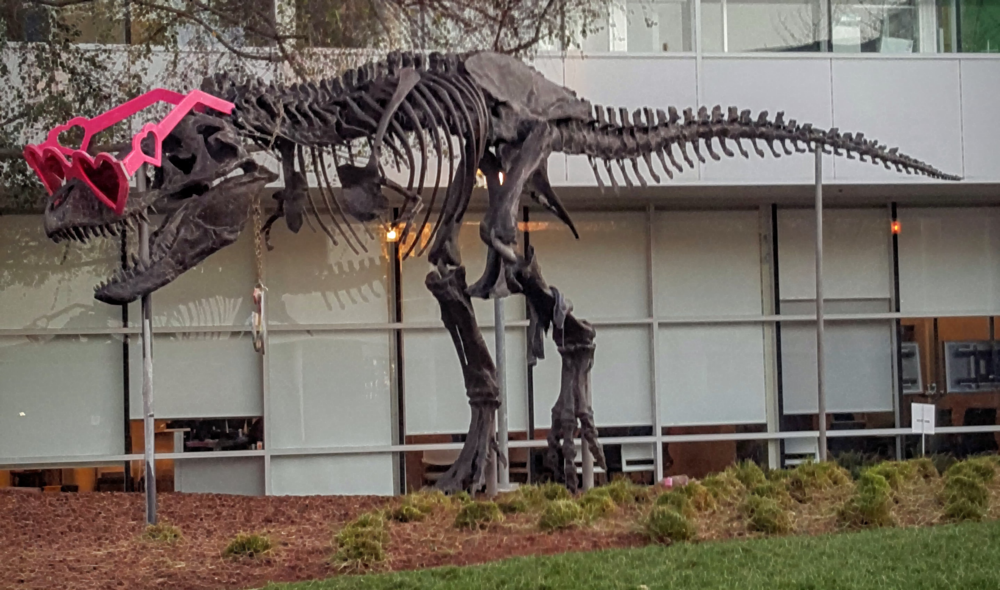

# CUDA morphology demo

This C++/CUDA example implements the single-image U8 case of the
[CV-CUDA morphology sample](https://github.com/CVCUDA/CV-CUDA/blob/main/samples/operators/morphology.py).
It applies one 5 × 5 dilation followed by one 5 × 5 erosion, with centered
anchors and replicated borders for both passes. OpenCV is used for image I/O;
the morphology runs on the GPU. Other masks, operations, iterations, formats
and batches are not implemented.

## Build and test

From the repository root, with Bazel, CUDA and OpenCV development libraries:

```bash
bazel build --@rules_cuda//cuda:archs=sm_89 \
  //cv-cuda-pipeline/examples/image_process/morphology:morphology_demo
bazel test --@rules_cuda//cuda:archs=sm_89 --test_output=errors \
  //cv-cuda-pipeline/calculators/image_process/cuda/tests:morphology_kernel_test
```

Replace `sm_89` with your GPU architecture. The build uses
[rules_cuda](https://github.com/bazel-contrib/rules_cuda). Tests compare both
the dilation intermediate and the final result exactly against OpenCV,
including small images, padded strides and boundaries.

## Run

```bash
mkdir -p cv-cuda-pipeline/examples/image_process/morphology/perf_asserts
bazel-bin/cv-cuda-pipeline/examples/image_process/morphology/morphology_demo \
  --input cv-cuda-pipeline/pictures/tabby_tiger_cat.jpg \
  --output cv-cuda-pipeline/examples/image_process/morphology/perf_asserts/morphology_cat.png
bazel-bin/cv-cuda-pipeline/examples/image_process/morphology/morphology_demo \
  --input cv-cuda-pipeline/pictures/dino.jpg \
  --output cv-cuda-pipeline/examples/image_process/morphology/perf_asserts/morphology_dino.png
```

`--input` is required; `--output` defaults to `cat_morphology.png`. OpenCV
selects the output format from its extension.

| Input | Output |
| --- | --- |
|  |  |
|  |  |

The kernel API accepts non-overlapping interleaved RGB8 or BGR8 input, scratch
and output device buffers, byte row strides, image dimensions, and an optional
CUDA stream. Keep all buffers valid until stream completion and check
synchronization errors.

## Nsight Systems performance

On an NVIDIA RTX 500 Ada Generation Laptop GPU, CUDA 13.3 and Nsight Systems
2026.1.3, the default Bazel build produced these single-launch results:

| Image | Dilation | Erosion | Combined kernel latency | Effective image bandwidth |
| --- | ---: | ---: | ---: | ---: |
| Cat, 720 × 720 | 77.298 µs | 77.002 µs | 154.300 µs | 40.32 GB/s |
| Dinosaur, 2876 × 1699 | 712.720 µs | 712.780 µs | 1425.500 µs | 41.13 GB/s |

Combined kernel latency is the sum of the two kernel durations, not elapsed
wall time. Effective bandwidth counts a three-byte read and write per pixel
for each pass divided by the combined time. Each neighborhood actually
performs multiple logical reads, and caching and transactions affect physical
traffic; this is not measured DRAM bandwidth. Single-launch timings exclude
CPU work, image I/O and transfers and are not a steady-state benchmark.

To reproduce, use new report names if they already exist:

```bash
mkdir -p build/morphology
nsys profile --trace=cuda --sample=none --cpuctxsw=none \
  --output=build/morphology/nsys_cat \
  bazel-bin/cv-cuda-pipeline/examples/image_process/morphology/morphology_demo \
  --input cv-cuda-pipeline/pictures/tabby_tiger_cat.jpg \
  --output build/morphology/cat.png
nsys stats --report cuda_gpu_kern_sum --format csv build/morphology/nsys_cat.nsys-rep
nsys profile --trace=cuda --sample=none --cpuctxsw=none \
  --output=build/morphology/nsys_dinosaur \
  bazel-bin/cv-cuda-pipeline/examples/image_process/morphology/morphology_demo \
  --input cv-cuda-pipeline/pictures/dino.jpg \
  --output build/morphology/dinosaur.png
nsys stats --report cuda_gpu_kern_sum --format csv build/morphology/nsys_dinosaur.nsys-rep
```
