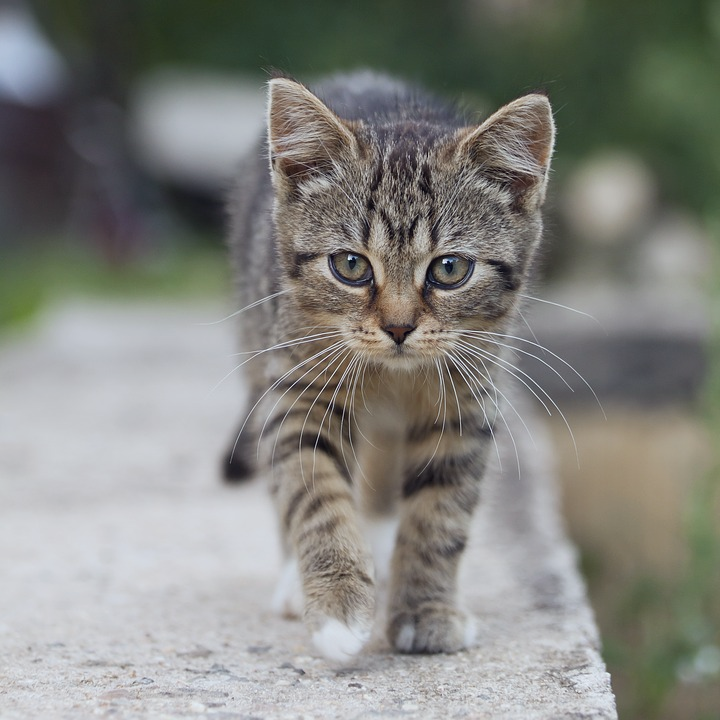
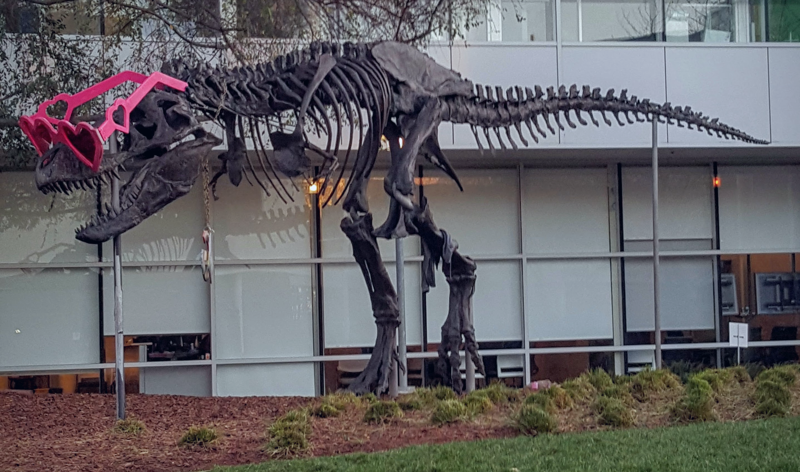

# CUDA ImageNet normalization demo

This C++/CUDA example implements the normalization and visualization steps in
the [CV-CUDA normalize sample](https://github.com/CVCUDA/CV-CUDA/blob/main/samples/operators/normalize.py).
For each channel it calculates
`(pixel - mean) / sqrt(stddev * stddev + 1e-5)`, using ImageNet RGB means
`[123.675, 116.28, 103.53]` and standard deviations
`[58.395, 57.12, 57.375]` in 0–255 units. Because OpenCV stores input in BGR
order, the kernel applies the corresponding reversed channel parameters.

The GPU produces an interleaved F32 normalized image. As in the Python sample,
the demo then downloads it, stretches the global min/max range to U8 `[0,255]`
on the CPU, and writes the visualization. The host-side display conversion is
not part of the normalization kernel timing.

## Build and test

From the repository root, with Bazel, CUDA and OpenCV development libraries:

```bash
bazel build --@rules_cuda//cuda:archs=sm_89 \
  //cv-cuda-pipeline/examples/image_process/normalize:normalize_demo
bazel test --@rules_cuda//cuda:archs=sm_89 --test_output=errors \
  //cv-cuda-pipeline/calculators/image_process/cuda/tests:normalize_kernel_test
```

Replace `sm_89` with your GPU architecture. The build uses
[rules_cuda](https://github.com/bazel-contrib/rules_cuda). Tests check every
normalized float value, padded row strides and invalid arguments.

## Run

```bash
mkdir -p cv-cuda-pipeline/examples/image_process/normalize/perf_asserts
bazel-bin/cv-cuda-pipeline/examples/image_process/normalize/normalize_demo \
  --input cv-cuda-pipeline/pictures/tabby_tiger_cat.jpg \
  --output cv-cuda-pipeline/examples/image_process/normalize/perf_asserts/normalize_cat.png
bazel-bin/cv-cuda-pipeline/examples/image_process/normalize/normalize_demo \
  --input cv-cuda-pipeline/pictures/dino.jpg \
  --output cv-cuda-pipeline/examples/image_process/normalize/perf_asserts/normalize_dino.png
```

`--input` is required; `--output` defaults to `cat_normalize.png`. OpenCV
selects the output format from its extension.

| Input | Output |
| --- | --- |
|  |  |
|  |  |

The kernel API accepts non-overlapping interleaved three-channel U8 input and
F32 output device buffers, byte row strides, image dimensions and an optional
CUDA stream. Keep buffers valid until stream completion and check asynchronous
errors.

## Nsight Systems performance

On an NVIDIA RTX 500 Ada Generation Laptop GPU, CUDA 13.3 and Nsight Systems
2026.1.3, the default Bazel build produced these single-launch results:

| Image | Kernel latency | Estimated logical bandwidth |
| --- | ---: | ---: |
| Cat, 720 × 720 | 47.494 µs | 163.73 GB/s |
| Dinosaur, 2876 × 1699 | 615.198 µs | 119.14 GB/s |

The estimate counts a three-byte U8 input and a twelve-byte F32 output per
pixel, divided by kernel time. It is not measured DRAM bandwidth; caching and
transaction sizes affect physical traffic. Single-launch timings exclude
transfers, CPU range stretching and image I/O and are not a steady-state
benchmark.

To reproduce, use new report names if they already exist:

```bash
mkdir -p build/normalize
nsys profile --trace=cuda --sample=none --cpuctxsw=none \
  --output=build/normalize/nsys_cat \
  bazel-bin/cv-cuda-pipeline/examples/image_process/normalize/normalize_demo \
  --input cv-cuda-pipeline/pictures/tabby_tiger_cat.jpg \
  --output build/normalize/cat.png
nsys stats --report cuda_gpu_kern_sum --format csv build/normalize/nsys_cat.nsys-rep
nsys profile --trace=cuda --sample=none --cpuctxsw=none \
  --output=build/normalize/nsys_dinosaur \
  bazel-bin/cv-cuda-pipeline/examples/image_process/normalize/normalize_demo \
  --input cv-cuda-pipeline/pictures/dino.jpg \
  --output build/normalize/dinosaur.png
nsys stats --report cuda_gpu_kern_sum --format csv build/normalize/nsys_dinosaur.nsys-rep
```
