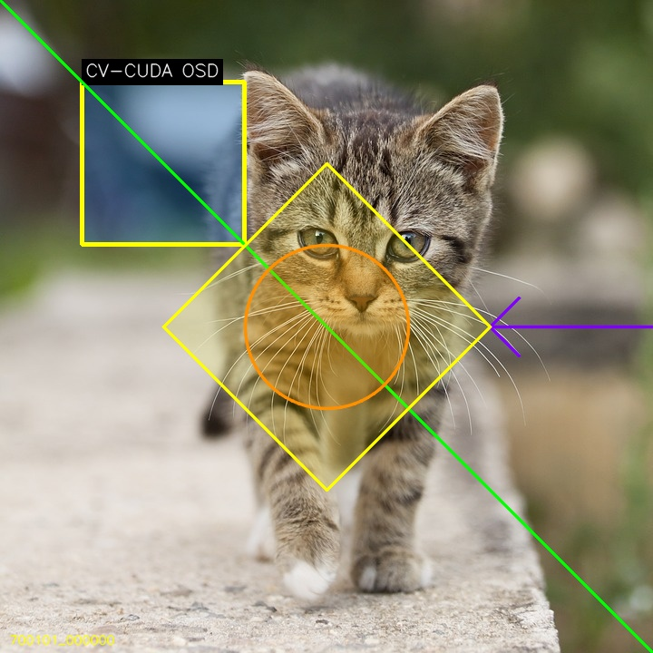
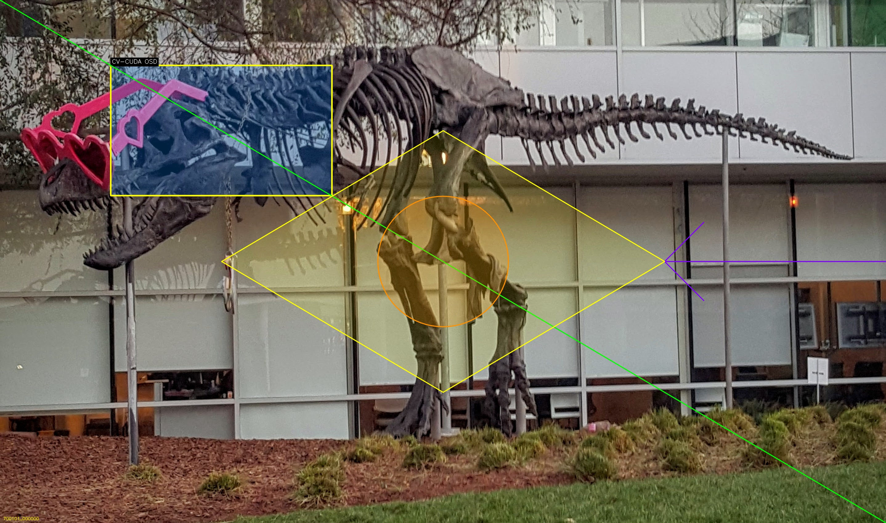

# On-screen display demo

This C++ example follows the CV-CUDA
[OSD sample](https://github.com/CVCUDA/CV-CUDA/blob/main/samples/operators/osd.py)
by drawing a translucent box, text, diagonal line, filled circle, arrow,
diamond, and fixed timestamp. OpenCV performs the rasterization and alpha
blending on the CPU because this repository does not provide CUDA kernels for
the complete OSD primitive set. Colors and font metrics therefore follow
OpenCV's BGR drawing conventions rather than CV-CUDA's renderer.

## Build and run

From the repository root:

```bash
bazel build \
  //cv-cuda-pipeline/examples/image_process/osd:osd_demo
mkdir -p cv-cuda-pipeline/examples/image_process/osd/perf_asserts
bazel-bin/cv-cuda-pipeline/examples/image_process/osd/osd_demo \
  --input cv-cuda-pipeline/pictures/tabby_tiger_cat.jpg \
  --output cv-cuda-pipeline/examples/image_process/osd/perf_asserts/osd_cat.jpg
bazel-bin/cv-cuda-pipeline/examples/image_process/osd/osd_demo \
  --input cv-cuda-pipeline/pictures/dino.jpg \
  --output cv-cuda-pipeline/examples/image_process/osd/perf_asserts/osd_dino.jpg
```

`--input` is required; `--output` defaults to `cat_osd.jpg`.

| Input | OpenCV OSD output |
| --- | --- |
|  |  |
|  |  |

The program reports CPU drawing time, excluding image I/O. On the measurement
machine, drawing took 3.673 ms for the 720 × 720 cat and 16.902 ms for the
2876 × 1699 dinosaur.
