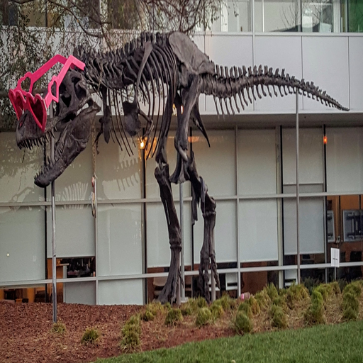

# Pillow-style resize demo

This C++/CUDA example follows the CV-CUDA
[Pillow resize sample](https://github.com/CVCUDA/CV-CUDA/blob/main/samples/operators/pillowresize.py).
It applies a separable Lanczos-3 filter in both dimensions, including
upscaling. This provides a Pillow-style high-quality resampling path; it is
not a bit-for-bit replacement for Pillow's implementation.

## Build and run

From the repository root:

```bash
bazel build --@rules_cuda//cuda:archs=sm_89 \
  //cv-cuda-pipeline/examples/image_process/pillowresize:pillowresize_demo
bazel test --@rules_cuda//cuda:archs=sm_89 --test_output=errors \
  //cv-cuda-pipeline/calculators/image_process/cuda/tests:quality_resize_kernel_test
mkdir -p cv-cuda-pipeline/examples/image_process/pillowresize/perf_asserts
bazel-bin/cv-cuda-pipeline/examples/image_process/pillowresize/pillowresize_demo \
  --input cv-cuda-pipeline/pictures/tabby_tiger_cat.jpg \
  --output cv-cuda-pipeline/examples/image_process/pillowresize/perf_asserts/pillowresize_cat.png
bazel-bin/cv-cuda-pipeline/examples/image_process/pillowresize/pillowresize_demo \
  --input cv-cuda-pipeline/pictures/dino.jpg \
  --output cv-cuda-pipeline/examples/image_process/pillowresize/perf_asserts/pillowresize_dino.png
```

`--input` is required; `--output` defaults to `cat_pillowresize.jpg`. The
output dimensions default to 512 × 512 and can be set with `--width` and
`--height`. Replace `sm_89` with your GPU architecture.

| Input | Pillow-style resize output |
| --- | --- |
|  |  |
|  |  |

## Nsight Systems performance

Measured on an NVIDIA RTX 500 Ada Generation Laptop GPU with CUDA 13.3 and
Nsight Systems 2026.1.3. Each measurement is one invocation at 512 × 512:

| Image | Horizontal kernel | Vertical kernel | Total |
| --- | ---: | ---: | ---: |
| Cat, 720 × 720 | 123.823 µs | 83.896 µs | 207.719 µs |
| Dinosaur, 2876 × 1699 | 965.062 µs | 185.244 µs | 1.150 ms |

The totals sum GPU kernel durations reported by Nsight Systems; they exclude
image I/O, host-device transfers, and launch overhead. Reproduce with:

```bash
mkdir -p build/pillowresize
nsys profile --trace=cuda --sample=none --cpuctxsw=none \
  --output=build/pillowresize/nsys_cat \
  bazel-bin/cv-cuda-pipeline/examples/image_process/pillowresize/pillowresize_demo \
  --input cv-cuda-pipeline/pictures/tabby_tiger_cat.jpg \
  --output build/pillowresize/cat.png
nsys stats --report cuda_gpu_kern_sum --format csv \
  build/pillowresize/nsys_cat.nsys-rep
```
