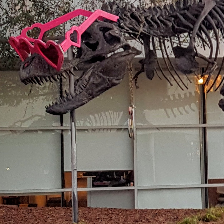

# CUDA random resized crop demo

This C++/CUDA example follows the CV-CUDA [random resized crop
sample](https://github.com/CVCUDA/CV-CUDA/blob/main/samples/operators/random_resized_crop.py).
It selects a seeded crop covering 8–100% of the input area with aspect ratio
0.75–1.3333, then resizes the crop to the requested output dimensions using
the CUDA bilinear resize kernel. The crop selection uses ten random
area/aspect-ratio attempts followed by a centered aspect-ratio fallback.
OpenCV is used only for image I/O.

The seed makes crop selection repeatable with the same standard-library
implementation; the selected rectangle is not guaranteed to match CV-CUDA's
internal random sequence. Random crop selection runs on the CPU; crop pixels
are read from the device image view and resized on the GPU.

## Build and test

From the repository root, with Bazel, CUDA and OpenCV development libraries:

```bash
bazel build --@rules_cuda//cuda:archs=sm_89 \
  //cv-cuda-pipeline/examples/image_process/random_resized_crop:random_resized_crop_demo
bazel test --@rules_cuda//cuda:archs=sm_89 --test_output=errors \
  //cv-cuda-pipeline/calculators/image_process/cuda/tests:random_resized_crop_test \
  //cv-cuda-pipeline/calculators/image_process/cuda/tests:resize_kernel_test
```

Replace `sm_89` with your GPU architecture. The build uses
[rules_cuda](https://github.com/bazel-contrib/rules_cuda).

## Run

```bash
mkdir -p cv-cuda-pipeline/examples/image_process/random_resized_crop/perf_asserts
bazel-bin/cv-cuda-pipeline/examples/image_process/random_resized_crop/random_resized_crop_demo \
  --input cv-cuda-pipeline/pictures/tabby_tiger_cat.jpg \
  --output cv-cuda-pipeline/examples/image_process/random_resized_crop/perf_asserts/random_resized_crop_cat.png
bazel-bin/cv-cuda-pipeline/examples/image_process/random_resized_crop/random_resized_crop_demo \
  --input cv-cuda-pipeline/pictures/dino.jpg \
  --output cv-cuda-pipeline/examples/image_process/random_resized_crop/perf_asserts/random_resized_crop_dino.png
```

`--input` is required; `--output` defaults to `random_resized_crop.png`. Output
dimensions default to 224×224; use `--width N` and `--height N` to change them.

| Input | Random resized crop |
| --- | --- |
|  |  |
|  |  |

## Nsight Systems performance

On an NVIDIA RTX 500 Ada Generation Laptop GPU, CUDA 13.3 and Nsight Systems
2026.1.3, the CUDA resize kernel measured:

| Image | Selected crop | Kernel time | Estimated logical bandwidth |
| --- | --- | ---: | ---: |
| Cat, 720 × 720 | (45, 15), 660 × 609 | 5.058 µs | 148.80 GB/s |
| Dinosaur, 2876 × 1699 | (20, 202), 1234 × 1314 | 14.340 µs | 52.49 GB/s |

For 224×224 output, the bandwidth estimate counts four three-byte source
samples and one three-byte output per pixel. It is logical traffic, not
measured DRAM bandwidth; cached taps and crop locality affect physical
traffic. Timings exclude CPU crop selection, image I/O and transfers.

To reproduce, use new report names if they already exist:

```bash
mkdir -p build/random_resized_crop
nsys profile --trace=cuda --sample=none --cpuctxsw=none \
  --output=build/random_resized_crop/nsys_cat \
  bazel-bin/cv-cuda-pipeline/examples/image_process/random_resized_crop/random_resized_crop_demo \
  --input cv-cuda-pipeline/pictures/tabby_tiger_cat.jpg \
  --output build/random_resized_crop/cat.png
nsys stats --report cuda_gpu_kern_sum --format csv \
  build/random_resized_crop/nsys_cat.nsys-rep
```
