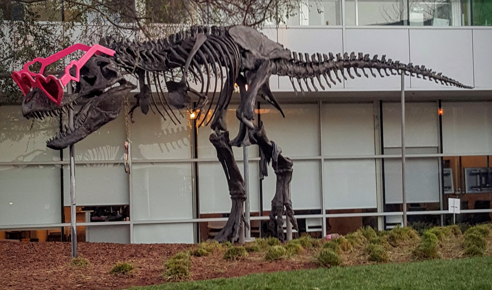

# CUDA tensor reformat demo

This C++/CUDA example follows the three layout transforms in the
[CV-CUDA reformat sample](https://github.com/CVCUDA/CV-CUDA/blob/main/samples/operators/reformat.py):
HWC to CHW, CHW back to HWC, and one-image NHWC to NCHW. The last transform
uses the same planar storage as CHW because the batch dimension is one. The
demo writes the HWC round-trip image; it also generates the planar CHW and
NCHW device tensors. OpenCV is used only for image I/O.

The kernels move interleaved three-channel U8 pixels without changing values.
Tests check planar and interleaved layouts, padding, tiny dimensions and both
conversion directions.

## Build and test

From the repository root, with Bazel, CUDA and OpenCV development libraries:

```bash
bazel build --@rules_cuda//cuda:archs=sm_89 \
  //cv-cuda-pipeline/examples/image_process/reformat:reformat_demo
bazel test --@rules_cuda//cuda:archs=sm_89 --test_output=errors \
  //cv-cuda-pipeline/calculators/image_process/cuda/tests:reformat_kernel_test
```

Replace `sm_89` with your GPU architecture. The build uses
[rules_cuda](https://github.com/bazel-contrib/rules_cuda).

## Run

```bash
mkdir -p cv-cuda-pipeline/examples/image_process/reformat/perf_asserts
bazel-bin/cv-cuda-pipeline/examples/image_process/reformat/reformat_demo \
  --input cv-cuda-pipeline/pictures/tabby_tiger_cat.jpg \
  --output cv-cuda-pipeline/examples/image_process/reformat/perf_asserts/reformat_cat.png
bazel-bin/cv-cuda-pipeline/examples/image_process/reformat/reformat_demo \
  --input cv-cuda-pipeline/pictures/dino.jpg \
  --output cv-cuda-pipeline/examples/image_process/reformat/perf_asserts/reformat_dino.png
```

`--input` is required; `--output` defaults to `reformat_roundtrip.png`. OpenCV
selects the output format from its extension.

| Input | HWC round trip |
| --- | --- |
|  |  |
|  |  |

The kernel API accepts non-overlapping device buffers for interleaved HWC and
planar CHW data, byte strides and image dimensions. Keep all buffers valid
until stream completion and synchronize to detect asynchronous errors.

## Nsight Systems performance

On an NVIDIA RTX 500 Ada Generation Laptop GPU, CUDA 13.3 and Nsight Systems
2026.1.3, the default Bazel build produced these results for the three
sequential reformat launches:

| Image | Kernel time, all three transforms | Estimated logical bandwidth |
| --- | ---: | ---: |
| Cat, 720 × 720 | 50.475 µs | 184.87 GB/s |
| Dinosaur, 2876 × 1699 | 798.897 µs | 110.09 GB/s |

Bandwidth counts three bytes read and three bytes written per pixel for each
of the three transforms, divided by the summed kernel durations. This is a
logical estimate, not measured DRAM bandwidth; caching and transaction sizes
affect actual traffic. The timings exclude CPU work, image I/O and transfers
and are not steady-state benchmarks.

To reproduce, use new report names if they already exist:

```bash
mkdir -p build/reformat
nsys profile --trace=cuda --sample=none --cpuctxsw=none \
  --output=build/reformat/nsys_cat \
  bazel-bin/cv-cuda-pipeline/examples/image_process/reformat/reformat_demo \
  --input cv-cuda-pipeline/pictures/tabby_tiger_cat.jpg \
  --output build/reformat/cat.png
nsys stats --report cuda_gpu_kern_sum --format csv build/reformat/nsys_cat.nsys-rep
nsys profile --trace=cuda --sample=none --cpuctxsw=none \
  --output=build/reformat/nsys_dinosaur \
  bazel-bin/cv-cuda-pipeline/examples/image_process/reformat/reformat_demo \
  --input cv-cuda-pipeline/pictures/dino.jpg \
  --output build/reformat/dinosaur.png
nsys stats --report cuda_gpu_kern_sum --format csv build/reformat/nsys_dinosaur.nsys-rep
```
