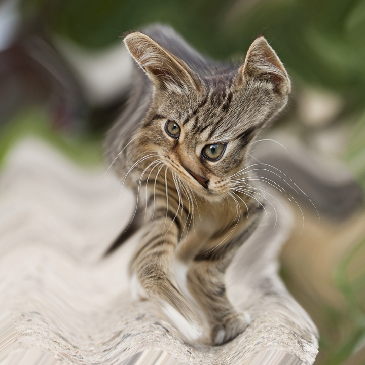
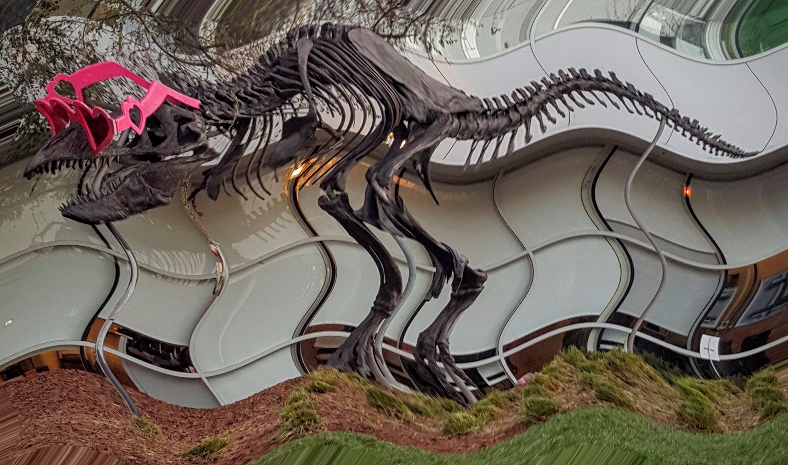

# CUDA remap demo

This C++ and CUDA example applies a sinusoidal wave distortion to an RGB8 image.
The output has the same dimensions as the input. OpenCV handles image I/O and
RGB/BGR conversion; the remap itself runs on the GPU.

The CPU constructs a two-float map for each output pixel `(x, y)`:

```text
amplitude = 0.04 * height
source_x = x + amplitude * sin(2 * pi * 3 * y / height)
source_y = y + amplitude * sin(2 * pi * 3 * x / width)
```

Coordinates are absolute source-pixel positions. The GPU uses bilinear source
interpolation and replicates edge pixels for out-of-bounds coordinates. The map
has the same size as the output, so its values are read directly at `(x, y)`.

## Build and test

Run from the repository root with a CUDA toolkit, a compatible NVIDIA driver
and GPU, OpenCV development libraries, and Bazel:

```bash
bazel build --@rules_cuda//cuda:archs=sm_89 \
  //cv-cuda-pipeline/examples/image_process/remap:remap_demo
bazel test --@rules_cuda//cuda:archs=sm_89 --test_output=errors \
  //cv-cuda-pipeline/calculators/image_process/cuda/tests:remap_kernel_test
```

The CUDA target uses [rules_cuda](https://github.com/bazel-contrib/rules_cuda).
Replace `sm_89` with the architecture of your GPU. No Python environment is
required.

## Run

```bash
mkdir -p cv-cuda-pipeline/examples/image_process/remap/perf_asserts
bazel-bin/cv-cuda-pipeline/examples/image_process/remap/remap_demo \
  --input cv-cuda-pipeline/pictures/tabby_tiger_cat.jpg \
  --output cv-cuda-pipeline/examples/image_process/remap/perf_asserts/remap_cat.png
bazel-bin/cv-cuda-pipeline/examples/image_process/remap/remap_demo \
  --input cv-cuda-pipeline/pictures/dino.jpg \
  --output cv-cuda-pipeline/examples/image_process/remap/perf_asserts/remap_dino.png
```

`--input` is required. `--output` defaults to `cat_remap.png` in the current
working directory; its extension determines the image format. Use `--help` to
show usage.

### Input and output images

| Input | Output |
| --- | --- |
| Cat, 720 × 720 | Remapped cat, 720 × 720 |
|  |  |
| Dinosaur, 2876 × 1699 | Remapped dinosaur, 2876 × 1699 |
|  |  |

For an additional GPU memory check:

```bash
bazel build --@rules_cuda//cuda:archs=sm_89 \
  //cv-cuda-pipeline/calculators/image_process/cuda/tests:remap_kernel_test
compute-sanitizer --tool memcheck --error-exitcode 1 \
  bazel-bin/cv-cuda-pipeline/calculators/image_process/cuda/tests/remap_kernel_test
```

## Nsight Systems performance

Measured using Nsight Systems 2026.1.3, the default Bazel build, CUDA Toolkit
13.3 and an NVIDIA RTX 500 Ada Generation Laptop GPU (`sm_89`). Each image
was run in a separate process with **one kernel launch**:

| Image | Kernel latency | Estimated effective bandwidth |
| --- | ---: | ---: |
| Cat, 720 × 720 | 50.574 µs | 235.76 GB/s |
| Dinosaur, 2876 × 1699 | 623.606 µs | 180.22 GB/s |

The timing is device kernel execution only; it excludes map generation,
transfers, launch overhead and image I/O. A single cold launch is not a
steady-state benchmark, and results vary with GPU clocks, cache state and
profiling overhead.

Bandwidth is a **logical traffic estimate**, not measured DRAM bandwidth:
each output pixel reads an eight-byte map entry and four three-byte source
pixels and writes three bytes, or `23 × width × height` bytes per launch.
Divide by kernel time for decimal GB/s. Caching, duplicated reads at borders,
and memory transactions can change actual hardware traffic. Hardware counters
were unavailable on the test machine (`ERR_NVGPUCTRPERM`).

To collect a trace and print the kernel summary:

```bash
mkdir -p build/remap cv-cuda-pipeline/examples/image_process/remap/perf_asserts
nsys profile --trace=cuda --sample=none --cpuctxsw=none \
  --output=build/remap/nsys_cat \
  bazel-bin/cv-cuda-pipeline/examples/image_process/remap/remap_demo \
  --input cv-cuda-pipeline/pictures/tabby_tiger_cat.jpg \
  --output cv-cuda-pipeline/examples/image_process/remap/perf_asserts/profile_cat.png
nsys stats --report cuda_gpu_kern_sum --format csv build/remap/nsys_cat.nsys-rep
```

Use a new report name if it already exists; replace the input and output paths
to profile another image.

## Kernel API scope

`RemapLinear` accepts same-size interleaved three-channel uint8 input and
output images and a `float2` map in device memory. Rows may have explicit byte
strides, and the caller can provide a CUDA stream. The map pointer and stride
must be `float2`-aligned, its coordinates finite, and the source, map, and
destination buffers non-overlapping. Each dimension must not exceed 2²³.
Buffers must remain valid until stream completion. Parameter and launch errors
are returned immediately; synchronize the stream to detect asynchronous errors.
Other formats, interpolation modes, map sizes and batched images are not
implemented.
