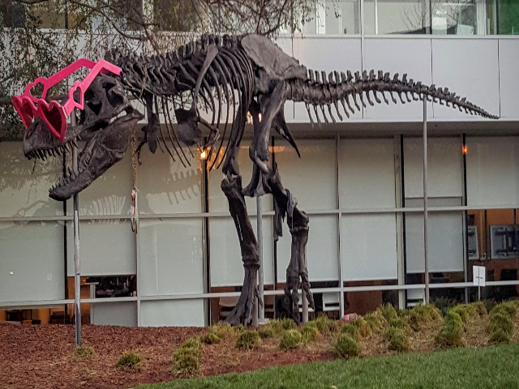

# CUDA resize demo

This C++ and CUDA example resizes RGB8 images using bilinear interpolation and
demonstrates both HWC and single-image NHWC calls. OpenCV handles image I/O and
RGB/BGR conversion; the resize runs in a CUDA kernel without a Python runtime
dependency.

## Tested environment

- Linux / WSL, NVIDIA RTX 500 Ada Generation Laptop GPU (`sm_89`)
- CUDA Toolkit 13.3, OpenCV 4.6.0 development libraries, and Bazel 7.7.0
- A working CUDA driver, which can be checked with `nvidia-smi`

Activating `.venv` is not necessary. Run the following commands from the
repository root:

```bash
cd /mnt/c/Users/xincu/cv-cuda-pipeline
```

## Build with Bazel

The project uses [`rules_cuda`](https://github.com/bazel-contrib/rules_cuda):
the `resize_kernel` target is a `cuda_library`, and the `resize_demo` binary
depends on it. Build the demo with:

```bash
bazel build --@rules_cuda//cuda:archs=sm_89 \
  //cv-cuda-pipeline/examples/image_process/resize:resize_demo
```

The executable is written to
`bazel-bin/cv-cuda-pipeline/examples/image_process/resize/resize_demo`.
To build and run the kernel test:

```bash
bazel test --@rules_cuda//cuda:archs=sm_89 --test_output=errors \
  //cv-cuda-pipeline/calculators/image_process/cuda/tests:resize_kernel_test
```

`sm_89` is the architecture of the GPU used for testing; replace it with the
appropriate architecture for your GPU. The project's Bazel configuration uses
the locally installed CUDA Toolkit and OpenCV development libraries.

## Run

Run the demo once for each image. The square cat image is 720 × 720, so
resizing it to 256 × 256 preserves its aspect ratio:

```bash
bazel-bin/cv-cuda-pipeline/examples/image_process/resize/resize_demo \
  --input cv-cuda-pipeline/pictures/tabby_tiger_cat.jpg \
  --output cv-cuda-pipeline/examples/image_process/resize/perf_asserts/resize_cat.png \
  --width 256 --height 256
```

The rectangular dinosaur image is 2876 × 1699. Specify the desired output
width and height independently:

```bash
bazel-bin/cv-cuda-pipeline/examples/image_process/resize/resize_demo \
  --input cv-cuda-pipeline/pictures/dino.jpg \
  --output cv-cuda-pipeline/examples/image_process/resize/perf_asserts/resize_dino.png \
  --width 640 --height 480
```

The dinosaur example changes the aspect ratio and therefore stretches the
image; choose dimensions with the same aspect ratio as the input if that is not
desired. The demo reports the input and output dimensions, whether the aspect
ratio is preserved, and the NHWC output shape. Both examples read from
`pictures` and write to `perf_asserts`.

### Input and output images

| Input | Output |
| --- | --- |
| Cat, 720 × 720 | Cat, 256 × 256 |
|  |  |
| Dinosaur, 2876 × 1699 | Dinosaur, 640 × 480 |
|  |  |

Options:

- `--input`: input image path, required.
- `--output`: output image path, default `cat_resized.jpg`. The file extension
  determines the format.
- `--width`, `--height`: positive output dimensions, both defaulting to 224.
- `--help`: show usage.

When CUDA Compute Sanitizer is available, run the following memory check on the
Bazel-built kernel test:

```bash
bazel build --@rules_cuda//cuda:archs=sm_89 \
  //cv-cuda-pipeline/calculators/image_process/cuda/tests:resize_kernel_test
compute-sanitizer --tool memcheck --error-exitcode 1 \
  bazel-bin/cv-cuda-pipeline/calculators/image_process/cuda/tests/resize_kernel_test
```

## Nsight Systems performance

The following measurements were captured with Nsight Systems 2026.1.3, the
GPU and software environment listed above, and the Bazel build command above
(the default build mode). Each image was profiled in a separate process. The
demo launches the same resize kernel twice, once for HWC and once for NHWC.
The table reports their individual device execution times and their mean; it
does not include image decoding, memory transfers, launch overhead, or encoding.

| Input → output | HWC latency | NHWC latency | Mean kernel latency | Estimated effective bandwidth |
| --- | ---: | ---: | ---: | ---: |
| Cat: 720 × 720 → 256 × 256 | 5.893 µs | 5.418 µs | 5.656 µs | 173.82 GB/s |
| Dinosaur: 2876 × 1699 → 640 × 480 | 74.215 µs | 21.690 µs | 47.953 µs | 96.10 GB/s |

These are only two launches per image, not a steady-state benchmark; cold
start, caching, GPU clocks and profiler overhead can affect the results. In
particular, the two dinosaur timings differ substantially.

Bandwidth is a **logical traffic estimate**, not measured DRAM bandwidth:
each output pixel performs four three-byte input reads and one three-byte output
write, giving `15 × output width × output height` bytes per launch. Divide
this by the unrounded mean kernel time; GB/s uses decimal units. Caches, reused
pixels and memory transactions mean actual hardware traffic may differ.
Hardware GPU metrics were unavailable on the test machine because access to
GPU performance counters was denied (`ERR_NVGPUCTRPERM`).

To reproduce the traces from the repository root, build the demo as above and
run the following commands. Use new report names if the files already exist.
Reports are written under `build/resize`, and profile output images are written
under `perf_asserts`.

```bash
mkdir -p build/resize
nsys profile --trace=cuda --sample=none --cpuctxsw=none \
  --output=build/resize/nsys_resize_cat \
  bazel-bin/cv-cuda-pipeline/examples/image_process/resize/resize_demo \
  --input cv-cuda-pipeline/pictures/tabby_tiger_cat.jpg \
  --output cv-cuda-pipeline/examples/image_process/resize/perf_asserts/profile_nsys_cat.png \
  --width 256 --height 256
nsys profile --trace=cuda --sample=none --cpuctxsw=none \
  --output=build/resize/nsys_resize_dino \
  bazel-bin/cv-cuda-pipeline/examples/image_process/resize/resize_demo \
  --input cv-cuda-pipeline/pictures/dino.jpg \
  --output cv-cuda-pipeline/examples/image_process/resize/perf_asserts/profile_nsys_dino.png \
  --width 640 --height 480
nsys stats --report cuda_gpu_kern_sum --format csv \
  build/resize/nsys_resize_cat.nsys-rep
nsys stats --report cuda_gpu_kern_sum --format csv \
  build/resize/nsys_resize_dino.nsys-rep
```

## Kernel API scope

The API supports equally sized batches of three-channel interleaved uint8
images, explicit row and batch strides, and a caller-provided CUDA stream.
Interpolation uses half-pixel coordinates, clamped borders, and
round-to-nearest-even conversion. Other image formats and interpolation modes
are not supported. Input and output device buffers must not overlap. Parameter
and launch errors are returned immediately; the caller must synchronize the
stream to check for asynchronous errors.
