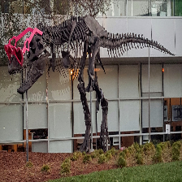

# CUDA resize/crop/convert/reformat demo

This C++/CUDA example follows the CV-CUDA [fused preprocessing
sample](https://github.com/CVCUDA/CV-CUDA/blob/main/samples/operators/resize_crop_convert_reformat.py).
It bilinearly resizes an interleaved BGR U8 image, applies a crop in the
resized coordinate space, reverses channels, converts values to F32, and
writes planar RGB (NCHW for a single image) in the `[0, 255]` range. The
default crop covers the full resized image, matching the sample's default
setup. OpenCV is used only for image I/O.

The fused kernel accepts independent resize and crop dimensions, a byte source
stride, and byte row/plane strides for the planar float destination. The demo
downloads the tensor and converts it back to BGR U8 only to save a viewable
image.

## Build and test

From the repository root, with Bazel, CUDA and OpenCV development libraries:

```bash
bazel build --@rules_cuda//cuda:archs=sm_89 \
  //cv-cuda-pipeline/examples/image_process/resize_crop_convert_reformat:resize_crop_convert_reformat_demo
bazel test --@rules_cuda//cuda:archs=sm_89 --test_output=errors \
  //cv-cuda-pipeline/calculators/image_process/cuda/tests:resize_crop_convert_reformat_kernel_test
```

Replace `sm_89` with your GPU architecture. The build uses
[rules_cuda](https://github.com/bazel-contrib/rules_cuda).

## Run

```bash
mkdir -p cv-cuda-pipeline/examples/image_process/resize_crop_convert_reformat/perf_asserts
bazel-bin/cv-cuda-pipeline/examples/image_process/resize_crop_convert_reformat/resize_crop_convert_reformat_demo \
  --input cv-cuda-pipeline/pictures/tabby_tiger_cat.jpg \
  --output cv-cuda-pipeline/examples/image_process/resize_crop_convert_reformat/perf_asserts/resize_crop_convert_reformat_cat.png
bazel-bin/cv-cuda-pipeline/examples/image_process/resize_crop_convert_reformat/resize_crop_convert_reformat_demo \
  --input cv-cuda-pipeline/pictures/dino.jpg \
  --output cv-cuda-pipeline/examples/image_process/resize_crop_convert_reformat/perf_asserts/resize_crop_convert_reformat_dino.png
```

`--input` is required; `--output` defaults to
`resize_crop_convert_reformat.png`. The output dimensions default to 224×224;
use `--width N` and `--height N` to change them.

| Input | Resized, cropped and converted output |
| --- | --- |
|  |  |
|  |  |

## Nsight Systems performance

On an NVIDIA RTX 500 Ada Generation Laptop GPU, CUDA 13.3 and Nsight Systems
2026.1.3, the single fused kernel measured:

| Image | Kernel time | Estimated logical bandwidth |
| --- | ---: | ---: |
| Cat, 720 × 720 input | 4.340 µs | 277.47 GB/s |
| Dinosaur, 2876 × 1699 input | 32.051 µs | 37.57 GB/s |

Each 224×224 output pixel accounts for up to four three-byte source samples
and three four-byte planar output values (24 logical bytes total). This is
not measured DRAM bandwidth; the input samples may be cached, and resize
coordinates affect locality. Timings exclude CPU work, image I/O and transfers.

To reproduce, use new report names if they already exist:

```bash
mkdir -p build/resize_crop_convert_reformat
nsys profile --trace=cuda --sample=none --cpuctxsw=none \
  --output=build/resize_crop_convert_reformat/nsys_cat \
  bazel-bin/cv-cuda-pipeline/examples/image_process/resize_crop_convert_reformat/resize_crop_convert_reformat_demo \
  --input cv-cuda-pipeline/pictures/tabby_tiger_cat.jpg \
  --output build/resize_crop_convert_reformat/cat.png
nsys stats --report cuda_gpu_kern_sum --format csv \
  build/resize_crop_convert_reformat/nsys_cat.nsys-rep
```
