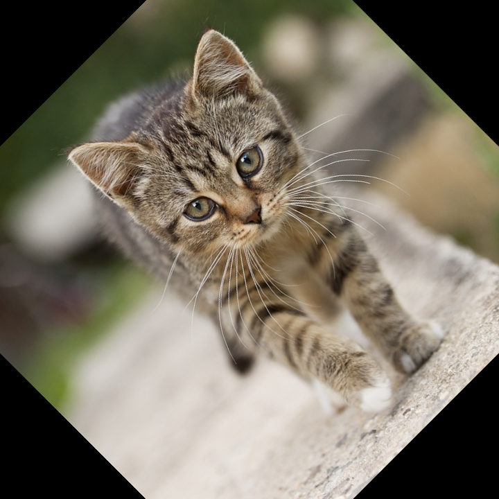
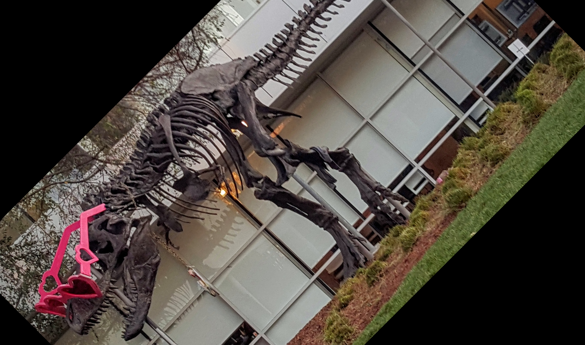

# CUDA rotate demo

This C++/CUDA example implements the 45-degree rotation shown in the
[CV-CUDA rotate sample](https://github.com/CVCUDA/CV-CUDA/blob/main/samples/operators/rotate.py).
It uses the sample's inverse affine mapping, center-preserving shift, and
bilinear interpolation. Coordinates outside the source image are filled with
zero. OpenCV is used only for image I/O; the rotation runs on the GPU.

The kernel implements interleaved three-channel U8 images and a fixed
45-degree angle. Tests compare against an independent CPU implementation of
the affine mapping and bilinear interpolation, including tiny inputs, edges
and padded strides.

## Build and test

From the repository root, with Bazel, CUDA and OpenCV development libraries:

```bash
bazel build --@rules_cuda//cuda:archs=sm_89 \
  //cv-cuda-pipeline/examples/image_process/rotate:rotate_demo
bazel test --@rules_cuda//cuda:archs=sm_89 --test_output=errors \
  //cv-cuda-pipeline/calculators/image_process/cuda/tests:rotate_kernel_test
```

Replace `sm_89` with your GPU architecture. The build uses
[rules_cuda](https://github.com/bazel-contrib/rules_cuda).

## Run

```bash
mkdir -p cv-cuda-pipeline/examples/image_process/rotate/perf_asserts
bazel-bin/cv-cuda-pipeline/examples/image_process/rotate/rotate_demo \
  --input cv-cuda-pipeline/pictures/tabby_tiger_cat.jpg \
  --output cv-cuda-pipeline/examples/image_process/rotate/perf_asserts/rotate_cat.png
bazel-bin/cv-cuda-pipeline/examples/image_process/rotate/rotate_demo \
  --input cv-cuda-pipeline/pictures/dino.jpg \
  --output cv-cuda-pipeline/examples/image_process/rotate/perf_asserts/rotate_dino.png
```

`--input` is required; `--output` defaults to `cat_rotate.png`. OpenCV
selects the output format from its extension.

| Input | Output |
| --- | --- |
|  |  |
|  |  |

The kernel API accepts non-overlapping interleaved three-channel U8 device
buffers, byte row strides, image dimensions and an optional CUDA stream. Keep
buffers valid until stream completion and synchronize to detect asynchronous
errors.

## Nsight Systems performance

On an NVIDIA RTX 500 Ada Generation Laptop GPU, CUDA 13.3 and Nsight Systems
2026.1.3, the default Bazel build produced these single-launch results:

| Image | Kernel latency | Estimated logical bandwidth |
| --- | ---: | ---: |
| Cat, 720 × 720 | 55.600 µs | 55.94 GB/s |
| Dinosaur, 2876 × 1699 | 494.233 µs | 59.32 GB/s |

Bandwidth counts one three-byte input and one three-byte output per pixel
divided by kernel time. Bilinear filtering performs multiple logical source
reads per output pixel; caching and transaction sizes affect physical traffic.
This is not measured DRAM bandwidth. Single-launch timings exclude CPU work,
image I/O and transfers and are not a steady-state benchmark.

To reproduce, use new report names if they already exist:

```bash
mkdir -p build/rotate
nsys profile --trace=cuda --sample=none --cpuctxsw=none \
  --output=build/rotate/nsys_cat \
  bazel-bin/cv-cuda-pipeline/examples/image_process/rotate/rotate_demo \
  --input cv-cuda-pipeline/pictures/tabby_tiger_cat.jpg \
  --output build/rotate/cat.png
nsys stats --report cuda_gpu_kern_sum --format csv build/rotate/nsys_cat.nsys-rep
nsys profile --trace=cuda --sample=none --cpuctxsw=none \
  --output=build/rotate/nsys_dinosaur \
  bazel-bin/cv-cuda-pipeline/examples/image_process/rotate/rotate_demo \
  --input cv-cuda-pipeline/pictures/dino.jpg \
  --output build/rotate/dinosaur.png
nsys stats --report cuda_gpu_kern_sum --format csv build/rotate/nsys_dinosaur.nsys-rep
```
