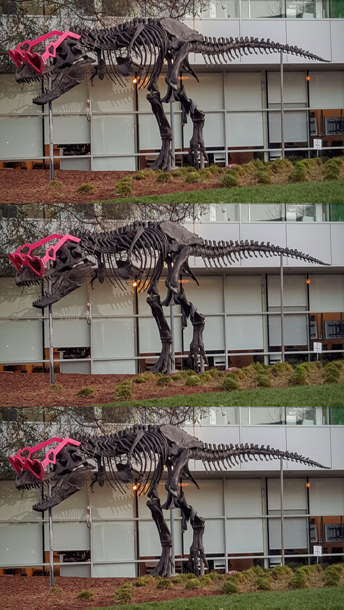

# CUDA tensor stack demo

This C++/CUDA example reproduces the [CV-CUDA stack sample](https://github.com/CVCUDA/CV-CUDA/blob/main/samples/operators/stack.py)
by stacking three copies of the input image along a batch dimension. The GPU
output is an NHWC batch of three images. For visualization, the demo writes
the batch as a vertical image with height `3 × input height`. OpenCV is used
only for image I/O.

The kernel handles interleaved three-channel U8 images and a fixed batch size
of three. Tests verify all batch elements, row padding, image strides and
invalid arguments.

## Build and test

From the repository root, with Bazel, CUDA and OpenCV development libraries:

```bash
bazel build --@rules_cuda//cuda:archs=sm_89 \
  //cv-cuda-pipeline/examples/image_process/stack:stack_demo
bazel test --@rules_cuda//cuda:archs=sm_89 --test_output=errors \
  //cv-cuda-pipeline/calculators/image_process/cuda/tests:stack_kernel_test
```

Replace `sm_89` with your GPU architecture. The build uses
[rules_cuda](https://github.com/bazel-contrib/rules_cuda).

## Run

```bash
mkdir -p cv-cuda-pipeline/examples/image_process/stack/perf_asserts
bazel-bin/cv-cuda-pipeline/examples/image_process/stack/stack_demo \
  --input cv-cuda-pipeline/pictures/tabby_tiger_cat.jpg \
  --output cv-cuda-pipeline/examples/image_process/stack/perf_asserts/stack_cat.png
bazel-bin/cv-cuda-pipeline/examples/image_process/stack/stack_demo \
  --input cv-cuda-pipeline/pictures/dino.jpg \
  --output cv-cuda-pipeline/examples/image_process/stack/perf_asserts/stack_dino.png
```

`--input` is required; `--output` defaults to `stacked_image.png`. OpenCV
selects the output format from its extension.

| Input | Three-image stack |
| --- | --- |
|  |  |
|  |  |

The kernel API accepts non-overlapping interleaved three-channel U8 source
and NHWC destination device buffers, row and image strides, image dimensions
and an optional CUDA stream. Keep buffers valid until stream completion and
synchronize to detect asynchronous errors.

## Nsight Systems performance

On an NVIDIA RTX 500 Ada Generation Laptop GPU, CUDA 13.3 and Nsight Systems
2026.1.3, the default Bazel build produced these single-launch results:

| Image | Kernel latency | Estimated logical bandwidth |
| --- | ---: | ---: |
| Cat, 720 × 720 | 44.027 µs | 141.30 GB/s |
| Dinosaur, 2876 × 1699 | 503.029 µs | 116.57 GB/s |

Bandwidth counts one three-byte input read and three three-byte output writes
per pixel, divided by kernel time. This is a logical estimate, not measured
DRAM bandwidth; caching and transaction sizes affect physical traffic.
Single-launch timings exclude CPU work, image I/O and transfers and are not a
steady-state benchmark.

To reproduce, use new report names if they already exist:

```bash
mkdir -p build/stack
nsys profile --trace=cuda --sample=none --cpuctxsw=none \
  --output=build/stack/nsys_cat \
  bazel-bin/cv-cuda-pipeline/examples/image_process/stack/stack_demo \
  --input cv-cuda-pipeline/pictures/tabby_tiger_cat.jpg \
  --output build/stack/cat.png
nsys stats --report cuda_gpu_kern_sum --format csv build/stack/nsys_cat.nsys-rep
nsys profile --trace=cuda --sample=none --cpuctxsw=none \
  --output=build/stack/nsys_dinosaur \
  bazel-bin/cv-cuda-pipeline/examples/image_process/stack/stack_demo \
  --input cv-cuda-pipeline/pictures/dino.jpg \
  --output build/stack/dinosaur.png
nsys stats --report cuda_gpu_kern_sum --format csv build/stack/nsys_dinosaur.nsys-rep
```
