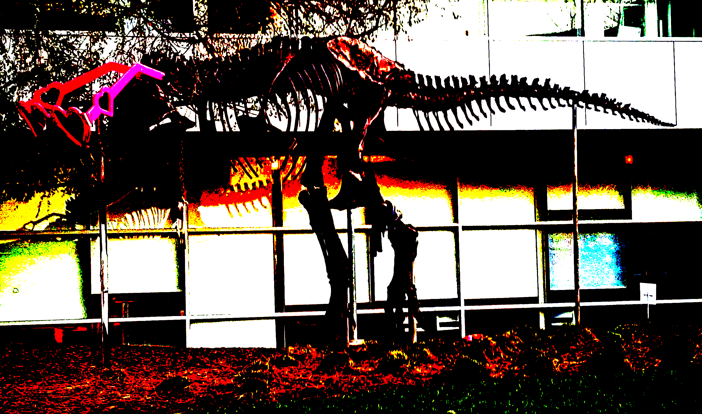

# CUDA binary threshold demo

This C++/CUDA example thresholds each channel of an 8-bit three-channel image
independently: values strictly greater than 128 become 255, and all others
become 0. OpenCV provides image I/O; thresholding runs on the GPU.

## Build and test

From the repository root, with Bazel, CUDA and OpenCV development libraries:

```bash
bazel build --@rules_cuda//cuda:archs=sm_89 \
  //cv-cuda-pipeline/examples/image_process/threshold:threshold_demo
bazel test --@rules_cuda//cuda:archs=sm_89 --test_output=errors \
  //cv-cuda-pipeline/calculators/image_process/cuda/tests:threshold_kernel_test
```

Replace `sm_89` with your GPU architecture. The build uses
[rules_cuda](https://github.com/bazel-contrib/rules_cuda).

## Run

```bash
mkdir -p cv-cuda-pipeline/examples/image_process/threshold/perf_asserts
bazel-bin/cv-cuda-pipeline/examples/image_process/threshold/threshold_demo \
  --input cv-cuda-pipeline/pictures/tabby_tiger_cat.jpg \
  --output cv-cuda-pipeline/examples/image_process/threshold/perf_asserts/threshold_cat.png
bazel-bin/cv-cuda-pipeline/examples/image_process/threshold/threshold_demo \
  --input cv-cuda-pipeline/pictures/dino.jpg \
  --output cv-cuda-pipeline/examples/image_process/threshold/perf_asserts/threshold_dino.png
```

`--input` is required; `--output` defaults to `cat_threshold.png`. OpenCV
selects the output format from its extension.

| Input | Output |
| --- | --- |
|  |  |
|  |  |

The kernel API accepts non-overlapping interleaved RGB8 or BGR8 input and
output device buffers, byte row strides, image dimensions, and an optional
CUDA stream. The caller must keep buffers valid until stream completion and
check synchronization errors. The threshold is fixed; other formats and
batches are not implemented.

## Nsight Systems performance

On an NVIDIA RTX 500 Ada Generation Laptop GPU, CUDA 13.3 and Nsight Systems
2026.1.3, the default Bazel build produced these single-launch results:

| Image | Kernel latency | Estimated logical bandwidth |
| --- | ---: | ---: |
| Cat, 720 × 720 | 16.831 µs | 184.80 GB/s |
| Dinosaur, 2876 × 1699 | 222.490 µs | 131.77 GB/s |

The estimate counts one three-byte read and one three-byte write per pixel,
divided by kernel time. It is not measured DRAM bandwidth; caching and
transaction sizes affect actual traffic. Single-launch timings are not a
steady-state benchmark and exclude CPU work, image I/O and transfers.

To reproduce, use new report names if they already exist:

```bash
mkdir -p build/threshold cv-cuda-pipeline/examples/image_process/threshold/perf_asserts
nsys profile --trace=cuda --sample=none --cpuctxsw=none \
  --output=build/threshold/nsys_cat \
  bazel-bin/cv-cuda-pipeline/examples/image_process/threshold/threshold_demo \
  --input cv-cuda-pipeline/pictures/tabby_tiger_cat.jpg \
  --output cv-cuda-pipeline/examples/image_process/threshold/perf_asserts/profile_cat.png
nsys stats --report cuda_gpu_kern_sum --format csv build/threshold/nsys_cat.nsys-rep
nsys profile --trace=cuda --sample=none --cpuctxsw=none \
  --output=build/threshold/nsys_dinosaur \
  bazel-bin/cv-cuda-pipeline/examples/image_process/threshold/threshold_demo \
  --input cv-cuda-pipeline/pictures/dino.jpg \
  --output cv-cuda-pipeline/examples/image_process/threshold/perf_asserts/profile_dinosaur.png
nsys stats --report cuda_gpu_kern_sum --format csv build/threshold/nsys_dinosaur.nsys-rep
```
