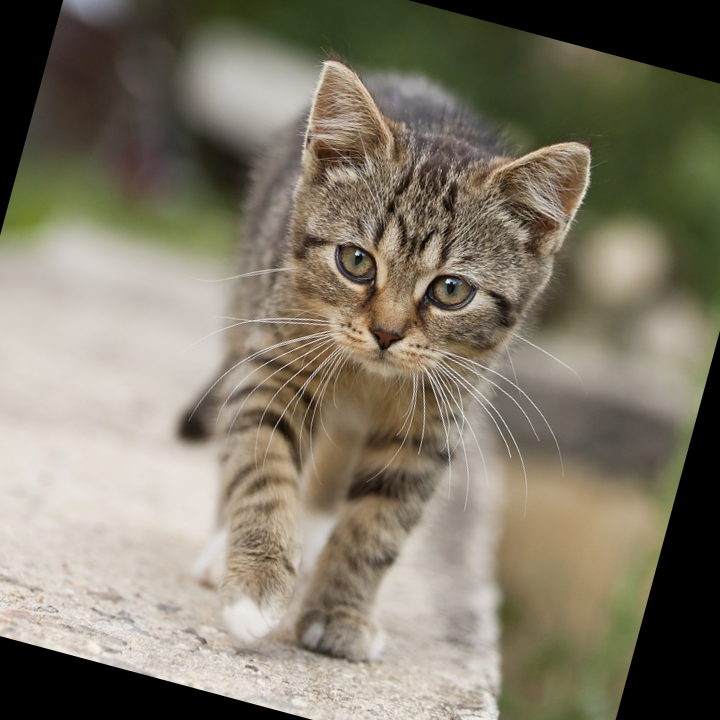
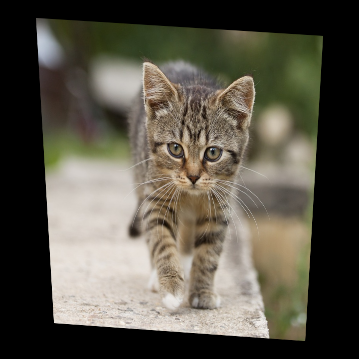
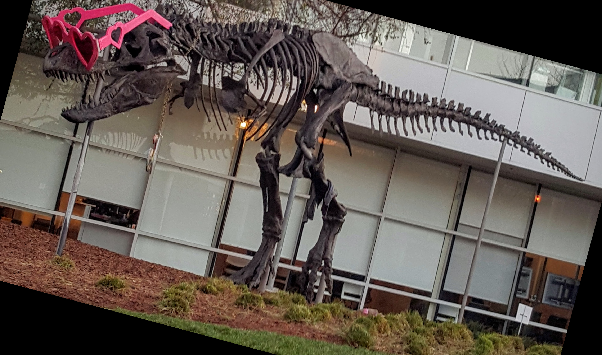
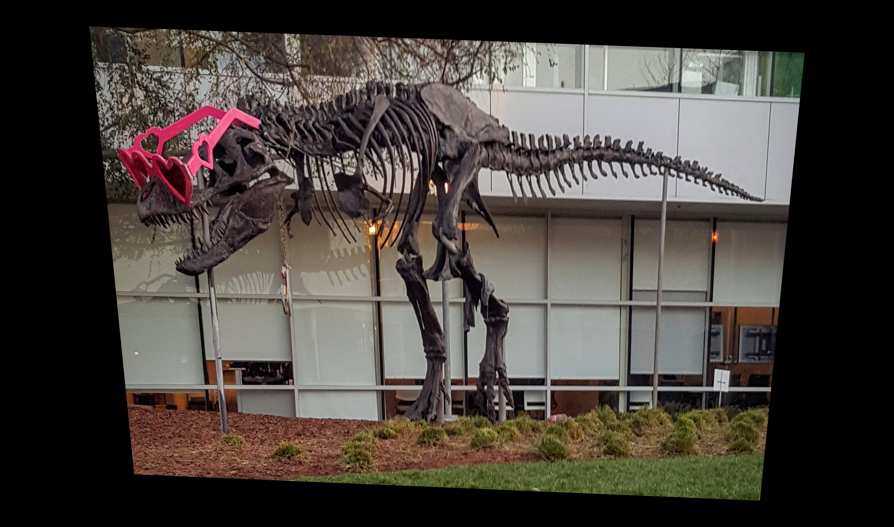

# CUDA affine and perspective warp demos

These C++/CUDA examples follow the CV-CUDA [affine
warp](https://github.com/CVCUDA/CV-CUDA/blob/main/samples/operators/warp_affine.py)
and [perspective
warp](https://github.com/CVCUDA/CV-CUDA/blob/main/samples/operators/warp_perspective.py)
samples. Both retain the input dimensions, use bilinear interpolation, map
destination coordinates to source coordinates, and fill out-of-image samples
with black. OpenCV is used for image I/O and to compute the perspective
transform matrix; pixel warping is performed by the CUDA kernel.

The affine mode rotates 15 degrees counter-clockwise about the image center and
translates 20 pixels horizontally. The perspective mode applies a mild
keystone transform using the same four-corner mapping as the Python sample.

## Build and test

From the repository root, with Bazel, CUDA and OpenCV development libraries:

```bash
bazel build --@rules_cuda//cuda:archs=sm_89 \
  //cv-cuda-pipeline/examples/image_process/warp:warp_demo
bazel test --@rules_cuda//cuda:archs=sm_89 --test_output=errors \
  //cv-cuda-pipeline/calculators/image_process/cuda/tests:warp_kernel_test
```

Replace `sm_89` with your GPU architecture. The build uses
[rules_cuda](https://github.com/bazel-contrib/rules_cuda).

## Run

```bash
mkdir -p cv-cuda-pipeline/examples/image_process/warp/perf_asserts
bazel-bin/cv-cuda-pipeline/examples/image_process/warp/warp_demo \
  --mode affine \
  --input cv-cuda-pipeline/pictures/tabby_tiger_cat.jpg \
  --output cv-cuda-pipeline/examples/image_process/warp/perf_asserts/warp_affine_cat.png
bazel-bin/cv-cuda-pipeline/examples/image_process/warp/warp_demo \
  --mode perspective \
  --input cv-cuda-pipeline/pictures/tabby_tiger_cat.jpg \
  --output cv-cuda-pipeline/examples/image_process/warp/perf_asserts/warp_perspective_cat.png
```

`--input` is required. `--mode` accepts `affine` (the default) or
`perspective`; `--output` defaults to `warp_<mode>.png`. OpenCV selects the
output format from its extension.

| Input | Affine warp | Perspective warp |
| --- | --- | --- |
|  |  |  |
|  |  |  |

## Nsight Systems performance

On an NVIDIA RTX 500 Ada Generation Laptop GPU, CUDA 13.3 and Nsight Systems
2026.1.3, the measured kernel times were:

| Transform | Image | Kernel time | Estimated logical bandwidth |
| --- | --- | ---: | ---: |
| Affine | Cat, 720 × 720 | 40.807 µs | 190.56 GB/s |
| Affine | Dinosaur, 2876 × 1699 | 466.657 µs | 157.06 GB/s |
| Perspective | Cat, 720 × 720 | 34.436 µs | 225.81 GB/s |
| Perspective | Dinosaur, 2876 × 1699 | 344.986 µs | 212.46 GB/s |

The bandwidth estimate counts four three-channel source samples and one
three-channel output per pixel. It is logical traffic, not measured DRAM
bandwidth; source samples may be cached, and out-of-image samples are supplied
as zeros. The single-launch timings exclude CPU work, image I/O and transfers.

To reproduce, substitute `affine` or `perspective` and `cat` or `dino`:

```bash
mkdir -p build/warp
nsys profile --trace=cuda --sample=none --cpuctxsw=none \
  --output=build/warp/nsys_affine_cat \
  bazel-bin/cv-cuda-pipeline/examples/image_process/warp/warp_demo \
  --mode affine \
  --input cv-cuda-pipeline/pictures/tabby_tiger_cat.jpg \
  --output build/warp/affine_cat.png
nsys stats --report cuda_gpu_kern_sum --format csv build/warp/nsys_affine_cat.nsys-rep
```
